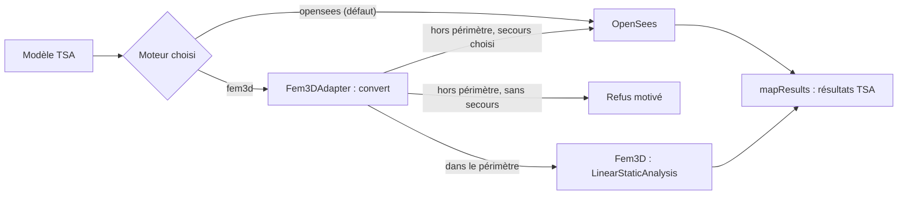

# Chapitre 1 — Présentation de Fem3D et de son rôle dans TSA

> **Objectifs**
>
> - Savoir ce que calcule Fem3D, avec quelles hypothèses, et ce qu'il ne calcule pas.
> - Comprendre la place de Fem3D dans TSA : moteur secondaire `fem3d`, derrière OpenSees, moteur 3D par défaut.
> - Repérer les grands modules du code et les preuves de validation disponibles.
>
> **Prérequis**
>
> - Notions de résistance des matériaux : effort normal, effort tranchant, moment fléchissant, torsion.
> - Lecture élémentaire du C++ (classes, structures). Aucune connaissance préalable des éléments finis n'est exigée :
>   le [chapitre 2](02-fondements-mef.md) les introduit.

## 1.1 Ce qu'est Fem3D

**Intuition.** Une ossature de bâtiment (poteaux, poutres, contreventements) se décrit par des barres reliées en des
nœuds. Si l'on connaît, pour chaque barre, la relation entre les déplacements de ses deux extrémités et les efforts
qu'elle y exerce, on peut écrire l'équilibre de chaque nœud et en déduire tous les déplacements. C'est la **méthode
des déplacements**, que Fem3D met en œuvre pour des barres 3D.

**Définition.** Fem3D est une bibliothèque C++20 autonome (`fem3d`) qui ne dépend que d'Eigen 3.4, sans Qt ni
composant graphique ([ARCHITECTURE.md](../../ARCHITECTURE.md)). Elle réalise l'**analyse statique linéaire** de
structures à barres 3D :

- éléments poutre-colonne à **2 nœuds et 12 degrés de liberté** (6 par nœud) ;
- deux formulations au choix pour chaque barre : **Euler–Bernoulli** (`EulerBernoulli3D`, [chapitre 6](06-euler-bernoulli.md))
  et **Timoshenko** (`Timoshenko3D`, [chapitre 7](07-timoshenko.md)) ;
- torsion de **Saint-Venant uniforme**, sans gauchissement ([chapitre 8](08-torsion-gauchissement.md)) ;
- charges nodales et charges réparties linéaires sur toute la longueur d'une barre ([chapitre 10](10-charges-conditions-limites.md)) ;
- appuis rigides, déplacements imposés et appuis élastiques nodaux ([chapitre 11](11-ressorts.md)) ;
- rotules de flexion My et Mz aux extrémités, par condensation statique (traitées après le chapitre 12) ;
- résultats : déplacements et rotations nodaux, réactions, forces des ressorts, efforts d'extrémité, efforts internes
  et déformée **exacts** le long des barres (polynômes), contraintes de résistance des matériaux, contrôle de
  l'équilibre global, détection des mécanismes.

**Origine du code.** Tout le code de Fem3D a été introduit dans le dépôt par le commit
[75700d2](https://github.com/ChristinotLeonnel/TSA-3D-FEM-Engine/commit/75700d2bfd33c29b2fadc795fd3051f25399ad19) ; le développement antérieur n'était pas versionné. Les permaliens de ce livre pointent tous sur cette
révision.

Le post-traitement (tableaux, diagrammes, note de calcul) est un sous-projet séparé du même dépôt, `postprocessor/`,
qui ne communique avec le moteur que par le fichier de résultats JSON versionné
([RESULTS_FORMAT.md](../../RESULTS_FORMAT.md)).

## 1.2 Ce que Fem3D ne fait pas

Le domaine est volontairement restreint. D'après [KNOWN_LIMITATIONS.md](../../limitations/KNOWN_LIMITATIONS.md),
Fem3D ne traite **pas** :

- la non-linéarité géométrique (P-Δ, flambement) ou matérielle (plasticité), la dynamique, l'analyse modale ;
- les barres à section variable ;
- le **gauchissement** et la torsion non uniforme de Vlasov : 6 DDL par nœud ne peuvent pas les représenter
  ([chapitre 8](08-torsion-gauchissement.md)) ;
- les barres de treillis et les câbles, les relâchements de N, V ou T, les rotules semi-rigides ;
- les ressorts couplés, orientés dans un repère local ou unilatéraux ;
- les excentrements (`-jntOffset` d'OpenSees), les contraintes cinématiques (diaphragme, `equalDOF`) ;
- les charges ponctuelles ou partielles sur barre, les moments répartis, les charges thermiques ;
- toute vérification réglementaire (Eurocodes).

Une fonction absente de cette liste n'est pas pour autant disponible : seules les fonctions décrites dans les
chapitres, avec leurs tests, le sont.

## 1.3 Rôle de Fem3D dans TSA

**Intuition.** TSA (Tsaraloha Structural Analysis) calcule ses modèles 3D avec OpenSees, un code externe. Fem3D
offre un second moteur, interne, dont chaque équation est documentée et testée. Tant qu'il n'a pas fait ses preuves
sur les modèles réels de TSA, il reste **secondaire**.

**Faits vérifiés dans le code de TSA** (révision de référence 2f5d7d4) :

- Le moteur est déclaré sous l'identifiant `fem3d` par la classe
  [`Fem3DEngine`](https://github.com/ChristinotLeonnel/Tsaraloha-Structural-Analysis/blob/2f5d7d4342e903fe536fbab91a7dcf80e8b89f7d/src/Analysis/Engines/Fem3D/Fem3DEngine.h#L23-L57). Son en-tête rappelle qu'**OpenSees reste le
  moteur 3D par défaut** tant que la qualification de Fem3D dans TSA n'est pas complète.
- La conversion du modèle de TSA en modèle Fem3D est faite par
  [`convert`](https://github.com/ChristinotLeonnel/Tsaraloha-Structural-Analysis/blob/2f5d7d4342e903fe536fbab91a7dcf80e8b89f7d/src/Analysis/Engines/Fem3D/Fem3DAdapter.cpp#L38-L189) :
  - les barres deviennent des éléments **Euler–Bernoulli** uniquement
    ([ligne 114](https://github.com/ChristinotLeonnel/Tsaraloha-Structural-Analysis/blob/2f5d7d4342e903fe536fbab91a7dcf80e8b89f7d/src/Analysis/Engines/Fem3D/Fem3DAdapter.cpp#L114-L115)) : la formulation de Timoshenko n'est
    pas exposée dans TSA, dont les sections ne transmettent pas d'aires de cisaillement ;
  - le module d'Young passe de Pa à kN/m² ([ligne 95](https://github.com/ChristinotLeonnel/Tsaraloha-Structural-Analysis/blob/2f5d7d4342e903fe536fbab91a7dcf80e8b89f7d/src/Analysis/Engines/Fem3D/Fem3DAdapter.cpp#L95-L95)) et
    G = E / (2 (1 + ν)) ;
  - le vecteur d'orientation v_xz est celui que TSA transmet à `geomTransf` d'OpenSees, et le calcul est refusé si
    Fem3D n'en déduit pas exactement les mêmes axes locaux ;
  - un ressort placé sur un DDL bloqué est **ignoré et signalé** par TSA (il n'aurait aucun effet), alors que Fem3D
    seul le **refuse** ([chapitre 11](11-ressorts.md)).
- Les résultats sont remis dans le format de TSA par
  [`mapResults`](https://github.com/ChristinotLeonnel/Tsaraloha-Structural-Analysis/blob/2f5d7d4342e903fe536fbab91a7dcf80e8b89f7d/src/Analysis/Engines/Fem3D/Fem3DAdapter.cpp#L191-L262) : les réactions de TSA additionnent les
  réactions des appuis rigides et les forces des ressorts.

**Logique de secours** ([INTEGRATION_TSA.md](../../INTEGRATION_TSA.md) §4) : un modèle hors du périmètre de Fem3D est
refusé avec ses raisons, ou confié à OpenSees si l'utilisateur l'a choisi ; ce secours est annoncé et les résultats
portent l'identité d'OpenSees. Un **mécanisme** ou une **donnée invalide** n'est jamais confié à un autre moteur.



Le diagramme complet de la sélection du moteur est dans
[selection-moteur-tsa.md](../../diagrams/selection-moteur-tsa.md).

## 1.4 Niveaux de maturité

Les niveaux de **maturité** du moteur (1 à 5) sont définis dans
[QUALIFICATION.md](../../validation/QUALIFICATION.md). Ils ne doivent pas être confondus avec des niveaux
pédagogiques.

| Niveau | Exigence (résumé) |
|---|---|
| 1. Implémenté | Code écrit, données invalides refusées avec un message qui désigne l'objet fautif. |
| 2. Vérifié | Résultats égaux aux solutions analytiques exactes (écart relatif ≤ 1e-9). |
| 3. Validé | Résultats égaux à une référence indépendante (OpenSees) sur des cas élémentaires. |
| 4. Validé sur modèles représentatifs | Niveau 3 sur des modèles multi-éléments, et audit indépendant des formulations. |
| 5. Qualifié dans TSA | Comparaison systématique dans TSA sur les modèles réels, relecture humaine de la théorie. |

État au 19/10/2026 d'après QUALIFICATION.md : niveau 4 pour Euler–Bernoulli, les charges réparties uniformes, les
rotules, les ressorts et la détection des mécanismes ; niveau 4 pour Timoshenko dans Fem3D, mais non exposé dans
TSA ; **niveau 5 non atteint**.

## 1.5 Organisation du code

| Module (`include/Fem3D/`, `src/`) | Rôle | Chapitre |
|---|---|---|
| `Core/Types.h` | Ordre des DDL, types 12×12, tolérances | [3](03-modele-physique.md) |
| `Geometry/LocalCoordinateSystem3D` | Repère local, matrices R et T | [4](04-reperes.md) |
| `Materials/ElasticMaterial`, `Sections/BeamSection3D` | E, G ; A, Iy, Iz, J, Asy, Asz, Wt | [9](09-materiaux-sections.md) |
| `Elements/EulerBernoulli3D`, `Timoshenko3D` | Matrices de rigidité, fonctions de forme | [6](06-euler-bernoulli.md), [7](07-timoshenko.md) |
| `Loads/Loads3D`, `Constraints/BoundaryConditions` | Charges, appuis, ressorts | [10](10-charges-conditions-limites.md), [11](11-ressorts.md) |
| `Assembly/`, `Solver/`, `Analysis/`, `Results/` | Assemblage, résolution, résultats | 12 et suivants |

Le schéma des modules est dans [architecture.md](../../diagrams/architecture.md) et le détail dans
[ARCHITECTURE.md](../../ARCHITECTURE.md).

## 1.6 Exemple vérifiable : une console

**Données** (unités kN, m ; ce sont celles des tests,
[`tests/TestModels.h`](https://github.com/ChristinotLeonnel/TSA-3D-FEM-Engine/blob/75700d2bfd33c29b2fadc795fd3051f25399ad19/tests/TestModels.h#L19-L30)) : console de longueur L = 3 m selon X, encastrée au nœud 1,
section rectangulaire 0,30 × 0,50 m, E = 210·10⁶ kN/m², charge F = 20 kN selon +Z au nœud 2.

**Solution analytique** d'Euler–Bernoulli : $w = F L^3 / (3 E I_y)$ avec $I_y = 0{,}3 \times 0{,}5^3/12 = 3{,}125\cdot10^{-3}$ m⁴.

$$
w = \frac{20 \times 3^3}{3 \times 210\cdot10^6 \times 3{,}125\cdot10^{-3}} = 2{,}742857\cdot10^{-4}\ \text{m}
$$

J'ai recalculé cette valeur avec un script Python indépendant qui assemble la matrice 12×12 du
[chapitre 6](06-euler-bernoulli.md) et résout le système : il donne $w = 2{,}742857\cdot10^{-4}$ m et
$\theta_y = -1{,}371429\cdot10^{-4}$ rad. C'est le cas du test `Analytical_CantileverTipLoad_BothPlanesBothFormulations`,
qui exige un écart relatif inférieur à 10⁻⁹.

## 1.7 Limites de ce livre

- Les chapitres décrivent le code de la révision 75700d2 ; une évolution ultérieure du code peut les rendre faux.
- Les numéros de chapitre des ouvrages cités n'ont pas été vérifiés sur les textes (voir les statuts dans
  [REFERENCES.md](../../references/REFERENCES.md)).
- La relecture humaine de la théorie reste à faire ([AUDIT.md](../../AUDIT.md) §3).

## À retenir

- Fem3D : statique linéaire de barres 3D à 12 DDL, Euler–Bernoulli ou Timoshenko, torsion de Saint-Venant sans
  gauchissement.
- Dans TSA, c'est le moteur **secondaire** `fem3d`, en Euler–Bernoulli seulement ; OpenSees reste le moteur par défaut.
- Un modèle hors périmètre est refusé (ou confié à OpenSees si l'utilisateur l'a choisi) ; un mécanisme n'est jamais
  délégué.
- Maturité : niveau 4 ; le niveau 5 (qualification dans TSA) n'est pas atteint.

## Dans le code source

- Moteur TSA : [`Fem3DEngine`](https://github.com/ChristinotLeonnel/Tsaraloha-Structural-Analysis/blob/2f5d7d4342e903fe536fbab91a7dcf80e8b89f7d/src/Analysis/Engines/Fem3D/Fem3DEngine.h#L23-L57),
  [`convert`](https://github.com/ChristinotLeonnel/Tsaraloha-Structural-Analysis/blob/2f5d7d4342e903fe536fbab91a7dcf80e8b89f7d/src/Analysis/Engines/Fem3D/Fem3DAdapter.cpp#L38-L189),
  [`mapResults`](https://github.com/ChristinotLeonnel/Tsaraloha-Structural-Analysis/blob/2f5d7d4342e903fe536fbab91a7dcf80e8b89f7d/src/Analysis/Engines/Fem3D/Fem3DAdapter.cpp#L191-L262).
- Orchestration du calcul dans Fem3D : [`LinearStaticAnalysis::run`](https://github.com/ChristinotLeonnel/TSA-3D-FEM-Engine/blob/75700d2bfd33c29b2fadc795fd3051f25399ad19/src/Analysis/LinearStaticAnalysis.cpp#L40-L115).
- Interface commune des éléments : [`IBeamElement3D`](https://github.com/ChristinotLeonnel/TSA-3D-FEM-Engine/blob/75700d2bfd33c29b2fadc795fd3051f25399ad19/include/Fem3D/Elements/IBeamElement3D.h#L35-L64).
- Exemple du README : [`README.md`](https://github.com/ChristinotLeonnel/TSA-3D-FEM-Engine/blob/75700d2bfd33c29b2fadc795fd3051f25399ad19/README.md).

## Vérifier par les tests

```bat
build\fem3d_tests.exe
```

La suite affiche une ligne `[PASS]` ou `[FAIL]` par test, puis le bilan (41 tests ; exécutée le 19/10/2026 :
41 / 41 réussis). Pour un test donné : `build\fem3d_tests.exe | findstr /C:"Readme_ExampleRuns"`.

- `Readme_ExampleRuns` : l'exemple du README est calculé et équilibré.
- `Analytical_CantileverTipLoad_BothPlanesBothFormulations` : l'exemple du §1.6.
- Comparaison à OpenSees 3.8.0 : `build\fem3d_opensees_benchmarks.exe [OpenSees.exe] [dossier]`, 20 cas définis dans
  [`cases()`](https://github.com/ChristinotLeonnel/TSA-3D-FEM-Engine/blob/75700d2bfd33c29b2fadc795fd3051f25399ad19/benchmarks/OpenSees/opensees_benchmarks.cpp#L114-L296) ; résultats publiés dans
  [VALIDATION_OPENSEES.md](../../validation/VALIDATION_OPENSEES.md) (non relancés pour ce chapitre).
- Dans TSA : tests 476 à 480 (suite `engines`).

## Références

- Aucune équation nouvelle dans ce chapitre. Théorie : [THEORY.md](../../theory/THEORY.md).
- A3 — Bathe, *Finite Element Procedures* : notice vérifiée (contenu non lu).
- A7 — McGuire, Gallagher, Ziemian, *Matrix Structural Analysis* : notice vérifiée ; chapitres à vérifier.

---

Chapitre suivant : [Chapitre 2 — Fondements de la méthode des éléments finis](02-fondements-mef.md)
