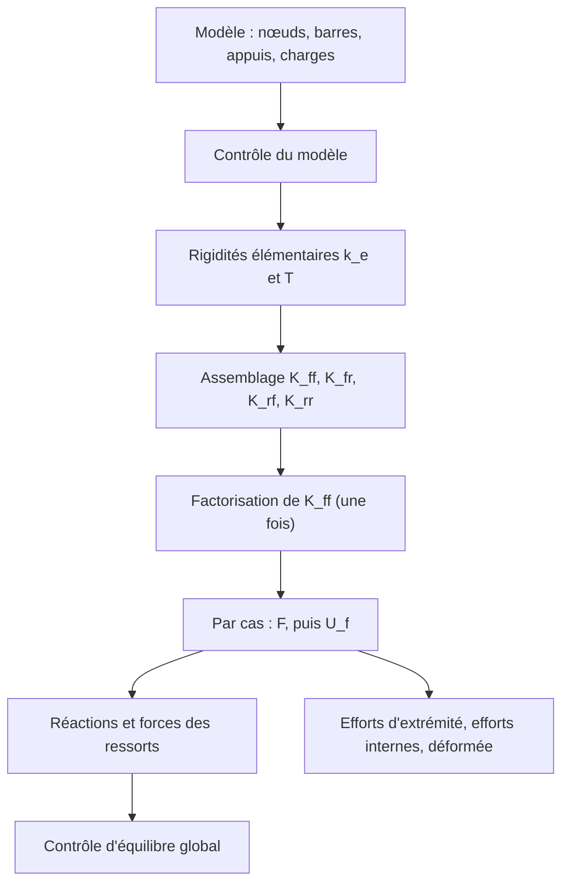

# Chapitre 2 — Fondements de la méthode des éléments finis : la méthode des déplacements

> **Objectifs**
>
> - Comprendre pourquoi une structure linéaire se ramène à un système $\mathbf{K}\,\mathbf{U} = \mathbf{F}$.
> - Relier la rigidité d'un élément à son énergie de déformation et à ses fonctions de forme.
> - Connaître les étapes de la méthode des déplacements telles que Fem3D les enchaîne.
> - Savoir pourquoi les éléments de Fem3D sont **exacts** aux nœuds pour une barre prismatique.
>
> **Prérequis**
>
> - [Chapitre 1](01-presentation.md).
> - Calcul matriciel (produit, transposée, résolution d'un système linéaire) ; dérivée et intégrale d'un polynôme.

## 2.1 Intuition physique : le ressort

Un ressort de raideur $k$ tiré par une force $F$ s'allonge de $u = F/k$. Une barre en traction se comporte comme un
ressort de raideur $EA/L$. Une structure est un assemblage de tels « ressorts généralisés » : chaque barre relie les
déplacements de ses extrémités aux efforts qu'elle y exerce. En écrivant que chaque nœud est en équilibre, on obtient
un système linéaire dont les inconnues sont les **déplacements nodaux** : d'où le nom de méthode des déplacements.

## 2.2 Symboles

| Symbole | Signification | Unité (système des tests) |
|---|---|---|
| $\mathbf{d}_e$ | vecteur des 12 DDL d'un élément, repère local | m, rad |
| $\mathbf{k}_e$ | matrice de rigidité élémentaire 12×12, repère local | kN/m, kN, kN·m |
| $\mathbf{f}_{eq}$ | forces nodales équivalentes des charges réparties | kN, kN·m |
| $\mathbf{U}$, $\mathbf{F}$ | déplacements et forces nodales de la structure, repère global | m, rad ; kN, kN·m |
| $\mathbf{K}$ | matrice de rigidité globale | |
| $f$, $r$ | indices des DDL libres et des DDL imposés (appuis) | |
| $N_k(x)$ | fonctions de forme : déformée due à un DDL unitaire, les autres étant nuls | |

## 2.3 Hypothèses

- **Petits déplacements et petites rotations** : l'équilibre s'écrit sur la géométrie initiale.
- **Élasticité linéaire** : les efforts sont proportionnels aux déformations.
- **Liaisons parfaites** aux nœuds (sauf rotules et ressorts, explicitement modélisés).

Avec ces hypothèses, la réponse est **linéaire** : doubler les charges double les déplacements, et les cas de charge
se superposent.

## 2.4 Énergie et rigidité élémentaire

**Équations.** Dans un élément, le champ de déplacement est interpolé à partir des DDL nodaux :
$u(x) = \mathbf{N}(x)\,\mathbf{d}_e$. L'énergie potentielle totale de l'élément sous une charge répartie $q(x)$ vaut

$$
\Pi_e = \frac{1}{2}\,\mathbf{d}_e^{T}\,\mathbf{k}_e\,\mathbf{d}_e - \mathbf{d}_e^{T}\,\mathbf{f}_{eq},
\qquad
\mathbf{f}_{eq} = \int_0^L \mathbf{N}^{T}(x)\,q(x)\,\mathrm{d}x .
$$

Pour la traction, $\mathbf{k}_e = \int_0^L EA\,\mathbf{N}'^{T}\mathbf{N}'\,\mathrm{d}x$ ; pour la flexion
d'Euler–Bernoulli, $\mathbf{k}_e = \int_0^L EI\,\mathbf{N}''^{T}\mathbf{N}''\,\mathrm{d}x$. Avec les fonctions linéaires
$N = (1-\xi,\ \xi)$, $\xi = x/L$, on trouve

$$
\mathbf{k}_{\text{axial}} = \frac{EA}{L}\begin{bmatrix} 1 & -1 \\ -1 & 1 \end{bmatrix},
$$

et, avec les cubiques d'Hermite, la matrice de flexion du [chapitre 6](06-euler-bernoulli.md). J'ai refait ces deux
intégrations symboliquement (sympy) : elles redonnent exactement les termes $EA/L$ et $EI/L^3\,[12,\ 6L,\ 4L^2,\ 2L^2]$
codés dans `BeamElements.cpp`.

**Interprétation.** La condition de stationnarité $\partial \Pi / \partial \mathbf{U} = 0$ de l'énergie de la structure
donne $\mathbf{K}\,\mathbf{U} = \mathbf{F}$ : c'est l'équilibre des nœuds. Le vecteur $\mathbf{f}_{eq}$ est la charge
nodale qui produit le même travail que la charge répartie pour tout déplacement interpolé.

**Mise en œuvre dans Fem3D.**

- Les matrices de rigidité ne sont **pas** intégrées numériquement : elles sont écrites en forme fermée
  ([chapitres 6](06-euler-bernoulli.md) et [7](07-timoshenko.md)).
- Les forces équivalentes sont intégrées par une quadrature de Gauss à 4 points, exacte jusqu'au degré 7, donc exacte
  pour l'intégrande polynomiale (degré ≤ 4) d'une charge linéaire
  ([`equivalentNodalLoads`](https://github.com/ChristinotLeonnel/TSA-3D-FEM-Engine/blob/75700d2bfd33c29b2fadc795fd3051f25399ad19/src/Results/BeamResponse.cpp#L31-L51)).

## 2.5 Les étapes de la méthode des déplacements

**Algorithme** (tel que l'enchaîne [`LinearStaticAnalysis`](https://github.com/ChristinotLeonnel/TSA-3D-FEM-Engine/blob/75700d2bfd33c29b2fadc795fd3051f25399ad19/src/Analysis/LinearStaticAnalysis.cpp#L40-L115)) :

1. contrôler le modèle (références, propriétés, géométrie, ressorts, charges) ;
2. pour chaque barre : repère local, rigidité locale $\mathbf{k}_e$, rigidité globale
   $\mathbf{T}^{T}\mathbf{k}_e\mathbf{T}$ ([chapitre 4](04-reperes.md)) ;
3. numéroter les DDL et les répartir en libres ($f$) et imposés ($r$) ;
4. assembler les blocs $\mathbf{K}_{ff}$, $\mathbf{K}_{fr}$, $\mathbf{K}_{rf}$, $\mathbf{K}_{rr}$ et, par cas de
   charge, le vecteur $\mathbf{F}$ ;
5. résoudre

$$
\mathbf{K}_{ff}\,\mathbf{U}_f = \mathbf{F}_f - \mathbf{K}_{fr}\,\mathbf{U}_r ;
$$

6. calculer les réactions $\mathbf{R} = \mathbf{K}_{rf}\mathbf{U}_f + \mathbf{K}_{rr}\mathbf{U}_r - \mathbf{F}_r$ ;
7. pour chaque barre : $\mathbf{d}_e = \mathbf{T}\,\mathbf{d}_{global}$, efforts d'extrémité
   $\mathbf{f} = \mathbf{k}_e\mathbf{d}_e - \mathbf{f}_{eq}$, efforts internes et déformée ;
8. contrôler l'équilibre global.



L'assemblage, la résolution et la détection des mécanismes sont détaillés à partir du chapitre 12
([12-assemblage.md](12-assemblage.md)) ; le diagramme complet est dans [calcul.md](../../diagrams/calcul.md).

## 2.6 Pourquoi les éléments de Fem3D sont exacts

Une fonction de forme est la déformée de la barre quand on impose un DDL unitaire, les autres étant nuls. Si cette
déformée est la **solution exacte** de l'équation différentielle de la barre sans charge, alors la rigidité est exacte :
c'est le cas des fonctions linéaires (traction, torsion), des cubiques d'Hermite (Euler–Bernoulli) et des fonctions
interdépendantes de Timoshenko ([chapitre 7](07-timoshenko.md)). Pour une barre prismatique :

- un seul élément par barre donne les déplacements nodaux exacts ;
- subdiviser une barre ne change pas les déplacements des nœuds communs ;
- les forces équivalentes $\mathbf{f}_{eq}$ sont exactement l'opposé des forces d'encastrement parfait
  ([THEORY.md](../../theory/THEORY.md) §4).

**Limite.** Cette exactitude ne vaut que dans les hypothèses du modèle de poutre (section constante, statique
linéaire). Elle ne dit rien de l'adéquation du modèle de poutre lui-même à une pièce massive ou à paroi mince.

## 2.7 Exemple vérifiable : barre en traction

Console de longueur L = 4 m, section 0,30 × 0,50 m (A = 0,15 m²), E = 210·10⁶ kN/m², nœud 1 encastré, force
P = 100 kN selon +X au nœud 2 (test `Analytical_AxialTension`, cas OpenSees `01_traction`).

- Rigidité axiale : $EA/L = 210\cdot10^6 \times 0{,}15 / 4 = 7{,}875\cdot10^6$ kN/m.
- DDL libre $u_2$, DDL imposé $u_1 = 0$ : $\mathbf{K}_{ff} = [7{,}875\cdot10^6]$, d'où
  $u_2 = 100 / 7{,}875\cdot10^6 = 1{,}269841\cdot10^{-5}$ m.
- Réaction : $R_1 = K_{rf}\,u_2 - F_r = -7{,}875\cdot10^6 \times 1{,}269841\cdot10^{-5} - 0 = -100$ kN.
- Effort normal : $N = +100$ kN (traction positive, [chapitre 5](05-unites-signes.md)).

Valeurs recalculées avec Python ; le test les vérifie à 10⁻⁹ près en relatif, pour les deux formulations.

## À retenir

- Petits déplacements + élasticité linéaire ⇒ $\mathbf{K}\,\mathbf{U} = \mathbf{F}$, superposition des cas.
- $\mathbf{k}_e$ vient de l'énergie de déformation, $\mathbf{f}_{eq} = \int \mathbf{N}^T q\,\mathrm{d}x$.
- Fem3D résout $\mathbf{K}_{ff}\mathbf{U}_f = \mathbf{F}_f - \mathbf{K}_{fr}\mathbf{U}_r$ puis calcule les réactions.
- Les fonctions de forme sont des solutions exactes : un élément par barre suffit pour une barre prismatique.

## Dans le code source

- Orchestration : [`LinearStaticAnalysis::run`](https://github.com/ChristinotLeonnel/TSA-3D-FEM-Engine/blob/75700d2bfd33c29b2fadc795fd3051f25399ad19/src/Analysis/LinearStaticAnalysis.cpp#L40-L115).
- Forces équivalentes (Gauss à 4 points) : [`equivalentNodalLoads`](https://github.com/ChristinotLeonnel/TSA-3D-FEM-Engine/blob/75700d2bfd33c29b2fadc795fd3051f25399ad19/src/Results/BeamResponse.cpp#L31-L51).
- Rigidité globale d'un élément : [`IBeamElement3D::globalStiffnessMatrix`](https://github.com/ChristinotLeonnel/TSA-3D-FEM-Engine/blob/75700d2bfd33c29b2fadc795fd3051f25399ad19/src/Elements/BeamElements.cpp#L18-L22).
- Assemblage partitionné : [`GlobalAssembler::assembleStiffness`](https://github.com/ChristinotLeonnel/TSA-3D-FEM-Engine/blob/75700d2bfd33c29b2fadc795fd3051f25399ad19/src/Assembly/Assembly.cpp#L55-L101).

## Vérifier par les tests

```bat
build\fem3d_tests.exe | findstr /C:"Analytical_AxialTension" /C:"MeshInvariance"
```

- [`Analytical_AxialTension`](https://github.com/ChristinotLeonnel/TSA-3D-FEM-Engine/blob/75700d2bfd33c29b2fadc795fd3051f25399ad19/tests/analytical/test_analytical.cpp#L52-L63) : $u = PL/EA$, $N = +P$, $R = -P$.
- [`Integration_SpatialFrame_EquilibriumAndMeshInvariance`](https://github.com/ChristinotLeonnel/TSA-3D-FEM-Engine/blob/75700d2bfd33c29b2fadc795fd3051f25399ad19/tests/integration/test_frames.cpp#L77-L92) :
  subdiviser les barres en 4 ne change pas les déplacements nodaux communs (écart relatif ≤ 10⁻⁸).
- Cas OpenSees `01_traction`.

## Références

- [THEORY.md](../../theory/THEORY.md) §1, §4 et §8 (source vérifiée dans le dépôt).
- A1 — Zienkiewicz, Taylor, Zhu : notice vérifiée ; table des matières vérifiée (ch. 3, 4 et 6 : formes faibles,
  fonctions de forme, quadrature de Gauss).
- A3 — Bathe, *Finite Element Procedures* : notice vérifiée ; §4.2 (vecteurs de charges consistants), correspondance
  vérifiée par le programme MIT OCW.
- B4 — Archer (1965), matrices consistantes : notice vérifiée (Crossref), texte non lu.

---

Chapitre précédent : [Chapitre 1 — Présentation](01-presentation.md) ·
Chapitre suivant : [Chapitre 3 — Modèle physique, hypothèses et degrés de liberté](03-modele-physique.md)
