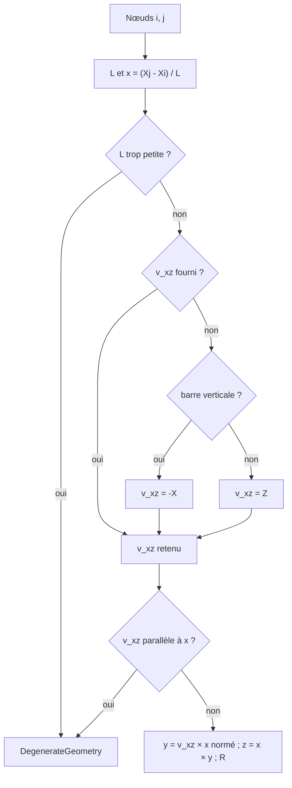

# Chapitre 4 — Repères locaux et globaux

> **Objectifs**
>
> - Construire le repère local d'une barre à partir de ses nœuds et du vecteur d'orientation v_xz.
> - Connaître le choix par défaut, le cas des barres verticales et les géométries refusées.
> - Passer d'un repère à l'autre : matrices R (3×3) et T (12×12), $\mathbf{K}_{global} = \mathbf{T}^T\mathbf{K}_{local}\mathbf{T}$.
>
> **Prérequis**
>
> - [Chapitre 3](03-modele-physique.md) : ordre des DDL.
> - Produit vectoriel, matrice de rotation orthonormée.

## 4.1 Intuition physique

Les propriétés d'une barre (inertie forte, inertie faible) se décrivent naturellement dans **son** repère : l'axe x le
long de la barre, les axes y et z dans le plan de la section. Les nœuds, les appuis et les charges nodales se décrivent
dans le repère **global** de la structure. Il faut donc, pour chaque barre, une rotation qui fasse passer de l'un à
l'autre, et une convention qui fixe l'orientation de la section autour de son axe : c'est le rôle du vecteur v_xz.

## 4.2 Symboles

| Symbole | Signification |
|---|---|
| $(X, Y, Z)$ | repère global, cartésien direct |
| $\mathbf{X}_i$, $\mathbf{X}_j$ | positions des nœuds i (début) et j (fin) |
| $\mathbf{x}, \mathbf{y}, \mathbf{z}$ | vecteurs unitaires du repère local, exprimés en global |
| $\mathbf{v}_{xz}$ | vecteur quelconque du plan local x-z (orientation de la section) |
| $\mathbf{R}$ | matrice 3×3 dont les lignes sont $\mathbf{x}^T, \mathbf{y}^T, \mathbf{z}^T$ |
| $\mathbf{T}$ | matrice 12×12 $= \mathrm{diag}(\mathbf{R}, \mathbf{R}, \mathbf{R}, \mathbf{R})$ |

## 4.3 Hypothèses

- La barre est droite ; sa longueur est la distance entre ses nœuds.
- Les axes y et z sont les axes principaux de la section ([chapitre 3](03-modele-physique.md)).
- Convention identique à celle de `geomTransf` d'OpenSees (vérifiée sur le wiki OpenSees, voir
  [REFERENCES.md](../../references/REFERENCES.md) §C7).

## 4.4 Équations

$$
\mathbf{x} = \frac{\mathbf{X}_j - \mathbf{X}_i}{L},\qquad
\mathbf{y} = \frac{\mathbf{v}_{xz} \times \mathbf{x}}{\lVert \mathbf{v}_{xz} \times \mathbf{x} \rVert},\qquad
\mathbf{z} = \mathbf{x} \times \mathbf{y},
\qquad L = \lVert \mathbf{X}_j - \mathbf{X}_i \rVert .
$$

Par construction, $\mathbf{z}$ est dans le plan $(\mathbf{x}, \mathbf{v}_{xz})$, du côté de $\mathbf{v}_{xz}$.

**Valeur par défaut** de $\mathbf{v}_{xz}$ (si l'utilisateur n'en donne pas) : $\mathbf{Z}$ global ; pour une barre
verticale, c'est-à-dire si $|\mathbf{x}\cdot\mathbf{Z}| \ge 1 - 10^{-9}$, $\mathbf{v}_{xz} = -\mathbf{X}$. Un poteau
orienté vers $+Z$ a alors $\mathbf{y} = +\mathbf{Y}$ et $\mathbf{z} = -\mathbf{X}$.

**Changements de repère** :

$$
\mathbf{a}_{local} = \mathbf{R}\,\mathbf{a}_{global},\qquad
\mathbf{d}_{local} = \mathbf{T}\,\mathbf{d}_{global},\qquad
\mathbf{K}_{global} = \mathbf{T}^{T}\,\mathbf{K}_{local}\,\mathbf{T},\qquad
\mathbf{f}_{global} = \mathbf{T}^{T}\,\mathbf{f}_{local}.
$$

**Interprétation.** $\mathbf{R}$ est orthonormée directe ($\mathbf{R}\mathbf{R}^T = \mathbf{I}$, $\det \mathbf{R} = 1$) :
son inverse est sa transposée. Le même bloc $\mathbf{R}$ s'applique aux translations et aux rotations de chaque
extrémité, car les rotations sont des vecteurs. La forme $\mathbf{T}^T\mathbf{K}\mathbf{T}$ conserve la symétrie et
l'énergie : $\tfrac12\mathbf{d}_g^T(\mathbf{T}^T\mathbf{K}\mathbf{T})\mathbf{d}_g = \tfrac12\mathbf{d}_l^T\mathbf{K}\mathbf{d}_l$.

## 4.5 Algorithme et géométries refusées

Le constructeur [`LocalCoordinateSystem3D`](https://github.com/ChristinotLeonnel/TSA-3D-FEM-Engine/blob/75700d2bfd33c29b2fadc795fd3051f25399ad19/src/Geometry/LocalCoordinateSystem3D.cpp#L11-L42) :

1. calcule $L$ ; refuse (`DegenerateGeometry`) une longueur non finie ou
   $L \le 10^{-9} \times \max(\text{plus grande coordonnée absolue des deux nœuds},\ 1)$ ;
2. calcule $\mathbf{x}$ ;
3. retient le $\mathbf{v}_{xz}$ fourni, sinon la valeur par défaut ;
4. refuse (`DegenerateGeometry`) un $\mathbf{v}_{xz}$ nul, non fini ou tel que
   $|\mathbf{x}\cdot\mathbf{v}_{xz}/\lVert\mathbf{v}_{xz}\rVert| \ge 1 - 10^{-9}$ (parallèle à l'axe) ;
5. calcule $\mathbf{y}$, $\mathbf{z}$ et remplit les lignes de $\mathbf{R}$.

[`transformation()`](https://github.com/ChristinotLeonnel/TSA-3D-FEM-Engine/blob/75700d2bfd33c29b2fadc795fd3051f25399ad19/src/Geometry/LocalCoordinateSystem3D.cpp#L44-L49) construit $\mathbf{T}$ par blocs, et
[`globalStiffnessMatrix()`](https://github.com/ChristinotLeonnel/TSA-3D-FEM-Engine/blob/75700d2bfd33c29b2fadc795fd3051f25399ad19/src/Elements/BeamElements.cpp#L18-L22) calcule $\mathbf{T}^T\mathbf{K}\mathbf{T}$. Un
élément dont les deux nœuds sont identiques est refusé dès
[`createElement`](https://github.com/ChristinotLeonnel/TSA-3D-FEM-Engine/blob/75700d2bfd33c29b2fadc795fd3051f25399ad19/src/Model/StructuralModel3D.cpp#L96-L111).



## 4.6 Exemples vérifiables

**Barre inclinée** du test `LocalAxes_HorizontalVerticalInclined` : $\mathbf{X}_i = (1, 2, 3)$,
$\mathbf{X}_j = (4, 6, 15)$, $\mathbf{v}_{xz}$ par défaut $= \mathbf{Z}$.

- $\mathbf{X}_j - \mathbf{X}_i = (3, 4, 12)$, $L = 13$ m, $\mathbf{x} = (3, 4, 12)/13$.
- $\mathbf{Z} \times \mathbf{x} = (-4, 3, 0)/13$, de norme $5/13$, d'où $\mathbf{y} = (-0{,}8;\ 0{,}6;\ 0)$.
- $\mathbf{z} = \mathbf{x} \times \mathbf{y} = (-36, -48, 25)/65 = (-0{,}553846;\ -0{,}738462;\ 0{,}384615)$.

J'ai recalculé ces vecteurs avec numpy ($\det\mathbf{R} = 1$). Le test vérifie $L = 13$ et que $\mathbf{R}$ est
orthonormée directe.

**Poteau vertical** de $(0,0,0)$ à $(0,0,3)$ : $\mathbf{v}_{xz} = -\mathbf{X}$,
$\mathbf{y} = (-\mathbf{X}) \times \mathbf{Z} = \mathbf{Y}$, $\mathbf{z} = \mathbf{Z} \times \mathbf{Y} = -\mathbf{X}$,
comme le vérifie le même test.

**v_xz fourni** : barre selon X avec $\mathbf{v}_{xz} = (0, 1, 1)$. On trouve $\mathbf{y} = (0, 1, -1)/\sqrt2$ et
$\mathbf{z} = (0, 1, 1)/\sqrt2$ : z est bien orienté comme $\mathbf{v}_{xz}$ (même test).

**Invariance par rotation** : une console inclinée selon $(2, -1, 3)$, chargée selon son axe local z, a exactement la
même flèche que la console horizontale (test `Integration_InclinedCantilever_OrientationInvariance`).

## 4.7 Limites

- **Barres presque verticales** : avec le $\mathbf{v}_{xz}$ par défaut, le repère local peut tourner brusquement de
  90° selon le sens d'une très faible inclinaison (le défaut passe de $-\mathbf{X}$ à $\mathbf{Z}$). Il faut alors
  fournir $\mathbf{v}_{xz}$ explicitement ([UNITS_AND_COORDINATES.md](../../theory/UNITS_AND_COORDINATES.md) §4).
- **Dans TSA**, $\mathbf{v}_{xz}$ est toujours fourni (celui de `geomTransf`), et l'adaptateur refuse le calcul si les
  axes x ou y de Fem3D diffèrent de ceux de TSA de plus de 10⁻⁹
  ([`convert`](https://github.com/ChristinotLeonnel/Tsaraloha-Structural-Analysis/blob/2f5d7d4342e903fe536fbab91a7dcf80e8b89f7d/src/Analysis/Engines/Fem3D/Fem3DAdapter.cpp#L38-L189)).
- Pas d'excentrement ni de décalage rigide des extrémités (`-jntOffset` d'OpenSees n'a pas d'équivalent).

## À retenir

- $\mathbf{x}$ de i vers j ; $\mathbf{y} = \mathbf{v}_{xz}\times\mathbf{x}$ normé ; $\mathbf{z} = \mathbf{x}\times\mathbf{y}$ :
  convention de `geomTransf` d'OpenSees.
- Défaut : $\mathbf{v}_{xz} = \mathbf{Z}$, ou $-\mathbf{X}$ pour une barre verticale.
- $\mathbf{K}_{global} = \mathbf{T}^T\mathbf{K}_{local}\mathbf{T}$ avec $\mathbf{T} = \mathrm{diag}(\mathbf{R},\mathbf{R},\mathbf{R},\mathbf{R})$.
- Longueur nulle et $\mathbf{v}_{xz}$ parallèle à l'axe sont refusés (`DegenerateGeometry`).

## Dans le code source

- [`LocalCoordinateSystem3D` (en-tête)](https://github.com/ChristinotLeonnel/TSA-3D-FEM-Engine/blob/75700d2bfd33c29b2fadc795fd3051f25399ad19/include/Fem3D/Geometry/LocalCoordinateSystem3D.h#L20-L43) et
  [constructeur](https://github.com/ChristinotLeonnel/TSA-3D-FEM-Engine/blob/75700d2bfd33c29b2fadc795fd3051f25399ad19/src/Geometry/LocalCoordinateSystem3D.cpp#L11-L42).
- [`transformation()`](https://github.com/ChristinotLeonnel/TSA-3D-FEM-Engine/blob/75700d2bfd33c29b2fadc795fd3051f25399ad19/src/Geometry/LocalCoordinateSystem3D.cpp#L44-L49).
- [`IBeamElement3D::globalStiffnessMatrix`](https://github.com/ChristinotLeonnel/TSA-3D-FEM-Engine/blob/75700d2bfd33c29b2fadc795fd3051f25399ad19/src/Elements/BeamElements.cpp#L18-L22).
- Tolérances `relativeMinimumLength` et `parallelCosine` : [`Tolerance`](https://github.com/ChristinotLeonnel/TSA-3D-FEM-Engine/blob/75700d2bfd33c29b2fadc795fd3051f25399ad19/include/Fem3D/Core/Types.h#L43-L55).

## Vérifier par les tests

```bat
build\fem3d_tests.exe | findstr /C:"LocalAxes_" /C:"OrientationInvariance"
```

- [`LocalAxes_HorizontalVerticalInclined`](https://github.com/ChristinotLeonnel/TSA-3D-FEM-Engine/blob/75700d2bfd33c29b2fadc795fd3051f25399ad19/tests/unit/test_geometry_and_elements.cpp#L40-L53).
- [`LocalAxes_DegenerateGeometryRejected`](https://github.com/ChristinotLeonnel/TSA-3D-FEM-Engine/blob/75700d2bfd33c29b2fadc795fd3051f25399ad19/tests/unit/test_geometry_and_elements.cpp#L55-L63).
- [`Integration_InclinedCantilever_OrientationInvariance`](https://github.com/ChristinotLeonnel/TSA-3D-FEM-Engine/blob/75700d2bfd33c29b2fadc795fd3051f25399ad19/tests/integration/test_frames.cpp#L54-L75).
- Cas OpenSees `07_barre_inclinee`, `10_geometrie_irreguliere`, `16_barre_inclinee_articulee`.

## Références

- [SIGN_CONVENTIONS.md](../../theory/SIGN_CONVENTIONS.md) §2 ; [UNITS_AND_COORDINATES.md](../../theory/UNITS_AND_COORDINATES.md) §4.
- REFERENCES.md §C7 : convention `geomTransf` vérifiée sur le wiki OpenSees (contenu consulté).
- A6 — Przemieniecki : notice vérifiée ; ch. 6 (matrices de transformation) d'après une table des matières partielle.

---

Chapitre précédent : [Chapitre 3 — Modèle physique](03-modele-physique.md) ·
Chapitre suivant : [Chapitre 5 — Conventions d'unités et de signes](05-unites-signes.md)
