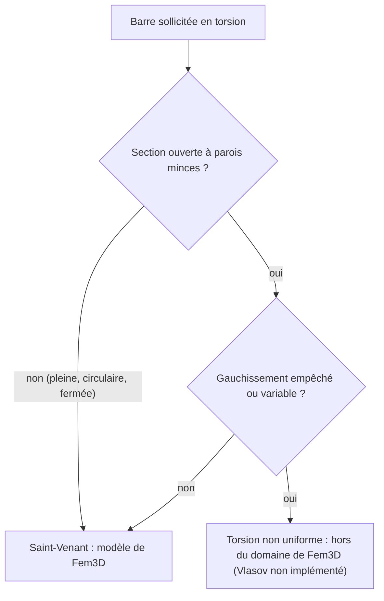

# Chapitre 8 — Torsion de Saint-Venant et limites concernant le gauchissement

> **Objectifs**
>
> - Comprendre la torsion uniforme de Saint-Venant et sa mise en œuvre (rigidité $GJ/L$).
> - Distinguer la constante de torsion $J$ du moment polaire $I_y + I_z$.
> - Savoir clairement ce que Fem3D **ne** représente **pas** : le gauchissement, le bimoment, la torsion non uniforme.
> - Situer la théorie de Vlasov comme extension **non implémentée**.
>
> **Prérequis**
>
> - [Chapitre 6](06-euler-bernoulli.md) (bloc de torsion de la matrice), [chapitre 3](03-modele-physique.md) (6 DDL).

## 8.1 Intuition physique

Tordre une barre, c'est faire tourner ses sections autour de son axe, d'un angle qui croît le long de la barre. Dans
un arbre circulaire, chaque section tourne en bloc et reste plane. Dans toute autre section (rectangle, profil en I),
les points de la section se déplacent aussi **hors de son plan** : la section **gauchit**. Si rien n'empêche ce
gauchissement et qu'il est le même dans toutes les sections, la torsion est dite **uniforme** (Saint-Venant) : le
couple est simplement proportionnel au taux de rotation.

## 8.2 Symboles

| Symbole | Signification | Unité (tests) |
|---|---|---|
| $\theta_x$ | rotation de la section autour de l'axe local x | rad |
| $\theta_x' = \mathrm{d}\theta_x/\mathrm{d}x$ | taux de rotation | rad/m |
| $T$ | moment de torsion (positif autour de $+x$ sur la face positive) | kN·m |
| $J$ | constante de torsion de Saint-Venant | m⁴ |
| $W_t$ | module de torsion : $\tau_{max} = T/W_t$ | m³ |
| $GJ$ | rigidité de torsion | kN·m² |

## 8.3 Hypothèses

- Torsion **uniforme** : gauchissement libre et identique dans toutes les sections, pas de bimoment.
- Pas de couple réparti le long de la barre (aucune charge de ce type n'existe dans Fem3D) : $T$ est constant par
  élément.
- Centre de cisaillement confondu avec le centre de gravité : la torsion est découplée de la flexion.
- Élasticité linéaire, petites rotations.

## 8.4 Équations

$$
T = G J\,\theta_x',\qquad
\mathbf{k}_{torsion} = \frac{GJ}{L}\begin{bmatrix} 1 & -1 \\ -1 & 1 \end{bmatrix}\ (\theta_{x,i},\ \theta_{x,j}),\qquad
\tau_{max} = \frac{|T|}{W_t}.
$$

La rotation varie linéairement : $\theta_x(x) = \theta_{x,i} + T\,x/(GJ)$
([`BeamResponse::BeamResponse`](https://github.com/ChristinotLeonnel/TSA-3D-FEM-Engine/blob/75700d2bfd33c29b2fadc795fd3051f25399ad19/src/Results/BeamResponse.cpp#L53-L98)), avec $T = -m_{ix}$, constant.

**Interprétation.** Le bloc de torsion n'a aucun terme commun avec la flexion ou la traction (DDL 3 et 9 seulement) :
c'est l'analogue en rotation d'une barre en traction. $J$ n'est **pas** le moment polaire $I_y + I_z$, sauf pour le
cercle (et l'anneau circulaire) : pour le rectangle 0,30 × 0,50 m, $I_y + I_z = 4{,}25\cdot10^{-3}$ m⁴ mais
$J = 2{,}817\cdot10^{-3}$ m⁴, soit 66 % seulement (recalcul Python). Prendre $I_y + I_z$ à la place de $J$
surestimerait la rigidité de torsion d'environ 50 %.

## 8.5 Algorithme

[`BeamElementBase::addAxialAndTorsion`](https://github.com/ChristinotLeonnel/TSA-3D-FEM-Engine/blob/75700d2bfd33c29b2fadc795fd3051f25399ad19/src/Elements/BeamElements.cpp#L24-L31) ajoute $\pm GJ/L$ aux termes
(3, 3), (3, 9), (9, 3), (9, 9), **de la même façon pour les deux formulations**. La contrainte $\tau = |T|/W_t$ n'est
calculée que si la section fournit $W_t$ ([`stressesAt`](https://github.com/ChristinotLeonnel/TSA-3D-FEM-Engine/blob/75700d2bfd33c29b2fadc795fd3051f25399ad19/src/Results/BeamResponse.cpp#L108-L122)). Les valeurs de
$J$ et $W_t$ des sections prédéfinies sont au [chapitre 9](09-materiaux-sections.md).

## 8.6 Exemple vérifiable

Console L = 4 m, section 0,30 × 0,50 m, G = 81·10⁶ kN/m², moment de torsion $M_x = 12$ kN·m au nœud libre (test
`Analytical_SaintVenantTorsion`, cas OpenSees `02_torsion`). Avec $J = 2{,}817371\cdot10^{-3}$ m⁴ et
$W_t = 1{,}061211\cdot10^{-2}$ m³ (formules du code, recalculées avec Python) :

$$
\theta_x = \frac{T L}{G J} = \frac{12 \times 4}{81\cdot10^6 \times 2{,}817371\cdot10^{-3}} = 2{,}103353\cdot10^{-4}\ \text{rad},
\qquad
\tau = \frac{T}{W_t} = 1130{,}78\ \text{kN/m}^2 .
$$

Le test vérifie $\theta_x$, $T = +12$ kN·m et $\tau = T/W_t$ à 10⁻⁹ près (ce dernier contrôle est tautologique vis-à-vis
de $W_t$ ; la valeur de $W_t$ elle-même est vérifiée par `Section_RectangleTorsionMatchesExactSeries`).

**Mécanisme de torsion.** Une poutre posée sur deux appuis qui ne bloquent pas la rotation autour de son axe a un mode
de rotation libre : $\mathbf{K}_{ff}$ est singulière et le moteur le signale en désignant un DDL Rx (test
`Integration_MechanismDetected`, cas OpenSees `11_mecanisme`). De même, une barre relâchée en My et Mz aux deux
extrémités garde sa rigidité de torsion : ce n'est pas un treillis ([FORMULATIONS.md](../../formulations/FORMULATIONS.md) §7).

## 8.7 Ce que Fem3D ne représente pas : le gauchissement

**Six DDL par nœud ne peuvent pas représenter le gauchissement.** Le modèle de poutre de Fem3D décrit chaque section
par trois translations et trois rotations ([chapitre 3](03-modele-physique.md)). Le gauchissement est un déplacement
**hors du plan** de la section, variable d'un point à l'autre de celle-ci : aucune combinaison de ces 6 nombres ne le
décrit. En conséquence, Fem3D ne calcule :

- ni la **torsion non uniforme** (gauchissement empêché à un appui, ou variable le long de la barre) ;
- ni le **bimoment** ni les **contraintes normales de gauchissement** ;
- ni la constante de gauchissement $I_w$, qui n'existe pas dans
  [`BeamSection3D`](https://github.com/ChristinotLeonnel/TSA-3D-FEM-Engine/blob/75700d2bfd33c29b2fadc795fd3051f25399ad19/include/Fem3D/Sections/BeamSection3D.h#L18-L40).

Ce n'est pas une approximation que l'on pourrait corriger par un coefficient : il faudrait un autre élément
([FORMULATIONS.md](../../formulations/FORMULATIONS.md) §6).

**Théorie de Vlasov (extension non implémentée), description qualitative.** Pour les profils ouverts à parois minces
(I, U, cornières), le gauchissement est grand. Quand un appui ou un encastrement l'empêche, les fibres longitudinales
de la section s'allongent ou se raccourcissent : apparaissent des contraintes normales de gauchissement, auto-équilibrées
dans la section, dont la résultante généralisée est le **bimoment**. La résistance à ce gauchissement empêché ajoute à
la rigidité de Saint-Venant $GJ$ une rigidité de gauchissement, proportionnelle à $E I_w$. La théorie de Vlasov
modélise ce phénomène en ajoutant à chaque nœud un **septième DDL** (le taux de rotation $\theta_x'$, qui mesure le
gauchissement) et la constante $I_w$ de la section.

À titre de repère, la théorie générale de la torsion non uniforme s'écrit couramment sous la forme

$$
G J\,\theta_x' - E I_w\,\theta_x''' = T ,
$$

**équation de théorie générale, NON implémentée dans Fem3D et NON vérifiée dans son code ni par ses tests** ; elle
n'est donnée que pour situer la limite. Son contenu, ses conditions aux limites et la formulation d'un élément à
7 DDL restent à établir à partir des références (A11, A12) avant toute implémentation.

**Conséquences pratiques** (d'après [KNOWN_LIMITATIONS.md](../../limitations/KNOWN_LIMITATIONS.md) §1 et
[REFERENCES.md](../../references/REFERENCES.md) §C10) :

- pour un profil ouvert mince dont le gauchissement est empêché aux appuis, $GJ$ seul **sous-estime** la rigidité de
  torsion ;
- les contraintes normales de gauchissement sont **absentes** des résultats : la vérification des contraintes n'est
  pas du côté de la sécurité pour ces profils ;
- dans une structure hyperstatique, la répartition des moments de torsion entre barres peut aussi en être affectée
  (affirmation qualitative, non quantifiée dans le dépôt : à vérifier) ;
- le déversement (flambement par flexion-torsion) est de toute façon hors du domaine, puisque Fem3D est linéaire.



Ce schéma reste qualitatif : le seuil à partir duquel l'effet de gauchissement devient significatif n'est pas
documenté dans le dépôt (à vérifier dans les références).

## 8.8 Limites

- Torsion uniforme seulement ; pas de couple réparti ; pas de relâchement de torsion.
- $J$ et $W_t$ du rectangle sont des formules approchées (écarts au [chapitre 9](09-materiaux-sections.md)).
- Dans TSA, $J$ vient de la section de TSA (`it()`) et aucun $W_t$ n'est transmis : la contrainte de torsion n'est pas
  calculée par Fem3D dans ce cas ([`convert`](https://github.com/ChristinotLeonnel/Tsaraloha-Structural-Analysis/blob/2f5d7d4342e903fe536fbab91a7dcf80e8b89f7d/src/Analysis/Engines/Fem3D/Fem3DAdapter.cpp#L38-L189)).

## À retenir

- Torsion de Saint-Venant : $T = GJ\theta_x'$, rigidité $GJ/L$, identique pour Euler–Bernoulli et Timoshenko.
- $J \neq I_y + I_z$ hors du cercle.
- **Six DDL ne représentent pas le gauchissement** : ni bimoment, ni torsion non uniforme, ni $I_w$.
- Vlasov (7ᵉ DDL, $EI_w$) est une extension **non implémentée** ; pour les profils ouverts minces à gauchissement
  empêché, $GJ$ seul sous-estime la rigidité et omet des contraintes.

## Dans le code source

- Bloc de torsion : [`BeamElementBase::addAxialAndTorsion`](https://github.com/ChristinotLeonnel/TSA-3D-FEM-Engine/blob/75700d2bfd33c29b2fadc795fd3051f25399ad19/src/Elements/BeamElements.cpp#L24-L31) et son
  commentaire « sans gauchissement (pas de bimoment) » dans [`BeamElementBase`](https://github.com/ChristinotLeonnel/TSA-3D-FEM-Engine/blob/75700d2bfd33c29b2fadc795fd3051f25399ad19/include/Fem3D/Elements/BeamElementBase.h#L11-L47).
- Rotation le long de la barre : [`BeamResponse::BeamResponse`](https://github.com/ChristinotLeonnel/TSA-3D-FEM-Engine/blob/75700d2bfd33c29b2fadc795fd3051f25399ad19/src/Results/BeamResponse.cpp#L53-L98).
- Contrainte de torsion : [`stressesAt`](https://github.com/ChristinotLeonnel/TSA-3D-FEM-Engine/blob/75700d2bfd33c29b2fadc795fd3051f25399ad19/src/Results/BeamResponse.cpp#L108-L122).
- Section (aucun $I_w$) : [`BeamSection3D`](https://github.com/ChristinotLeonnel/TSA-3D-FEM-Engine/blob/75700d2bfd33c29b2fadc795fd3051f25399ad19/include/Fem3D/Sections/BeamSection3D.h#L18-L40).

## Vérifier par les tests

```bat
build\fem3d_tests.exe | findstr /C:"SaintVenantTorsion" /C:"MechanismDetected" /C:"RectangleTorsion"
```

- [`Analytical_SaintVenantTorsion`](https://github.com/ChristinotLeonnel/TSA-3D-FEM-Engine/blob/75700d2bfd33c29b2fadc795fd3051f25399ad19/tests/analytical/test_analytical.cpp#L65-L73) : $\theta_x = TL/GJ$, $T$, $\tau$.
- [`Integration_MechanismDetected`](https://github.com/ChristinotLeonnel/TSA-3D-FEM-Engine/blob/75700d2bfd33c29b2fadc795fd3051f25399ad19/tests/integration/test_frames.cpp#L137-L167) : mécanisme de torsion désigné.
- [`Section_RectangleTorsionMatchesExactSeries`](https://github.com/ChristinotLeonnel/TSA-3D-FEM-Engine/blob/75700d2bfd33c29b2fadc795fd3051f25399ad19/tests/analytical/test_audit_gaps.cpp#L130-L152) : $J$ et $W_t$.
- Cas OpenSees `02_torsion` et `11_mecanisme`.
- Aucun test ne porte sur le gauchissement : il n'est pas implémenté.

## Références

- [THEORY.md](../../theory/THEORY.md) §1 ; [FORMULATIONS.md](../../formulations/FORMULATIONS.md) §6 ;
  [KNOWN_LIMITATIONS.md](../../limitations/KNOWN_LIMITATIONS.md) §1.
- A11 — Vlasov, *Thin-Walled Elastic Beams* (1961) : notice vérifiée ; texte non consulté.
- A12 — Trahair, *Flexural-Torsional Buckling of Structures* (1993) : notice vérifiée ; chapitres à vérifier.
- A10 — Timoshenko, Gere, *Theory of Elastic Stability* : notice vérifiée ; ch. 5 (*torsional buckling*) vérifié par la
  préface (extrait).
- A14 — Pilkey (2002) : notice vérifiée ; contenu sur le gauchissement à vérifier.
- A13 — Roark : notice vérifiée ; formule de $J$ du rectangle vue par une source secondaire (voir chapitre 9).

---

Chapitre précédent : [Chapitre 7 — Élément poutre 3D Timoshenko](07-timoshenko.md) ·
Chapitre suivant : [Chapitre 9 — Matériaux et propriétés de section](09-materiaux-sections.md)
