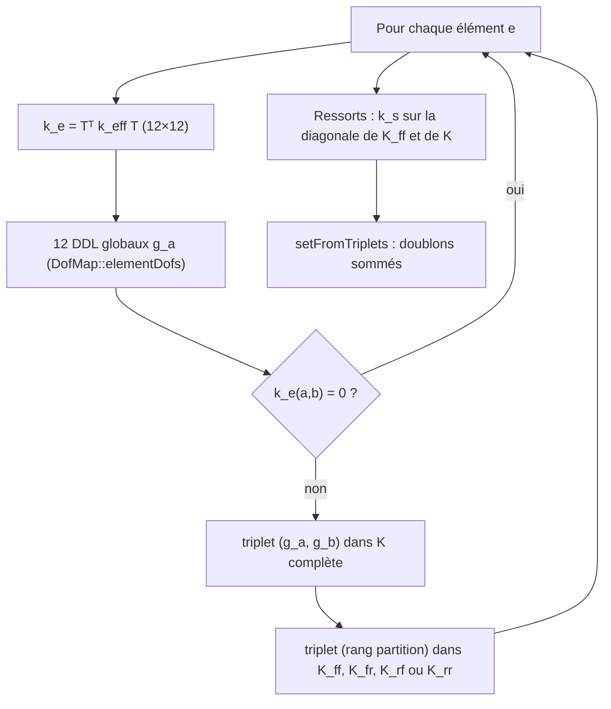

# Chapitre 12 — Assemblage des matrices globales

> **Objectifs**
>
> - Savoir comment Fem3D numérote les degrés de liberté (DDL) et les répartit entre DDL libres et imposés.
> - Comprendre l'assemblage direct de la matrice de rigidité, en blocs partitionnés, à partir des matrices
>   élémentaires 12×12 exprimées dans le repère global.
> - Savoir comment le vecteur des charges est construit (charges nodales et forces nodales équivalentes exactes).
> - Refaire à la main l'assemblage d'un petit modèle et vérifier le résultat par les tests.
>
> **Prérequis**
>
> - Matrices élémentaires d'Euler–Bernoulli et de Timoshenko ([chapitres 6](06-euler-bernoulli.md) et
>   [7](07-timoshenko.md)), repère local et matrice de transformation $T$ ([SIGN_CONVENTIONS.md](../../theory/SIGN_CONVENTIONS.md) §2).
> - Forces nodales équivalentes ([chapitre 10](10-charges-conditions-limites.md)), appuis élastiques
>   ([chapitre 11](11-ressorts.md)).
> - Notion de matrice creuse.

## 12.1 Numérotation des degrés de liberté

**Intuition.** Pour écrire l'équilibre de toute la structure, il faut ranger les inconnues (trois translations et
trois rotations par nœud) dans un seul vecteur. La règle de rangement doit être simple, stable, et ne dépendre que de
l'ordre dans lequel les nœuds ont été créés.

**Symboles.**

| Symbole | Sens |
|---|---|
| $n_\text{nœuds}$ | nombre de nœuds du modèle |
| $p$ | indice interne d'un nœud : sa position dans le modèle (0, 1, 2…), **pas** son identifiant |
| $r \in \{0,\dots,5\}$ | rang du DDL dans le nœud : Ux, Uy, Uz, Rx, Ry, Rz |
| $g$ | numéro global du DDL |
| $n_f$, $n_r$ | nombres de DDL libres et imposés, $n_f + n_r = 6\,n_\text{nœuds}$ |

**Hypothèses.** Six DDL par nœud, dans le même ordre partout ([SIGN_CONVENTIONS.md](../../theory/SIGN_CONVENTIONS.md) §1).
Un nœud sans élément garde ses six DDL (il produit alors un mécanisme, [chapitre 13](13-conditions-limites-stabilite.md)).

**Équation.**

$$
g = 6\,p + r .
$$

Les 12 DDL globaux d'un élément sont ceux de son nœud i (rangs 0 à 5) suivis de ceux de son nœud j : c'est l'ordre du
vecteur élémentaire $d_e = [u_i\ v_i\ w_i\ \theta_{x,i}\ \theta_{y,i}\ \theta_{z,i}\ u_j \dots \theta_{z,j}]^T$.

**Partition.** Chaque DDL global est soit **libre** (f), soit **imposé** (r) : un DDL est imposé si l'appui de son
nœud le bloque (`NodeRestraint::fixed`). La classe `DofMap` parcourt ensuite les DDL dans l'ordre croissant de $g$ et
donne à chacun son **rang dans sa partition** (`partitionIndex`) : le $k$-ième DDL libre rencontré reçoit l'indice
$k$ dans $U_f$, le $k$-ième DDL imposé l'indice $k$ dans $U_r$. Aucune renumérotation n'est faite à ce stade : la
réduction du remplissage est laissée au solveur ([chapitre 14](14-solveur-diagnostics.md)).

**Interprétation.** L'identifiant d'un nœud (10, 20, 1001…) ne sert qu'à le désigner ; seule sa position compte pour
la numérotation. Les messages de diagnostic retraduisent un DDL en « nœud 20, Rz » (`DofMap::label`).

**Algorithme** (`DofMap::DofMap`) :

1. marquer les $6\,n_\text{nœuds}$ DDL comme libres ;
2. pour chaque appui, marquer imposés les DDL bloqués et mémoriser leur valeur imposée ;
3. parcourir $g = 0, 1, \dots$ et ajouter $g$ à la liste des libres ou des imposés ; son rang dans cette liste
   devient son `partitionIndex`.

**Exemple vérifiable.** Trois nœuds créés dans l'ordre 20, 10, 30. Le nœud 20 est encastré, le nœud 30 a Uy et Uz
bloqués. Le nœud 10 a l'indice interne $p = 1$ : son DDL Rz vaut $g = 6 \cdot 1 + 5 = 11$ ; le DDL Uy du nœud 30 vaut
$g = 6 \cdot 2 + 1 = 13$. Les DDL libres sont, dans l'ordre, $\{6,7,8,9,10,11,12,15,16,17\}$ ($n_f = 10$) ; le DDL
17 (nœud 30, Rz) a donc l'indice libre 9, et le DDL 14 (nœud 30, Uz) l'indice imposé 7. Valeurs recalculées par un
script Python qui reproduit l'algorithme ci-dessus (exercice 1 du [chapitre 22](22-exercices-projets.md)).

**Limites.** La numérotation est dense (tous les DDL de tous les nœuds) ; il n'y a ni DDL supplémentaire (7ᵉ DDL de
gauchissement), ni contrainte cinématique (`equalDOF`, diaphragme) qui lierait des DDL entre eux.

## 12.2 Assemblage direct de la rigidité, en blocs partitionnés

**Intuition.** Chaque barre apporte sa rigidité aux DDL de ses deux nœuds. Là où deux barres se rejoignent, leurs
contributions s'additionnent : c'est l'équilibre du nœud. Plutôt que d'assembler une grande matrice puis de la
découper, Fem3D range directement chaque terme dans le bon bloc.

**Symboles.** $k_e^\text{loc}$ : rigidité locale effective de l'élément (condensée s'il a des rotules : condensation statique
présentée au [chapitre 15](15-efforts-internes.md) §15.4 et dans [THEORY.md](../../theory/THEORY.md) §6) ; $T = \mathrm{diag}(R,R,R,R)$ : transformation local → global ;
$k_e = T^T k_e^\text{loc} T$ : rigidité de l'élément dans le repère global ; $K$ : rigidité globale.

**Hypothèses.** Petits déplacements (la géométrie de référence sert pour toutes les matrices), matériau élastique
linéaire, éléments à deux nœuds.

**Équations.** Le système de la méthode des déplacements, écrit directement par blocs, est :

$$
\begin{bmatrix} K_{ff} & K_{fr} \\ K_{rf} & K_{rr} \end{bmatrix}
\begin{bmatrix} U_f \\ U_r \end{bmatrix}
=
\begin{bmatrix} F_f \\ F_r + R \end{bmatrix},
\qquad
K = \sum_{e} A_e^T\, T_e^T\, k_e^\text{loc}\, T_e\, A_e + \sum_{\text{ressorts}} k_s\, a_s a_s^T ,
$$

où $A_e$ est la matrice booléenne (jamais formée) qui extrait les 12 DDL de l'élément, et $a_s$ le vecteur unité du
DDL retenu par un ressort de raideur $k_s$ ([chapitre 11](11-ressorts.md)). $R$ désigne les réactions des appuis
rigides, connues seulement après la résolution.

**Interprétation.**

- Le terme $(a,b)$ de $k_e$ va dans le bloc choisi par la nature (libre ou imposée) des DDL $g_a$ et $g_b$ :
  libre-libre → $K_{ff}$, libre-imposé → $K_{fr}$, imposé-libre → $K_{rf}$, imposé-imposé → $K_{rr}$.
- $K$ est **symétrique** (chaque $k_e$ l'est, test `Element_SymmetryAndRigidBodyModes`) et **creuse** : une ligne
  ne contient que les DDL des nœuds voisins.
- Un ressort ajoute $k_s$ au seul terme diagonal de son DDL ; comme un ressort sur un DDL bloqué est refusé à la
  validation, ce terme tombe toujours dans $K_{ff}$.
- La matrice complète $K$ (ordre des DDL globaux) est aussi conservée (`PartitionedStiffness::full`) pour l'export
  et les vérifications ; elle ne sert pas à la résolution.

**Algorithme** (`GlobalAssembler::assembleStiffness`) :

1. Pour chaque élément : calculer $k_e$ (`IBeamElement3D::globalStiffnessMatrix`), récupérer ses 12 DDL globaux.
2. Pour chaque terme non nul : empiler un triplet $(g_a, g_b, k)$ pour la matrice complète et un triplet
   (rang dans la partition de $g_a$, rang dans la partition de $g_b$, $k$) dans la liste du bon bloc.
3. Ajouter les raideurs des ressorts sur la diagonale.
4. Construire les cinq matrices creuses par `setFromTriplets`, qui **additionne les doublons** : c'est l'addition des
   contributions des éléments voisins (comportement documenté d'Eigen, [REFERENCES.md](../../references/REFERENCES.md) §C8).

**Coût.** L'assemblage est linéaire en nombre d'éléments : $144$ triplets au plus par élément. Le stockage est
compressé par colonnes (`Eigen::SparseMatrix<double>`).

**Exemple vérifiable** (assemblage à la main). Console axiale de longueur 4 m découpée en deux éléments de 2 m
(nœuds 1, 2, 3 ; nœud 1 encastré), section 0,30 × 0,50 m, $E = 210 \cdot 10^6$ kN/m². En ne gardant que les DDL
axiaux, $k = EA/(L/2) = 210 \cdot 10^6 \times 0{,}15 / 2 = 1{,}575 \cdot 10^7$ kN/m et

$$
K_{ff} = \begin{bmatrix} 2k & -k \\ -k & k \end{bmatrix},\qquad
K_{ff}\begin{bmatrix} u_2 \\ u_3\end{bmatrix} = \begin{bmatrix} 0 \\ 100 \end{bmatrix}
\Rightarrow u_2 = 6{,}349 \cdot 10^{-6}\ \text{m},\ u_3 = 1{,}2698 \cdot 10^{-5}\ \text{m}.
$$

On retrouve $u_3 = PL/EA$ ; la réaction vaut $R_1 = K_{rf} U_f = -k\,u_2 = -100$ kN. Valeurs recalculées en Python.
Le test `Analytical_AxialTension` vérifie $u = PL/EA$ et $R = -P$ avec un seul élément, et
`Integration_SpatialFrame_EquilibriumAndMeshInvariance` vérifie que subdiviser les barres ne change pas les
déplacements des nœuds communs (éléments exacts).

**Limites.**

- Les termes exactement nuls de $k_e$ sont omis ; les termes très petits mais non nuls (arrondi de la rotation $T$)
  sont conservés.
- L'assemblage ne vérifie pas la stabilité : un DDL sans rigidité donne une ligne nulle, détectée seulement à la
  factorisation ([chapitre 14](14-solveur-diagnostics.md)).
- Toutes les matrices sont celles de la configuration initiale : pas de matrice géométrique (P-Δ,
  [chapitre 21](21-extensions.md)).

## 12.3 Vecteur des charges

**Intuition.** Les charges appliquées aux nœuds entrent telles quelles dans $F$. Une charge répartie sur une barre
est remplacée, **pour l'assemblage seulement**, par ses forces nodales équivalentes exactes ; elle reste prise en
compte exactement dans les efforts internes ([chapitre 15](15-efforts-internes.md)).

**Équations.** Pour un cas de charge :

$$
F = \sum_{\text{nœuds}} \begin{bmatrix} F_x & F_y & F_z & M_x & M_y & M_z \end{bmatrix}^T_\text{nœud}
  + \sum_e A_e^T\, T_e^T\, f_{c,e},
\qquad
f_{c,e} = \begin{cases} f_{eq,e} & \text{sans rotule} \\ f_{eq,a} - K_{ab} K_{bb}^{-1} f_{eq,b} & \text{avec rotules}\end{cases}
$$

avec $f_{eq,e,k} = \int_0^L N_k(x)\, q(x)\,dx$, calculé par une quadrature de Gauss à 4 points avec les fonctions de
forme de la formulation ([THEORY.md](../../theory/THEORY.md) §4). Les charges nodales sont données dans le repère
global ; les charges réparties sont additionnées par élément dans le repère local (`LocalLinearLoad::fromLoads`, qui
projette les charges globales par $q_\text{loc} = R\, q_\text{glob}$).

**Algorithme** (`GlobalAssembler::assembleLoads`) : vecteur $F$ de taille $6\,n_\text{nœuds}$ (ordre global) ;
ajout des charges nodales ; pour chaque élément chargé, $f_{eq}$, condensation éventuelle, rotation $T^T$, ajout aux
12 DDL. La séparation en $F_f$ et $F_r$ est faite ensuite par `LinearStaticAnalysis::run`.

**Exemple vérifiable.** Poutre bi-encastrée de 5 m sous une charge triangulaire nulle en i et valant 12 kN/m en j
(Euler–Bernoulli). La quadrature donne, pour (v_i, θz_i, v_j, θz_j) : $(9,\ 10,\ 21,\ -15)$, c'est-à-dire
$3wL/20$, $wL^2/30$, $7wL/20$ et $-wL^2/20$. Valeurs recalculées en Python avec les mêmes points et poids de Gauss que
le code ; test `Analytical_FixedFixedTriangularLoad_EulerBernoulli`.

**Limites.** Charges réparties linéaires sur **toute** la longueur seulement ; ni charge ponctuelle sur barre, ni
charge partielle, ni moment réparti ([chapitre 21](21-extensions.md)).

## 12.4 Export de la matrice

`exportMatrixMarket` écrit une matrice creuse au format Matrix Market (coordonnées, réels, « general », indices à
partir de 1, 17 chiffres significatifs). Elle permet de relire $K$ ou $K_{ff}$ dans un autre outil (Python, Octave)
pour un contrôle indépendant : symétrie, valeurs propres, comparaison terme à terme. Une erreur d'écriture lève
`Fem3DError` (`IoError`). Aucun test du dépôt n'appelle cette fonction : son format est **à vérifier** par
l'utilisateur sur son propre outil de lecture.

## À retenir

- $g = 6\,p + r$, avec $p$ la position du nœud dans le modèle, jamais son identifiant.
- La partition libres / imposés est faite **avant** l'assemblage : les quatre blocs $K_{ff}$, $K_{fr}$, $K_{rf}$,
  $K_{rr}$ sont assemblés directement, sans pénalité ni grand nombre sur la diagonale.
- `setFromTriplets` additionne les contributions des éléments voisins ; les ressorts s'ajoutent sur la diagonale.
- $F$ contient les charges nodales et les forces nodales équivalentes exactes (condensées aux rotules).
- L'assemblage ne détecte pas les mécanismes : c'est le rôle du solveur.

## Dans le code source

- Numérotation : [`DofMap` (déclaration)](https://github.com/ChristinotLeonnel/TSA-3D-FEM-Engine/blob/75700d2bfd33c29b2fadc795fd3051f25399ad19/include/Fem3D/Assembly/DofMap.h#L15-L45), [`DofMap::DofMap`](https://github.com/ChristinotLeonnel/TSA-3D-FEM-Engine/blob/75700d2bfd33c29b2fadc795fd3051f25399ad19/src/Assembly/Assembly.cpp#L9-L30),
  [`DofMap::elementDofs`](https://github.com/ChristinotLeonnel/TSA-3D-FEM-Engine/blob/75700d2bfd33c29b2fadc795fd3051f25399ad19/src/Assembly/Assembly.cpp#L38-L47), [`DofMap::label`](https://github.com/ChristinotLeonnel/TSA-3D-FEM-Engine/blob/75700d2bfd33c29b2fadc795fd3051f25399ad19/src/Assembly/Assembly.cpp#L32-L36).
- Blocs : [`PartitionedStiffness`](https://github.com/ChristinotLeonnel/TSA-3D-FEM-Engine/blob/75700d2bfd33c29b2fadc795fd3051f25399ad19/include/Fem3D/Assembly/GlobalAssembler.h#L21-L28), [`GlobalAssembler`](https://github.com/ChristinotLeonnel/TSA-3D-FEM-Engine/blob/75700d2bfd33c29b2fadc795fd3051f25399ad19/include/Fem3D/Assembly/GlobalAssembler.h#L30-L42).
- Assemblage : [`GlobalAssembler::assembleStiffness`](https://github.com/ChristinotLeonnel/TSA-3D-FEM-Engine/blob/75700d2bfd33c29b2fadc795fd3051f25399ad19/src/Assembly/Assembly.cpp#L55-L101),
  [`GlobalAssembler::assembleLoads`](https://github.com/ChristinotLeonnel/TSA-3D-FEM-Engine/blob/75700d2bfd33c29b2fadc795fd3051f25399ad19/src/Assembly/Assembly.cpp#L103-L126).
- Rigidité élémentaire globale : [`IBeamElement3D::globalStiffnessMatrix`](https://github.com/ChristinotLeonnel/TSA-3D-FEM-Engine/blob/75700d2bfd33c29b2fadc795fd3051f25399ad19/src/Elements/BeamElements.cpp#L18-L22),
  [`IBeamElement3D::effectiveLocalStiffnessMatrix`](https://github.com/ChristinotLeonnel/TSA-3D-FEM-Engine/blob/75700d2bfd33c29b2fadc795fd3051f25399ad19/src/Elements/BeamElements.cpp#L13-L16).
- Charges : [`LocalLinearLoad::fromLoads`](https://github.com/ChristinotLeonnel/TSA-3D-FEM-Engine/blob/75700d2bfd33c29b2fadc795fd3051f25399ad19/src/Results/BeamResponse.cpp#L18-L29), [`equivalentNodalLoads`](https://github.com/ChristinotLeonnel/TSA-3D-FEM-Engine/blob/75700d2bfd33c29b2fadc795fd3051f25399ad19/src/Results/BeamResponse.cpp#L31-L51),
  [`condensedLoads`](https://github.com/ChristinotLeonnel/TSA-3D-FEM-Engine/blob/75700d2bfd33c29b2fadc795fd3051f25399ad19/src/Elements/StaticCondensation.cpp#L47-L58).
- Export : [`exportMatrixMarket`](https://github.com/ChristinotLeonnel/TSA-3D-FEM-Engine/blob/75700d2bfd33c29b2fadc795fd3051f25399ad19/src/Analysis/LinearStaticAnalysis.cpp#L172-L181).
- Tout ce code a été introduit par le commit [75700d2](https://github.com/ChristinotLeonnel/TSA-3D-FEM-Engine/commit/75700d2bfd33c29b2fadc795fd3051f25399ad19) (le développement antérieur n'était pas versionné).

## Vérifier par les tests

| Test | Ce qu'il vérifie pour l'assemblage |
|---|---|
| [`Element_SymmetryAndRigidBodyModes`](https://github.com/ChristinotLeonnel/TSA-3D-FEM-Engine/blob/75700d2bfd33c29b2fadc795fd3051f25399ad19/tests/unit/test_geometry_and_elements.cpp#L65-L82) | $k_e$ global symétrique, 6 modes de corps rigide sans effort |
| [`Analytical_AxialTension`](https://github.com/ChristinotLeonnel/TSA-3D-FEM-Engine/blob/75700d2bfd33c29b2fadc795fd3051f25399ad19/tests/analytical/test_analytical.cpp#L52-L63) | $u = PL/EA$, réaction $-P$ |
| [`Integration_SpatialFrame_EquilibriumAndMeshInvariance`](https://github.com/ChristinotLeonnel/TSA-3D-FEM-Engine/blob/75700d2bfd33c29b2fadc795fd3051f25399ad19/tests/integration/test_frames.cpp#L77-L92) | assemblage multiéléments : équilibre global, invariance au maillage |
| [`Analytical_FixedFixedTriangularLoad_EulerBernoulli`](https://github.com/ChristinotLeonnel/TSA-3D-FEM-Engine/blob/75700d2bfd33c29b2fadc795fd3051f25399ad19/tests/analytical/test_analytical.cpp#L142-L162) | vecteur $F$ d'une charge triangulaire |
| [`Integration_GlobalAndLocalDistributedLoadsEquivalent`](https://github.com/ChristinotLeonnel/TSA-3D-FEM-Engine/blob/75700d2bfd33c29b2fadc795fd3051f25399ad19/tests/integration/test_frames.cpp#L94-L109) | projection des charges globales |
| [`Springs_TipSpringInParallelWithCantilever`](https://github.com/ChristinotLeonnel/TSA-3D-FEM-Engine/blob/75700d2bfd33c29b2fadc795fd3051f25399ad19/tests/analytical/test_springs.cpp#L37-L54) | ressort ajouté sur la diagonale |

Lancer : `build\fem3d_tests.exe` (les 41 tests ; la sortie affiche `[PASS]` ou `[FAIL]` par test). Côté OpenSees,
les cas 08 à 10, 14 et 20 (portiques) éprouvent l'assemblage multiéléments :
`build\fem3d_opensees_benchmarks.exe [OpenSees.exe] [dossier]`.

## Références

- A6 Przemieniecki, *Theory of Matrix Structural Analysis* — vérifié (notice) ; chapitres **à vérifier**.
- A7 McGuire, Gallagher, Ziemian, *Matrix Structural Analysis* — vérifié (notice) ; chapitres **à vérifier**.
- A3 Bathe, *Finite Element Procedures* — vérifié (notice) ; §4.2 (vecteurs de charges consistants) : correspondance
  vérifiée par le programme MIT OCW.
- B4 Archer (1965), matrices et charges consistantes — vérifié (notice Crossref), texte non lu.
- Documentation d'Eigen (`SparseMatrix`, `setFromTriplets`) — vérifié (contenu), [REFERENCES.md](../../references/REFERENCES.md) §C8.

---

Précédent : [Chapitre 11 — Ressorts d'appui](11-ressorts.md) · Suivant :
[Chapitre 13 — Conditions aux limites et stabilité](13-conditions-limites-stabilite.md)
