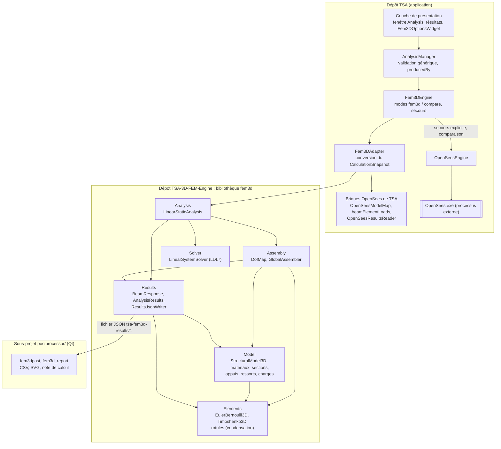

# A. Architecture générale

Composants et dépendances **réelles** (relevées dans le code ; le graphe exhaustif des `#include` est dans
[dependances-code.md](dependances-code.md)). Trois ensembles indépendants : le **moteur** (bibliothèque `fem3d`, C++20
et Eigen, sans Qt), le **post-traitement** (sous-projet Qt, qui ne lit que le fichier JSON) et l'**intégration TSA**
(dépôt TSA, qui dépend du moteur ; le moteur ne connaît pas TSA).

Points à noter, vérifiés dans le code :

- `Assembly` dépend de `Results` : les forces nodales équivalentes des charges réparties sont calculées par
  `equivalentNodalLoads` de `BeamResponse` ([Assembly.cpp](https://github.com/ChristinotLeonnel/TSA-3D-FEM-Engine/blob/75700d2bfd33c29b2fadc795fd3051f25399ad19/src/Assembly/Assembly.cpp)).
- Les conditions aux limites et les ressorts sont des données du modèle (`Constraints`), appliquées par la
  numérotation (`DofMap`) et l'assemblage (termes diagonaux des ressorts).
- Le post-traitement n'inclut aucun en-tête du moteur : seul le format JSON les relie
  ([RESULTS_FORMAT.md](../RESULTS_FORMAT.md)).
- Dans TSA, l'adaptateur réutilise les briques du chemin OpenSees, pour que les deux moteurs calculent et présentent
  le même modèle ([INTEGRATION_TSA.md](../INTEGRATION_TSA.md)).
