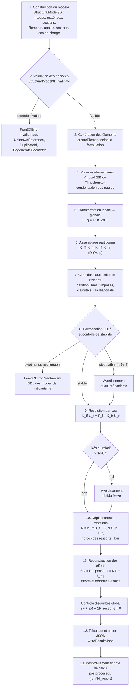

# B. Déroulement d'un calcul Fem3D

D'après `LinearStaticAnalysis` (constructeur puis `run`) :
[LinearStaticAnalysis.cpp](https://github.com/ChristinotLeonnel/TSA-3D-FEM-Engine/blob/75700d2bfd33c29b2fadc795fd3051f25399ad19/src/Analysis/LinearStaticAnalysis.cpp).
Les branches d'erreur lèvent `Fem3DError` avec un code stable ; les avertissements ne bloquent pas le calcul.

Étapes 2 à 8 : une seule fois par modèle (constructeur) ; étapes 9 à 12 : pour chaque cas de charge (`run`).
Détails : [livre, chapitres 12 à 16](../book/Fem3D_Technical_Book.md).
