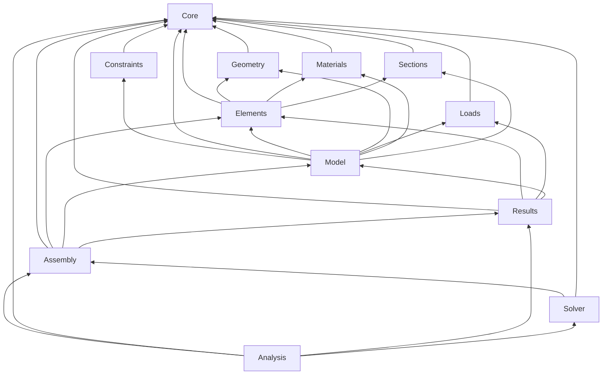

# Dépendances du code (généré)

Généré par `python tools/docs/gen_dependency_graph.py` à partir des `#include "Fem3D/…"` de `include/` et
`src/` : **ne pas modifier à la main**. Une flèche A → B signifie « un fichier du module A inclut un en-tête du
module B ». Le graphe des fichiers est dans `dependances-code.dot` (Graphviz :
`dot -Tsvg dependances-code.dot -o dependances-code.svg`).

34 fichiers, 12 modules, 30 dépendances entre modules,
61 inclusions internes.

| Module | Dépend de |
|---|---|
| Analysis | Assembly, Core, Results, Solver |
| Assembly | Core, Elements, Model, Results |
| Constraints | Core |
| Core | — |
| Elements | Core, Geometry, Materials, Sections |
| Geometry | Core |
| Loads | Core |
| Materials | Core |
| Model | Constraints, Core, Elements, Geometry, Loads, Materials, Sections |
| Results | Core, Elements, Loads, Model |
| Sections | Core |
| Solver | Assembly, Core |
