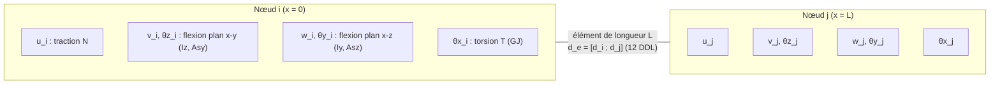
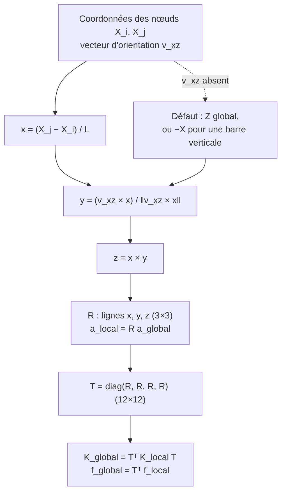
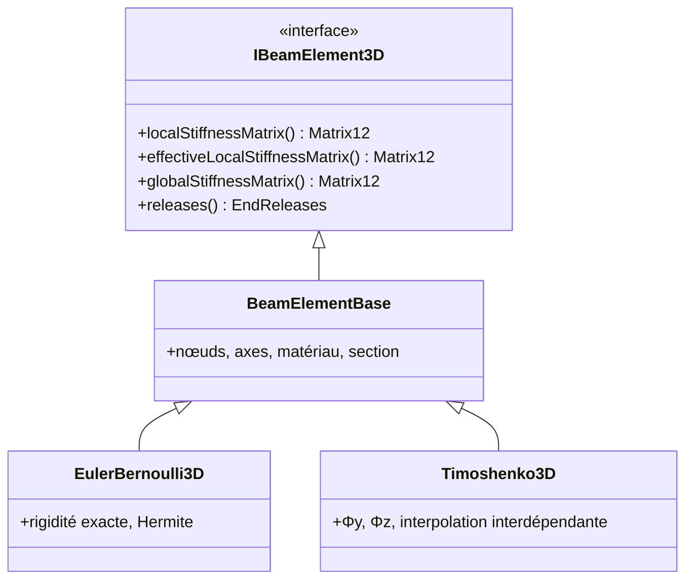

# D. Éléments poutre : degrés de liberté, repères, transformations

## Degrés de liberté d'un élément

Deux nœuds, six DDL chacun, dans l'ordre [u v w θx θy θz] (repère local) — voir
[SIGN_CONVENTIONS.md](../theory/SIGN_CONVENTIONS.md) §1.

## Repère local et transformation

Code : [LocalCoordinateSystem3D.cpp](https://github.com/ChristinotLeonnel/TSA-3D-FEM-Engine/blob/75700d2bfd33c29b2fadc795fd3051f25399ad19/src/Geometry/LocalCoordinateSystem3D.cpp),
[IBeamElement3D::globalStiffnessMatrix](https://github.com/ChristinotLeonnel/TSA-3D-FEM-Engine/blob/75700d2bfd33c29b2fadc795fd3051f25399ad19/src/Elements/BeamElements.cpp#L18-L22).

## Hiérarchie des classes

Grandeurs physiques : N (EA/L), T (GJ/L, torsion de Saint-Venant uniforme, **sans gauchissement**), flexion
Mz, Vy (EIz, et G·Asy en Timoshenko) et My, Vz (EIy, G·Asz). Détails : livre, chapitres 6 à 8.
