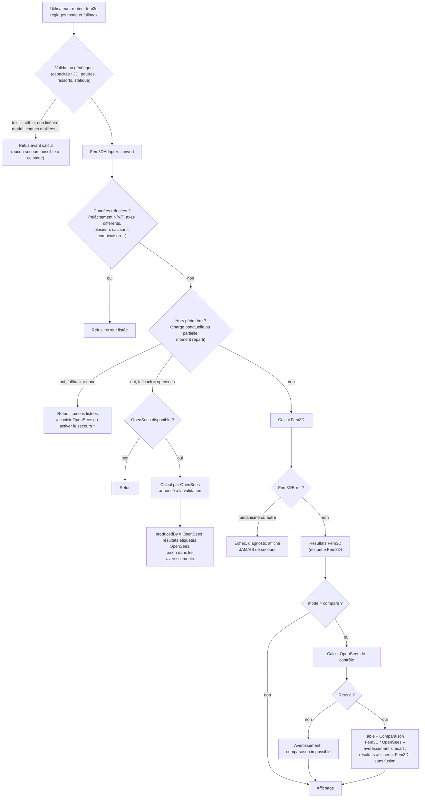

# F. Choix du moteur dans TSA : Fem3D, comparaison, secours

D'après `AnalysisManager::prepare` / `run` et `Fem3DEngine::validate` / `run` (dépôt TSA, révision 2f5d7d4) :
[Fem3DEngine.cpp](https://github.com/ChristinotLeonnel/Tsaraloha-Structural-Analysis/blob/2f5d7d4342e903fe536fbab91a7dcf80e8b89f7d/src/Analysis/Engines/Fem3D/Fem3DEngine.cpp),
[AnalysisManager.cpp](https://github.com/ChristinotLeonnel/Tsaraloha-Structural-Analysis/blob/2f5d7d4342e903fe536fbab91a7dcf80e8b89f7d/src/Analysis/Engine/AnalysisManager.cpp).
OpenSees est le moteur par défaut ; Fem3D n'est utilisé que si l'utilisateur le choisit.

Tests : TSA, suite `engines`, tests 476 à 480 ([INTEGRATION_TSA.md](../INTEGRATION_TSA.md)).
