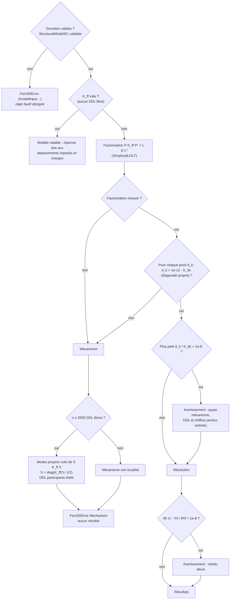

# E. Diagnostic de stabilité

D'après [LinearSystemSolver::factorize](https://github.com/ChristinotLeonnel/TSA-3D-FEM-Engine/blob/75700d2bfd33c29b2fadc795fd3051f25399ad19/src/Solver/LinearSystemSolver.cpp#L59-L98)
et `LinearStaticAnalysis` (avertissements, résidu).

Le critère compare chaque pivot à la rigidité de **son propre** DDL : il ne dépend pas des unités (test
`Solver_MechanismCriterionIndependentOfUnits`). Dans TSA, un mécanisme n'est jamais confié à un autre moteur
([selection-moteur-tsa.md](selection-moteur-tsa.md)).
