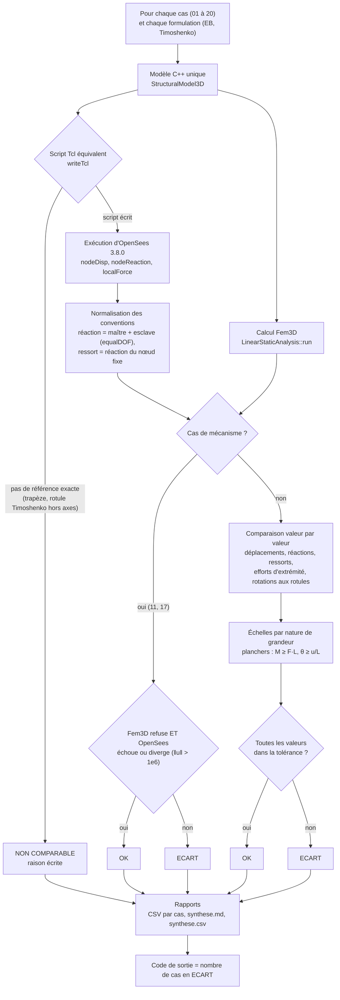

# C. Validation contre OpenSees

D'après le programme de comparaison
[opensees_benchmarks.cpp](https://github.com/ChristinotLeonnel/TSA-3D-FEM-Engine/blob/75700d2bfd33c29b2fadc795fd3051f25399ad19/benchmarks/OpenSees/opensees_benchmarks.cpp)
(fonction `main`). Tolérance fixée avant les essais : écart absolu ≤ max(1e-6 × réf, 1e-9 × échelle).

Résultats mesurés : [VALIDATION_OPENSEES.md](../validation/VALIDATION_OPENSEES.md). Méthode :
[SCIENTIFIC_VALIDATION_GUIDE.md](../validation/SCIENTIFIC_VALIDATION_GUIDE.md).
