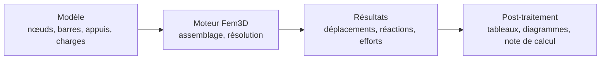

# Fem3D — moteur éléments finis 3D de poutres

Fem3D calcule les déplacements, les réactions et les efforts dans les ossatures de poutres et de poteaux en 3D, par la
méthode des déplacements. C'est une bibliothèque C++20 libre (licence MIT), validée contre OpenSees, et le moteur de
calcul 3D secondaire du logiciel TSA.

## Par où commencer ?

- **Je découvre** — vous n'avez jamais lu de code d'éléments finis :
  [niveau 0 : découverte](learning/level-00/index.md), puis le [parcours complet](learning/index.md).
- **J'étudie la méthode** — vous voulez comprendre les équations :
  [livre technique](book/Fem3D_Technical_Book.md), [théorie condensée](theory/THEORY.md).
- **Je veux l'utiliser** — compiler et lancer un premier calcul :
  [démarrage rapide](getting-started.md).
- **Je vérifie ou je recherche** — reproduire la validation, retrouver le code et les commits :
  [guide de validation](validation/SCIENTIFIC_VALIDATION_GUIDE.md), [traçabilité Git](traceability/GIT_TRACEABILITY.md).
- **Je contribue** — architecture, conventions, tests :
  [guide développeur](developer/DEVELOPER_GUIDE.md), [référence API](reference/API.md).

## En bref

| | |
|---|---|
| Formulations | poutres d'Euler–Bernoulli et de Timoshenko exactes (12 DDL), rotules My/Mz, appuis rigides et élastiques |
| Charges | nodales ; réparties linéaires sur toute la longueur, en repère local ou global |
| Analyse | statique linéaire ; diagnostic des mécanismes, avertissement des quasi-mécanismes |
| Validation | 49 tests ; 22 cas × 2 formulations contre OpenSees 3.8.0, 2 993 valeurs, 0 hors tolérance |
| Maturité | niveau 4 sur le périmètre qualifié ; niveau 5 (qualification dans TSA) **non atteint** — [détails](validation/MATURITY_LEVELS.md) |
| Non traité | non-linéarité, dynamique, gauchissement, treillis, couples concentrés sur barre — [limites](limitations/KNOWN_LIMITATIONS.md) |

Code source : [github.com/ChristinotLeonnel/TSA-3D-FEM-Engine](https://github.com/ChristinotLeonnel/TSA-3D-FEM-Engine).
