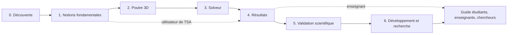

# Parcours d'apprentissage de Fem3D

Ce parcours mène progressivement de la découverte de Fem3D (moteur d'éléments finis 3D de poutres, écrit en C++20)
jusqu'à sa modification et à son prolongement en recherche. Il s'adresse aux étudiants (licence, master, école
d'ingénieurs), à leurs enseignants et aux chercheurs.

> **Niveaux pédagogiques et niveaux de maturité sont deux choses distinctes.** Les niveaux 0 à 6 ci-dessous mesurent
> ce que **le lecteur** a appris. Les niveaux de maturité 1 à 5 mesurent ce que **le moteur** a démontré (implémenté,
> vérifié, validé…) ; ils sont définis et attribués uniquement dans
> [../validation/QUALIFICATION.md](../validation/QUALIFICATION.md). Aucune page du parcours ne déclare de niveau de
> maturité.

## Les niveaux

| Niveau | Thème | Objectif | Durée indicative | Prérequis |
|---|---|---|---|---|
| [0](level-00/index.md) | Découverte | Savoir ce que fait Fem3D, où il se place dans TSA, et suivre un calcul de bout en bout. | 1 h | Aucun |
| [1](level-01/index.md) | Notions fondamentales | Décrire un modèle (nœuds, éléments, DDL, matériaux, sections, charges, appuis, repères, signes) et prévoir un premier résultat à la main. | 2 à 3 h | Statique, RDM de base (console, poutre sur appuis) |
| [2](level-02/index.md) | Poutre 3D | Comprendre les matrices de rigidité d'Euler–Bernoulli et de Timoshenko, la transformation de repère, et choisir une formulation. | 4 h | Niveau 1, calcul matriciel |
| [3](level-03/index.md) | Solveur | Comprendre l'assemblage, les conditions aux limites, les ressorts, la résolution et la détection des mécanismes. | 3 h | Niveau 2, systèmes linéaires |
| [4](level-04/index.md) | Résultats | Lire et contrôler réactions, déplacements, efforts internes, contraintes et diagrammes ; utiliser le post-traitement. | 3 h | Niveau 3 |
| [5](level-05/index.md) | Validation scientifique | Savoir comment le moteur est vérifié et validé (analytique, OpenSees, tolérances, invariances) et interpréter un écart. | 3 h | Niveau 4 |
| [6](level-06/index.md) | Développement et recherche | Modifier ou étendre le moteur proprement : architecture, ajout d'un élément ou d'une charge, tests, reproductibilité. | 6 h et plus | Niveau 5, C++ moderne |

Les durées sont indicatives : elles comprennent la lecture, l'exemple et l'exercice, mais pas la compilation du
projet.

## Le parcours

Deux raccourcis sont possibles : un utilisateur de TSA qui veut seulement comprendre les résultats peut passer du
niveau 1 au niveau 4 ; un enseignant trouvera des séquences de cours toutes prêtes dans le
[guide pour les étudiants, les enseignants et les chercheurs](../education/RESEARCH_AND_STUDENT_GUIDE.md).

## Par où commencer

- **Débutant** : commencez par le [niveau 0 — Découverte](level-00/index.md).
- **Vous connaissez déjà la méthode des éléments finis** : lisez le niveau 1 en diagonale (surtout les conventions
  de signe, qui diffèrent d'un logiciel à l'autre), puis le niveau 2.
- **Vous voulez contribuer au code** : niveaux 5 et 6, puis les règles du dépôt (`AGENTS.md`, `CONTRIBUTING.md`).

## Organisation de chaque page

Chaque niveau suit le même plan : objectif, prérequis, notions à connaître, contenu explicatif, diagramme, liens
vers le code source (permaliens à la révision
[75700d2](https://github.com/ChristinotLeonnel/TSA-3D-FEM-Engine/commit/75700d2bfd33c29b2fadc795fd3051f25399ad19),
qui a introduit tout le code de Fem3D), tests à lancer, exemple chiffré, exercice corrigé, critères de réussite,
« À retenir » et « Pour aller plus loin » (chapitres du livre).

Le parcours **résume et renvoie** : la théorie détaillée est dans [../theory/THEORY.md](../theory/THEORY.md), les
conventions dans [../theory/SIGN_CONVENTIONS.md](../theory/SIGN_CONVENTIONS.md), et le livre
([../book/chapters/01-presentation.md](../book/chapters/01-presentation.md) et suivants) développe chaque thème.

## Valeurs numériques

Tous les exemples utilisent le système d'unités des tests (kN, m, kN/m²) et les données de
[`tests/TestModels.h`](https://github.com/ChristinotLeonnel/TSA-3D-FEM-Engine/blob/75700d2bfd33c29b2fadc795fd3051f25399ad19/tests/TestModels.h#L19-L30) :
acier E = 210·10⁶ kN/m², G = 81·10⁶ kN/m², section rectangulaire 0,3 m × 0,5 m. Les valeurs ont été recalculées
indépendamment en Python (NumPy) et, chaque fois que c'est possible, rapprochées d'un test ou d'un cas OpenSees
existant.
