# Niveau 0 — Découverte

> Niveau **pédagogique** 0 sur 6 : il mesure ce que vous avez appris, pas la maturité du moteur (niveaux 1 à 5,
> définis dans [../../validation/QUALIFICATION.md](../../validation/QUALIFICATION.md)).

[Parcours](../index.md) · Niveau suivant : [1 — Notions fondamentales](../level-01/index.md)

## Objectif

Savoir ce que calcule Fem3D, ce qu'il ne calcule pas, où il se place dans TSA, et suivre les trois étapes d'un
calcul (modèle, solveur, post-traitement) sur un portique spatial.

## Prérequis

Aucun. Une première idée de ce qu'est une poutre, une force et un appui suffit.

## Notions à connaître

- **Structure à barres** (ossature) : poteaux et poutres reliés en des points appelés nœuds.
- **Statique linéaire** : charges appliquées une fois pour toutes, petits déplacements, matériau élastique.
- **Moteur de calcul** : programme qui reçoit un modèle et rend des résultats, sans interface graphique.

## Contenu explicatif

### Ce qu'est Fem3D

Fem3D est une **bibliothèque C++20** qui calcule des ossatures 3D de poutres et de poteaux en **statique linéaire**.
Elle ne dépend que d'Eigen (algèbre linéaire), d'aucune interface graphique. Elle propose deux formulations de
poutre à deux nœuds et douze degrés de liberté : **Euler–Bernoulli** (cisaillement négligé) et **Timoshenko**
(déformation de cisaillement prise en compte). Ses résultats sont exacts aux arrondis près pour des barres
prismatiques, car les deux éléments résolvent exactement l'équation de la poutre (niveau 2).

Fem3D **ne fait pas** : non-linéarité géométrique ou matérielle, flambement, dynamique, analyse modale, coques,
volumes, gauchissement de torsion, charges ponctuelles ou partielles sur une barre. La liste complète est dans
[../../limitations/KNOWN_LIMITATIONS.md](../../limitations/KNOWN_LIMITATIONS.md).

### Sa place dans TSA

TSA (Tsaraloha Structural Analysis) est un logiciel de modélisation de structures qui délègue le calcul à des
moteurs. **OpenSees reste le moteur 3D par défaut** ; Fem3D y est enregistré comme **moteur secondaire** `fem3d`, sur
un périmètre restreint (ossatures d'Euler–Bernoulli, rotules My et Mz, appuis rigides et élastiques, charges
nodales et réparties sur toute la longueur). Hors de ce périmètre, TSA refuse le calcul avec la raison, ou le
confie à OpenSees si l'utilisateur l'a choisi : voir [../../INTEGRATION_TSA.md](../../INTEGRATION_TSA.md) et le
diagramme [../../diagrams/selection-moteur-tsa.md](../../diagrams/selection-moteur-tsa.md). Fem3D ne connaît pas
TSA : c'est TSA qui l'appelle par un adaptateur.

### Modèle, solveur, post-traitement

1. **Modèle** (`StructuralModel3D`) : des données seulement — nœuds, matériaux, sections, éléments, appuis, ressorts,
   cas de charge. Aucune équation.
2. **Solveur** (`LinearStaticAnalysis`) : contrôle le modèle, crée les éléments finis, assemble la matrice de
   rigidité, la factorise une fois, puis résout chaque cas de charge et vérifie l'équilibre global.
3. **Post-traitement** : le moteur exporte un fichier JSON versionné (`tsa-fem3d-results/1`,
   [../../RESULTS_FORMAT.md](../../RESULTS_FORMAT.md)). Le sous-projet séparé `postprocessor/` (Qt) le lit et produit
   tableaux CSV, diagrammes SVG et note de calcul HTML/PDF. Il ne dépend pas du moteur.

```mermaid
flowchart LR
    M["Modèle : nœuds, éléments, appuis, charges"] --> V["Contrôle des données"]
    V --> K["Assemblage de K et factorisation"]
    K --> S["Résolution par cas de charge"]
    S --> R["Réactions, déplacements, efforts, contraintes"]
    R --> E["Contrôle d'équilibre global"]
    E --> J["Fichier JSON tsa-fem3d-results/1"]
    J --> P["Post-traitement : CSV, SVG, note de calcul"]
```



Le déroulement détaillé, avec les branches d'erreur, est dans [../../diagrams/calcul.md](../../diagrams/calcul.md) ;
l'architecture générale dans [../../diagrams/architecture.md](../../diagrams/architecture.md).

### Un exemple : le portique spatial

Le programme d'exemple du dépôt construit un portique : quatre poteaux encastrés en pied, de hauteurs 3,0 m, 3,5 m,
4,0 m et 3,2 m, reliés en tête par quatre poutres formant un quadrilatère irrégulier. Il le calcule en Timoshenko
sous deux cas de charge et écrit le fichier `examples/output/portique_spatial_resultats.json` :

- **G** : charge verticale de 12 kN/m (repère global, vers −Z) sur les quatre poutres ;
- **W** : vent selon X, force nodale de 18 kN en tête du premier poteau, plus une pression croissante de 3 à 5 kN/m
  le long de ce poteau.

## Dans le code source

| Rôle | Lien |
|---|---|
| Programme d'exemple (portique spatial) | [`examples/fem3d_example.cpp`, `main`](https://github.com/ChristinotLeonnel/TSA-3D-FEM-Engine/blob/75700d2bfd33c29b2fadc795fd3051f25399ad19/examples/fem3d_example.cpp#L13-L54) |
| Résultats versionnés de l'exemple | [`examples/output/portique_spatial_resultats.json`](https://github.com/ChristinotLeonnel/TSA-3D-FEM-Engine/blob/75700d2bfd33c29b2fadc795fd3051f25399ad19/examples/output/portique_spatial_resultats.json) |
| Le modèle (données) | [`class StructuralModel3D`](https://github.com/ChristinotLeonnel/TSA-3D-FEM-Engine/blob/75700d2bfd33c29b2fadc795fd3051f25399ad19/include/Fem3D/Model/StructuralModel3D.h#L34-L74) |
| Le calcul : contrôle, assemblage, factorisation | [`LinearStaticAnalysis::LinearStaticAnalysis`](https://github.com/ChristinotLeonnel/TSA-3D-FEM-Engine/blob/75700d2bfd33c29b2fadc795fd3051f25399ad19/src/Analysis/LinearStaticAnalysis.cpp#L14-L33) |
| Le calcul d'un cas de charge | [`LinearStaticAnalysis::run`](https://github.com/ChristinotLeonnel/TSA-3D-FEM-Engine/blob/75700d2bfd33c29b2fadc795fd3051f25399ad19/src/Analysis/LinearStaticAnalysis.cpp#L40-L115) |
| Export JSON | [`resultsToJson`](https://github.com/ChristinotLeonnel/TSA-3D-FEM-Engine/blob/75700d2bfd33c29b2fadc795fd3051f25399ad19/src/Results/ResultsJsonWriter.cpp#L78-L78) |
| Post-traitement (lecture du JSON) | [`postprocessor/include/fem3dpost/ResultsReader.h`](https://github.com/ChristinotLeonnel/TSA-3D-FEM-Engine/blob/75700d2bfd33c29b2fadc795fd3051f25399ad19/postprocessor/include/fem3dpost/ResultsReader.h#L22-L22) |
| Moteur `fem3d` dans TSA | [`class Fem3DEngine`](https://github.com/ChristinotLeonnel/Tsaraloha-Structural-Analysis/blob/2f5d7d4342e903fe536fbab91a7dcf80e8b89f7d/src/Analysis/Engines/Fem3D/Fem3DEngine.h#L23-L57) (dépôt TSA) |

## Vérifier par les tests

Après compilation (voir le `README.md` du dépôt : CMake ≥ 3.21, compilateur C++20) :

```bat
build\fem3d_tests.exe
build\fem3d_example.exe sortie.json
```

Le premier programme lance les 41 tests du moteur et affiche une ligne `[PASS]` ou `[FAIL]` par test, puis
`RESULTATS : 41 / 41 tests reussis` (résultat obtenu le 19/10/2026). Deux tests concernent directement ce niveau :

- [`Integration_SpatialFrame_EquilibriumAndMeshInvariance`](https://github.com/ChristinotLeonnel/TSA-3D-FEM-Engine/blob/75700d2bfd33c29b2fadc795fd3051f25399ad19/tests/integration/test_frames.cpp#L77-L92) : un portique du même type est en équilibre global ;
- [`Integration_ResultsJsonFormat`](https://github.com/ChristinotLeonnel/TSA-3D-FEM-Engine/blob/75700d2bfd33c29b2fadc795fd3051f25399ad19/tests/integration/test_frames.cpp#L169-L180) : le fichier JSON porte le format, la version du moteur et aucune valeur non finie.

Le second programme recalcule l'exemple et affiche, pour chaque cas, les résidus d'équilibre |ΣF| et |ΣM|.

## Exemple

Le contrôle d'équilibre compare la résultante des charges appliquées à celle des réactions. On peut le refaire à la
main, à partir des données de l'exemple, et le comparer au fichier JSON versionné.

**Cas G.** Les quatre poutres relient les têtes de poteaux (0 ; 0 ; 3), (6 ; 0 ; 3,5), (6,5 ; 4 ; 4) et
(−0,5 ; 4,5 ; 3,2). Leur longueur totale vaut 21,6782 m (somme des quatre distances). La charge totale vaut donc
12 × 21,6782 = **260,139 kN** vers le bas. Le fichier JSON indique `appliedForce` = (0 ; 0 ; −260,1385) et une
réaction totale de +260,1385 kN.

**Cas W.** Résultante : 18 + (3 + 5)/2 × 3 = **30 kN** selon X. Moment autour de Y par rapport à l'origine : la force
nodale agit à z = 3 m, soit 3 × 18 = 54 kN·m ; la charge trapézoïdale donne ∫₀³ s q(s) ds = L² (q₁/6 + q₂/3) =
9 × (0,5 + 1,6667) = 19,5 kN·m ; total **73,5 kN·m**. Le JSON indique `appliedForce` = (30 ; 0 ; 0) et
`appliedMoment` = (0 ; 73,5 ; 0).

Les résidus d'équilibre du fichier sont de l'ordre de 10⁻¹⁴ à 10⁻¹³ (kN, kN·m) : la précision machine.

## Exercice

1. Citez trois analyses que Fem3D ne sait pas faire.
2. Dans TSA, quel moteur calcule par défaut un modèle 3D ? Que se passe-t-il si le modèle contient une charge
   ponctuelle au milieu d'une poutre et que l'utilisateur a choisi le moteur `fem3d` sans secours ?
3. Le post-traitement a-t-il besoin du code du moteur pour fonctionner ?

### Corrigé

1. Par exemple : flambement (ou second ordre P-Δ), analyse modale, dynamique, plasticité, coques, gauchissement
   de torsion.
2. OpenSees. La charge ponctuelle sur barre est hors du périmètre de Fem3D : le calcul est refusé, avec la raison
   (secours `none`, réglage par défaut). Avec le secours `opensees`, il est confié à OpenSees, ce qui est annoncé, et
   les résultats portent l'identité d'OpenSees.
3. Non : il ne lit que le fichier JSON au format `tsa-fem3d-results/1`.

## Critères de réussite

- Vous savez expliquer en deux phrases ce que fait Fem3D et ce qu'il ne fait pas.
- Vous savez nommer les trois étapes d'un calcul et la classe qui porte chacune.
- Vous avez retrouvé à la main la résultante de 30 kN et le moment de 73,5 kN·m du cas W.

## À retenir

- Fem3D : poutres 3D, statique linéaire, Euler–Bernoulli ou Timoshenko, résultats exacts pour des barres
  prismatiques.
- Dans TSA, c'est un moteur **secondaire** ; OpenSees reste le moteur par défaut.
- Modèle (données) → solveur (calcul et contrôle d'équilibre) → fichier JSON → post-traitement indépendant.

## Pour aller plus loin

- Livre : [01 — Présentation](../../book/chapters/01-presentation.md),
  [18 — Intégration dans TSA et OpenSees](../../book/chapters/18-integration-tsa-opensees.md).
- Documentation : [../../ARCHITECTURE.md](../../ARCHITECTURE.md), [../../INTEGRATION_TSA.md](../../INTEGRATION_TSA.md).

---

[Parcours](../index.md) · Niveau suivant : [1 — Notions fondamentales](../level-01/index.md)
