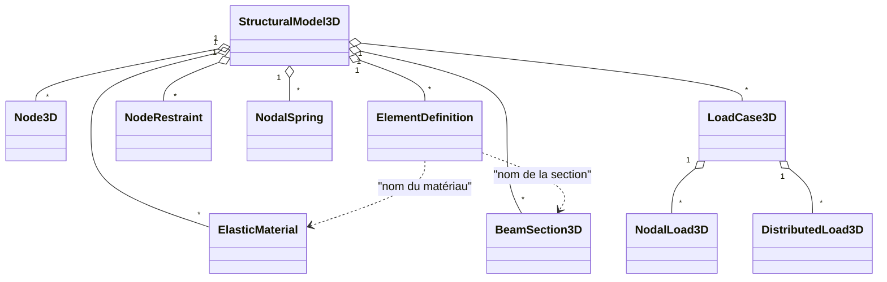

# Niveau 1 — Notions fondamentales

> Niveau **pédagogique** 1 sur 6 : il mesure ce que vous avez appris, pas la maturité du moteur (niveaux 1 à 5,
> définis dans [../../validation/QUALIFICATION.md](../../validation/QUALIFICATION.md)).

[Parcours](../index.md) · Niveau précédent : [0 — Découverte](../level-00/index.md) · Niveau suivant :
[2 — Poutre 3D](../level-02/index.md)

## Objectif

Savoir décrire un modèle Fem3D complet et prévoir à la main, avec les bons signes, le résultat d'un cas simple :
la console chargée en bout.

## Prérequis

[Niveau 0](../level-00/index.md). Statique (équilibre des forces et des moments) et résistance des matériaux de
base : flèche d'une console, moment d'encastrement.

## Notions à connaître

Nœud, élément, degré de liberté (DDL), matériau, section, charge nodale et répartie, appui, repère global et repère
local, convention de signe, système d'unités cohérent.

## Contenu explicatif

### Nœuds et degrés de liberté

Un **nœud** est un point de l'espace repéré par un identifiant entier choisi par l'utilisateur. Chaque nœud porte
**six DDL**, toujours dans cet ordre : trois translations Ux, Uy, Uz et trois rotations Rx, Ry, Rz (repère global,
règle de la main droite). En interne, le DDL global vaut `g = 6 × indice + rang`, où l'indice est la **position du
nœud dans le modèle** (ordre d'ajout), jamais son identifiant.

### Éléments

Un **élément** relie un nœud i à un nœud j. Il a donc 12 DDL : `[u v w θx θy θz]` en i puis en j, exprimés dans son
repère local. Chaque élément choisit sa formulation (Euler–Bernoulli par défaut, ou Timoshenko), son matériau et sa
section par leur nom, et peut porter des rotules My et Mz à ses extrémités.

### Matériaux et sections

- **Matériau élastique** : module d'Young E et module de cisaillement G. `ElasticMaterial::fromPoisson` calcule
  G = E / (2 (1 + ν)).
- **Section** constante le long de la barre : aire A, moments quadratiques Iy et Iz, constante de torsion J ; aires de
  cisaillement Asy et Asz, exigées par Timoshenko ; facultativement, distances des fibres extrêmes et module de
  torsion Wt pour les contraintes. `BeamSection3D::rectangle(b, h)` remplit tout : b selon y local, h selon z local,
  Iy = b h³/12, Iz = h b³/12, As = 5/6 A.

### Repères

- **Repère global** (X, Y, Z) : direct, sans direction privilégiée (la gravité est une charge comme une autre).
- **Repère local** d'une barre : x va de i vers j ; y = (v_xz × x)/‖v_xz × x‖ ; z = x × y, où v_xz est un vecteur
  du plan local x-z, comme dans `geomTransf` d'OpenSees. Par défaut v_xz = Z global, ou −X pour une barre verticale.
  Une barre selon +X a donc y = Y et z = Z ; un poteau selon +Z a y = Y et z = −X.
- **Iz** gouverne la flexion dans le plan x-y, **Iy** celle dans le plan x-z.

### Charges et appuis

- **Charge nodale** : force (Fx, Fy, Fz) et moment (Mx, My, Mz) en repère global.
- **Charge répartie** : linéaire de q(0) à q(L) sur **toute** la longueur, par unité de longueur réelle, en repère
  local ou global (projetée par q_local = R q_global). Elle n'est jamais remplacée par une charge nodale approchée.
- **Appui** : chaque DDL d'un nœud est libre ou imposé (valeur 0, ou déplacement imposé non nul).
  `NodeRestraint::fullyFixed` bloque les six DDL ; `pinned` bloque les trois translations.
- **Ressort** (appui élastique) : une raideur par DDL, en axes globaux (niveau 3).

### Signes et unités

| Grandeur | Signe positif |
|---|---|
| Déplacements, rotations nodales | selon les axes globaux (main droite) |
| Réactions | force exercée **par l'appui sur la structure**, repère global |
| N | traction |
| Vy, Vz, T, My, Mz | sur la face positive de la coupe (normale +x local), selon les axes locaux |

Attention : en flexion dans le plan x-z, θy = −dw/dx (main droite). Une console selon X chargée par +Fz en bout a
donc une rotation θy **négative** et un moment My(x) = −F (L − x).

Le moteur **ne convertit aucune unité** : toutes les données doivent être dans un même système cohérent (kN, m,
kN/m² dans les tests ; N, mm, N/mm² conviendrait aussi). Détails :
[../../theory/SIGN_CONVENTIONS.md](../../theory/SIGN_CONVENTIONS.md) et
[../../theory/UNITS_AND_COORDINATES.md](../../theory/UNITS_AND_COORDINATES.md).



## Dans le code source

| Notion | Lien |
|---|---|
| Ordre des DDL | [`enum class Dof`](https://github.com/ChristinotLeonnel/TSA-3D-FEM-Engine/blob/75700d2bfd33c29b2fadc795fd3051f25399ad19/include/Fem3D/Core/Types.h#L28-L36) |
| Nœud | [`struct Node3D`](https://github.com/ChristinotLeonnel/TSA-3D-FEM-Engine/blob/75700d2bfd33c29b2fadc795fd3051f25399ad19/include/Fem3D/Geometry/Node3D.h#L10-L14) |
| Définition d'élément | [`struct ElementDefinition`](https://github.com/ChristinotLeonnel/TSA-3D-FEM-Engine/blob/75700d2bfd33c29b2fadc795fd3051f25399ad19/include/Fem3D/Model/StructuralModel3D.h#L22-L32) |
| Matériau | [`struct ElasticMaterial`](https://github.com/ChristinotLeonnel/TSA-3D-FEM-Engine/blob/75700d2bfd33c29b2fadc795fd3051f25399ad19/include/Fem3D/Materials/ElasticMaterial.h#L11-L22), [`fromPoisson`](https://github.com/ChristinotLeonnel/TSA-3D-FEM-Engine/blob/75700d2bfd33c29b2fadc795fd3051f25399ad19/src/Materials/ElasticMaterial.cpp#L10-L15) |
| Section | [`struct BeamSection3D`](https://github.com/ChristinotLeonnel/TSA-3D-FEM-Engine/blob/75700d2bfd33c29b2fadc795fd3051f25399ad19/include/Fem3D/Sections/BeamSection3D.h#L18-L40), [`rectangle`](https://github.com/ChristinotLeonnel/TSA-3D-FEM-Engine/blob/75700d2bfd33c29b2fadc795fd3051f25399ad19/src/Sections/BeamSection3D.cpp#L23-L45) |
| Charges | [`NodalLoad3D`](https://github.com/ChristinotLeonnel/TSA-3D-FEM-Engine/blob/75700d2bfd33c29b2fadc795fd3051f25399ad19/include/Fem3D/Loads/Loads3D.h#L15-L20), [`DistributedLoad3D`](https://github.com/ChristinotLeonnel/TSA-3D-FEM-Engine/blob/75700d2bfd33c29b2fadc795fd3051f25399ad19/include/Fem3D/Loads/Loads3D.h#L31-L37), [`LoadCase3D`](https://github.com/ChristinotLeonnel/TSA-3D-FEM-Engine/blob/75700d2bfd33c29b2fadc795fd3051f25399ad19/include/Fem3D/Loads/Loads3D.h#L39-L45) |
| Appuis et ressorts | [`NodeRestraint`](https://github.com/ChristinotLeonnel/TSA-3D-FEM-Engine/blob/75700d2bfd33c29b2fadc795fd3051f25399ad19/include/Fem3D/Constraints/BoundaryConditions.h#L13-L22), [`NodalSpring`](https://github.com/ChristinotLeonnel/TSA-3D-FEM-Engine/blob/75700d2bfd33c29b2fadc795fd3051f25399ad19/include/Fem3D/Constraints/BoundaryConditions.h#L27-L31) |
| Repère local | [`LocalCoordinateSystem3D::LocalCoordinateSystem3D`](https://github.com/ChristinotLeonnel/TSA-3D-FEM-Engine/blob/75700d2bfd33c29b2fadc795fd3051f25399ad19/src/Geometry/LocalCoordinateSystem3D.cpp#L11-L42) |
| Contrôle des données | [`StructuralModel3D::validate`](https://github.com/ChristinotLeonnel/TSA-3D-FEM-Engine/blob/75700d2bfd33c29b2fadc795fd3051f25399ad19/src/Model/StructuralModel3D.cpp#L113-L158) |
| Numérotation des DDL | [`DofMap::DofMap`](https://github.com/ChristinotLeonnel/TSA-3D-FEM-Engine/blob/75700d2bfd33c29b2fadc795fd3051f25399ad19/src/Assembly/Assembly.cpp#L9-L30) |

## Vérifier par les tests

```bat
build\fem3d_tests.exe | findstr "Analytical_CantileverTipLoad LocalAxes_ Input_"
```

Le programme exécute toujours les 41 tests ; `findstr` ne fait que filtrer l'affichage.

- [`Analytical_CantileverTipLoad_BothPlanesBothFormulations`](https://github.com/ChristinotLeonnel/TSA-3D-FEM-Engine/blob/75700d2bfd33c29b2fadc795fd3051f25399ad19/tests/analytical/test_analytical.cpp#L75-L100) : flèches, rotations (avec θy = −dw/dx) et efforts de la console dans les deux plans ;
- [`LocalAxes_HorizontalVerticalInclined`](https://github.com/ChristinotLeonnel/TSA-3D-FEM-Engine/blob/75700d2bfd33c29b2fadc795fd3051f25399ad19/tests/unit/test_geometry_and_elements.cpp#L40-L53) : repères locaux d'une barre horizontale, verticale et inclinée ;
- [`LocalAxes_DegenerateGeometryRejected`](https://github.com/ChristinotLeonnel/TSA-3D-FEM-Engine/blob/75700d2bfd33c29b2fadc795fd3051f25399ad19/tests/unit/test_geometry_and_elements.cpp#L55-L63) : longueur nulle et v_xz parallèle refusés ;
- [`Input_InvalidPropertiesRejected`](https://github.com/ChristinotLeonnel/TSA-3D-FEM-Engine/blob/75700d2bfd33c29b2fadc795fd3051f25399ad19/tests/unit/test_geometry_and_elements.cpp#L121-L134) : E ≤ 0, J nul, Timoshenko sans aire de cisaillement et identifiant en double refusés.

## Exemple

Console selon X, L = 3 m, encastrée au nœud 1, section 0,3 × 0,5 m, E = 210·10⁶ kN/m², force **Fz = −20 kN** au
nœud 2 (vers le bas). C'est le cas OpenSees 03 et le modèle du test `Analytical_CantileverTipLoad_…`.

- Iy = 0,3 × 0,5³/12 = 3,125·10⁻³ m⁴, E Iy = 656 250 kN·m².
- Flèche : w = F L³/(3 E Iy) = −20 × 27/(3 × 656 250) = **−2,742857·10⁻⁴ m**.
- Rotation : θy = −F L²/(2 E Iy) = **+1,371429·10⁻⁴ rad** (positive, car θy = −dw/dx et w décroît).
- Réactions au nœud 1 (exercées par l'appui) : Fz = **+20 kN** ; le moment de la charge par rapport à l'origine vaut
  (3 ; 0 ; 0) × (0 ; 0 ; −20) = (0 ; +60 ; 0), donc My = **−60 kN·m**.
- Efforts internes : Vz = F = **−20 kN** sur toute la barre, My(x) = −F (L − x), soit **+60 kN·m** à l'encastrement.

Le fichier versionné `benchmarks/OpenSees/results/03_flexion_y_euler_bernoulli_comparaison.csv` donne, pour Fem3D et
pour OpenSees : Uz = −2,7428571428571…·10⁻⁴, Ry = +1,3714285714285…·10⁻⁴, réaction Fz = +20, réaction My = −60.

## Exercice

Même console, mais avec une force **Fy = +20 kN** en bout (cas OpenSees 04).

1. Quelle inertie intervient ? Calculez-la.
2. Calculez la flèche v et la rotation θz au nœud 2.
3. Donnez les réactions Fy et Mz au nœud 1, puis Vy et Mz(0).
4. Le nœud 2 est le deuxième nœud ajouté au modèle. Quel est le numéro global du DDL Rz de ce nœud ?

### Corrigé

1. Flexion dans le plan x-y : Iz = 0,5 × 0,3³/12 = 1,125·10⁻³ m⁴ ; E Iz = 236 250 kN·m².
2. v = F L³/(3 E Iz) = 540/708 750 = **7,619·10⁻⁴ m** ; θz = F L²/(2 E Iz) = 180/472 500 = **3,810·10⁻⁴ rad**
   (dans ce plan, θz = +dv/dx : pas de signe moins).
3. Fy = **−20 kN** ; moment de la charge : (3 ; 0 ; 0) × (0 ; 20 ; 0) = (0 ; 0 ; 60), donc Mz = **−60 kN·m**.
   Vy = **+20 kN** et Mz(0) = +F L = **+60 kN·m** (convention : Mz(x) = +F (L − x)).
4. Indice interne 1, rang 5 : g = 6 × 1 + 5 = **11**.

## Critères de réussite

- Vous trouvez la flèche et la rotation de la console avec le bon signe dans les deux plans.
- Vous distinguez réaction (exercée par l'appui) et effort interne (face positive de la coupe).
- Vous savez pourquoi θy = −dw/dx alors que θz = +dv/dx.

## À retenir

- 6 DDL par nœud (Ux Uy Uz Rx Ry Rz), 12 par élément ; numéro global = 6 × indice interne + rang.
- Repère local : x de i vers j, y = v_xz × x normé, z = x × y ; Iz pour le plan x-y, Iy pour le plan x-z.
- Unités cohérentes choisies par l'utilisateur : le moteur ne convertit rien.

## Pour aller plus loin

- Livre : [03 — Modèle physique](../../book/chapters/03-modele-physique.md),
  [04 — Repères](../../book/chapters/04-reperes.md),
  [05 — Unités et signes](../../book/chapters/05-unites-signes.md),
  [09 — Matériaux et sections](../../book/chapters/09-materiaux-sections.md),
  [10 — Charges et conditions aux limites](../../book/chapters/10-charges-conditions-limites.md).
- Diagramme des DDL et repères : [../../diagrams/elements-poutre.md](../../diagrams/elements-poutre.md).

---

[Parcours](../index.md) · Niveau précédent : [0 — Découverte](../level-00/index.md) · Niveau suivant :
[2 — Poutre 3D](../level-02/index.md)
