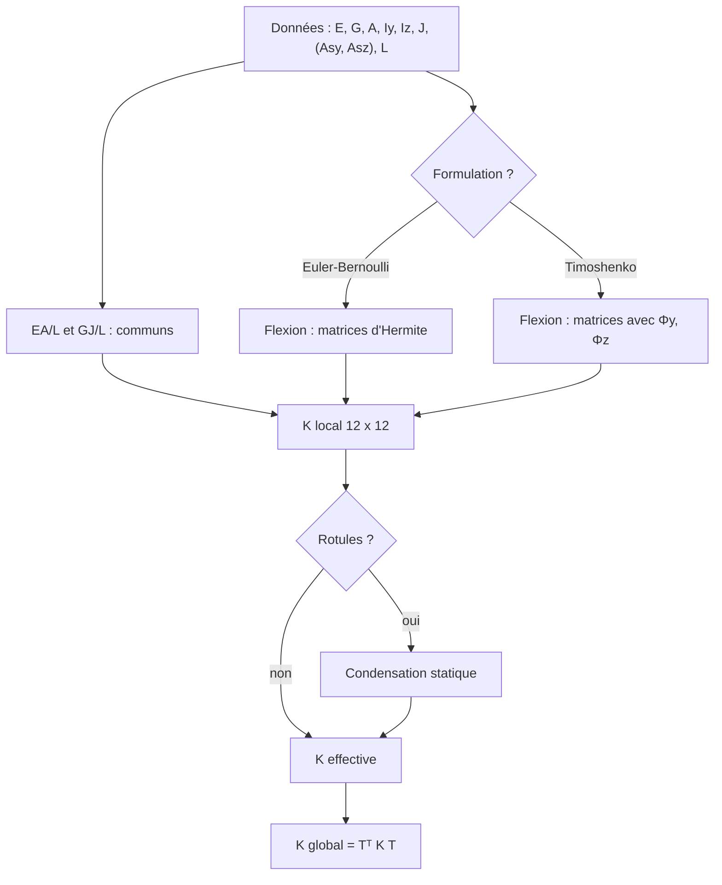

# Niveau 2 — Poutre 3D : Euler–Bernoulli et Timoshenko

> Niveau **pédagogique** 2 sur 6 : il mesure ce que vous avez appris, pas la maturité du moteur (niveaux 1 à 5,
> définis dans [../../validation/QUALIFICATION.md](../../validation/QUALIFICATION.md)).

[Parcours](../index.md) · Niveau précédent : [1 — Notions fondamentales](../level-01/index.md) · Niveau suivant :
[3 — Solveur](../level-03/index.md)

## Objectif

Comprendre comment est construite la matrice de rigidité 12 × 12 d'une poutre 3D dans ses deux formulations, comment
elle passe du repère local au repère global, et savoir quand le choix de la formulation change le résultat.

## Prérequis

[Niveau 1](../level-01/index.md). Produit matriciel, matrice inverse, notion de fonction de forme.

## Notions à connaître

Matrice de rigidité élémentaire, fonctions de forme d'Hermite, déformation de cisaillement, paramètre Φ,
verrouillage en cisaillement, matrice de rotation R et de transformation T.

## Contenu explicatif

### Quatre comportements découplés

Dans le repère local, une poutre prismatique dont les axes principaux sont y et z se décompose en quatre problèmes
indépendants, assemblés dans la matrice 12 × 12 :

| Comportement | DDL locaux (rangs) | Rigidité |
|---|---|---|
| Traction-compression | u_i, u_j (0, 6) | E A / L |
| Torsion de Saint-Venant | θx_i, θx_j (3, 9) | G J / L, sans gauchissement |
| Flexion dans le plan x-y | v, θz (1, 5, 7, 11) | gouvernée par E Iz |
| Flexion dans le plan x-z | w, θy (2, 4, 8, 10) | gouvernée par E Iy |

Les deux premiers termes sont communs aux deux formulations (`BeamElementBase::addAxialAndTorsion`). Seule la flexion
diffère.

### Euler–Bernoulli

Les sections restent planes et normales à la ligne moyenne : le cisaillement transversal est négligé. Avec les
cubiques d'Hermite, on obtient pour le plan x-z, dans l'ordre (w_i, θy_i, w_j, θy_j) :

$$
k_{xz} = \frac{E I_y}{L^3}
\begin{bmatrix}
12 & -6L & -12 & -6L \\
-6L & 4L^2 & 6L & 2L^2 \\
-12 & 6L & 12 & 6L \\
-6L & 2L^2 & 6L & 4L^2
\end{bmatrix}
$$

Le plan x-y a la même matrice avec E Iz et des termes croisés v-θz de signe opposé (+6L), parce que θz = +dv/dx
alors que θy = −dw/dx. Pour une barre prismatique, cette rigidité est **exacte** : un seul élément donne la solution
exacte aux nœuds.

### Timoshenko

On ajoute la déformation de cisaillement γ = V/(G As). Fem3D utilise l'élément **exact à interpolation
interdépendante**, en forme fermée, avec le paramètre

$$
\Phi_z = \frac{12\,E I_y}{G A_{sz} L^2} \qquad (\text{plan } x\text{-}z), \qquad
\Phi_y = \frac{12\,E I_z}{G A_{sy} L^2} \qquad (\text{plan } x\text{-}y).
$$

La matrice est celle d'Euler–Bernoulli divisée par (1 + Φ), avec (4 + Φ) L² et (2 − Φ) L² à la place de 4 L² et
2 L². Quand Φ → 0, on retrouve exactement Euler–Bernoulli : **pas de verrouillage en cisaillement**, donc pas
d'intégration réduite. Les fonctions de forme sont elles aussi exactes ; elles servent au calcul des charges
réparties (niveau 3). Formules complètes : [../../theory/THEORY.md](../../theory/THEORY.md) §2 et §3.

### Du repère local au repère global

La matrice de rotation R (3 × 3) a pour lignes les axes locaux x, y, z exprimés en global : `a_local = R a_global`.
La transformation de l'élément est T = diag(R, R, R, R) (12 × 12), et

$$
d_{local} = T\, d_{global}, \qquad K_{global} = T^{\mathsf T} K_{local}\, T, \qquad f_{global} = T^{\mathsf T} f_{local}.
$$

Si l'élément a des rotules, la matrice locale est d'abord condensée (`effectiveLocalStiffnessMatrix`, niveau 3).



### Comparer les deux formulations

Pour une console chargée en bout, la flèche de Timoshenko vaut celle d'Euler–Bernoulli multipliée par (1 + Φ/4).
Timoshenko n'est donc **pas « toujours meilleur »** : il n'apporte quelque chose que pour les barres courtes ou peu
rigides en cisaillement, et seulement si les aires effectives Asy, Asz sont correctes. Pour une poutre élancée, les
deux coïncident. Pour une poutre très courte (L/h < 1) ou une section mince à fort gauchissement, aucune des deux
théories ne suffit (coques ou volumes). Dans TSA, Timoshenko n'est pas exposé
([../../validation/QUALIFICATION.md](../../validation/QUALIFICATION.md) §2).

## Dans le code source

| Notion | Lien |
|---|---|
| Interface commune d'un élément | [`class IBeamElement3D`](https://github.com/ChristinotLeonnel/TSA-3D-FEM-Engine/blob/75700d2bfd33c29b2fadc795fd3051f25399ad19/include/Fem3D/Elements/IBeamElement3D.h#L35-L64) |
| Termes communs EA/L et GJ/L | [`BeamElementBase::addAxialAndTorsion`](https://github.com/ChristinotLeonnel/TSA-3D-FEM-Engine/blob/75700d2bfd33c29b2fadc795fd3051f25399ad19/src/Elements/BeamElements.cpp#L24-L31) |
| Rigidité d'Euler–Bernoulli | [`EulerBernoulli3D::localStiffnessMatrix`](https://github.com/ChristinotLeonnel/TSA-3D-FEM-Engine/blob/75700d2bfd33c29b2fadc795fd3051f25399ad19/src/Elements/BeamElements.cpp#L37-L60) |
| Fonctions de forme d'Hermite | [`EulerBernoulli3D::shapeFunctions`](https://github.com/ChristinotLeonnel/TSA-3D-FEM-Engine/blob/75700d2bfd33c29b2fadc795fd3051f25399ad19/src/Elements/BeamElements.cpp#L62-L75) |
| Paramètre Φ | [`Timoshenko3D::shearParameterY`](https://github.com/ChristinotLeonnel/TSA-3D-FEM-Engine/blob/75700d2bfd33c29b2fadc795fd3051f25399ad19/src/Elements/BeamElements.cpp#L91-L95) |
| Rigidité de Timoshenko | [`Timoshenko3D::localStiffnessMatrix`](https://github.com/ChristinotLeonnel/TSA-3D-FEM-Engine/blob/75700d2bfd33c29b2fadc795fd3051f25399ad19/src/Elements/BeamElements.cpp#L103-L134) |
| Fonctions de forme interdépendantes | [`Timoshenko3D::shapeFunctions`](https://github.com/ChristinotLeonnel/TSA-3D-FEM-Engine/blob/75700d2bfd33c29b2fadc795fd3051f25399ad19/src/Elements/BeamElements.cpp#L136-L155) |
| Rigidité effective (rotules) | [`IBeamElement3D::effectiveLocalStiffnessMatrix`](https://github.com/ChristinotLeonnel/TSA-3D-FEM-Engine/blob/75700d2bfd33c29b2fadc795fd3051f25399ad19/src/Elements/BeamElements.cpp#L13-L16) |
| K global = Tᵀ K T | [`IBeamElement3D::globalStiffnessMatrix`](https://github.com/ChristinotLeonnel/TSA-3D-FEM-Engine/blob/75700d2bfd33c29b2fadc795fd3051f25399ad19/src/Elements/BeamElements.cpp#L18-L22) |
| Repère local et T | [`LocalCoordinateSystem3D`](https://github.com/ChristinotLeonnel/TSA-3D-FEM-Engine/blob/75700d2bfd33c29b2fadc795fd3051f25399ad19/src/Geometry/LocalCoordinateSystem3D.cpp#L11-L42), [`transformation`](https://github.com/ChristinotLeonnel/TSA-3D-FEM-Engine/blob/75700d2bfd33c29b2fadc795fd3051f25399ad19/src/Geometry/LocalCoordinateSystem3D.cpp#L44-L49) |

## Vérifier par les tests

```bat
build\fem3d_tests.exe | findstr "Element_ Timoshenko Integration_InclinedCantilever"
```

- [`Element_ExplicitStiffnessTerms`](https://github.com/ChristinotLeonnel/TSA-3D-FEM-Engine/blob/75700d2bfd33c29b2fadc795fd3051f25399ad19/tests/unit/test_geometry_and_elements.cpp#L95-L111) : EA/L, GJ/L, 12EI/L³, ±6EI/L², Φy, (4 + Φ)EI/((1 + Φ)L) ;
- [`Element_SymmetryAndRigidBodyModes`](https://github.com/ChristinotLeonnel/TSA-3D-FEM-Engine/blob/75700d2bfd33c29b2fadc795fd3051f25399ad19/tests/unit/test_geometry_and_elements.cpp#L65-L82) : symétrie, six modes de corps rigide sans effort, aucune valeur propre négative ;
- [`Element_TimoshenkoTendsToEulerBernoulli`](https://github.com/ChristinotLeonnel/TSA-3D-FEM-Engine/blob/75700d2bfd33c29b2fadc795fd3051f25399ad19/tests/unit/test_geometry_and_elements.cpp#L84-L93) : Φ → 0 redonne la matrice et les fonctions de forme d'Euler–Bernoulli ;
- [`Analytical_TimoshenkoDeepBeam_NoShearLocking`](https://github.com/ChristinotLeonnel/TSA-3D-FEM-Engine/blob/75700d2bfd33c29b2fadc795fd3051f25399ad19/tests/analytical/test_analytical.cpp#L164-L188) : poutre courte exacte avec 1 ou 10 éléments, écart < 0,01 % à L/h = 100 ;
- [`Timoshenko_DistinctShearAreasPerPlane`](https://github.com/ChristinotLeonnel/TSA-3D-FEM-Engine/blob/75700d2bfd33c29b2fadc795fd3051f25399ad19/tests/analytical/test_audit_gaps.cpp#L85-L95) : Asy ≠ Asz traités chacun dans son plan ;
- [`Integration_InclinedCantilever_OrientationInvariance`](https://github.com/ChristinotLeonnel/TSA-3D-FEM-Engine/blob/75700d2bfd33c29b2fadc795fd3051f25399ad19/tests/integration/test_frames.cpp#L54-L75) : une console inclinée quelconque a la même flèche qu'une console horizontale.

## Exemple

Reprenons la console du niveau 1 (L = 3 m, E Iy = 656 250 kN·m², Fz = −20 kN en bout).

**Euler–Bernoulli.** Avec L = 3, la matrice k_xz vaut (kN, m) :

```text
[  291 666,7  −437 500  −291 666,7  −437 500 ]
[ −437 500     875 000   437 500     437 500 ]
[ −291 666,7   437 500   291 666,7   437 500 ]
[ −437 500     437 500   437 500     875 000 ]
```

L'encastrement supprime w_i et θy_i. Il reste le bloc 2 × 2 inférieur droit ; la résolution de
`[[291 666,7, 437 500], [437 500, 875 000]] (w_j, θy_j) = (−20, 0)` donne w_j = −2,742857·10⁻⁴ m et
θy_j = +1,371429·10⁻⁴ rad : exactement les formules de la RDM.

**Timoshenko.** As = 5/6 × 0,15 = 0,125 m², G = 81·10⁶ kN/m², donc
Φz = 12 × 656 250/(81·10⁶ × 0,125 × 9) = **0,08642**. La même résolution avec la matrice de Timoshenko donne
w_j = **−2,802116·10⁻⁴ m**, soit 1,0216 fois la flèche d'Euler–Bernoulli = 1 + Φ/4. La rotation de section reste
1,371429·10⁻⁴ rad. Ces valeurs sont celles du cas OpenSees 03 en Timoshenko
(`03_flexion_y_timoshenko_comparaison.csv` : Uz = −2,8021164021164…·10⁻⁴).

**Effet de l'élancement** (section 0,3 × 1,0 m, F = 50 kN, comme dans `Analytical_TimoshenkoDeepBeam_…`) :

| L/h | Flexion F L³/(3 E I) | Cisaillement F L/(G As) | Rapport Timoshenko / Euler–Bernoulli |
|---|---|---|---|
| 1 | 3,175·10⁻⁶ m | 2,469·10⁻⁶ m | 1,778 |
| 100 | 3,175 m | 2,469·10⁻⁴ m | 1,0000778 (écart 0,0078 %) |

## Exercice

1. Une barre va du nœud (1 ; 2 ; 3) au nœud (4 ; 6 ; 15), sans v_xz fourni. Calculez L et les axes locaux x, y, z.
2. Pour un poteau vertical de (0 ; 0 ; 0) à (0 ; 0 ; 3), quels sont y et z par défaut ? Que se passe-t-il pour une
   barre presque verticale ?
3. Pour la console de l'exemple, quelle longueur L faudrait-il pour que Timoshenko dépasse Euler–Bernoulli de 10 % ?
4. Pourquoi l'élément de Timoshenko de Fem3D n'a-t-il pas besoin d'intégration réduite ?

### Corrigé

1. Corde (3 ; 4 ; 12), L = **13 m**, x = (0,2308 ; 0,3077 ; 0,9231). v_xz = Z par défaut :
   Z × x = (−0,3077 ; 0,2308 ; 0), normé : y = **(−0,8 ; 0,6 ; 0)** ; z = x × y = **(−0,5538 ; −0,7385 ; 0,3846)**.
   C'est le cas du test `LocalAxes_HorizontalVerticalInclined` (longueur 13).
2. v_xz = −X, d'où y = **+Y** et z = **−X**. Pour une barre presque verticale, v_xz = Z est conservé tant que l'axe
   n'est pas exactement vertical, et le repère peut tourner brusquement de 90° selon le sens de l'inclinaison :
   il faut fournir v_xz (TSA le fait toujours).
3. 1 + Φ/4 = 1,10, soit Φ = 0,4 = 12 E Iy/(G As L²) : L² = 12 × 656 250/(81·10⁶ × 0,125 × 0,4) = 1,944, donc
   **L ≈ 1,39 m** (L/h ≈ 2,8).
4. Parce que sa matrice n'est pas obtenue par intégration numérique d'interpolations indépendantes : elle est la
   solution exacte en forme fermée de l'équation de Timoshenko, qui tend vers Euler–Bernoulli quand Φ → 0.

## Critères de réussite

- Vous savez placer les termes de flexion dans les bons rangs (1, 5, 7, 11 et 2, 4, 8, 10) avec les bons signes.
- Vous savez calculer Φ et prévoir l'écart Timoshenko / Euler–Bernoulli d'une console.
- Vous savez construire R et T pour une barre quelconque.

## À retenir

- Quatre comportements découplés ; seule la flexion distingue les deux formulations.
- Les deux éléments sont exacts pour une barre prismatique ; Timoshenko → Euler–Bernoulli quand Φ → 0, sans
  verrouillage.
- K_global = Tᵀ K_local T, avec T = diag(R, R, R, R) et les lignes de R égales aux axes locaux.

## Pour aller plus loin

- Livre : [02 — Fondements de la MEF](../../book/chapters/02-fondements-mef.md),
  [06 — Euler–Bernoulli](../../book/chapters/06-euler-bernoulli.md),
  [07 — Timoshenko](../../book/chapters/07-timoshenko.md),
  [08 — Torsion et gauchissement](../../book/chapters/08-torsion-gauchissement.md),
  [04 — Repères](../../book/chapters/04-reperes.md).
- Documentation : [../../formulations/FORMULATIONS.md](../../formulations/FORMULATIONS.md),
  [../../verification/INDEPENDENT_FORMULATION_AUDIT.md](../../verification/INDEPENDENT_FORMULATION_AUDIT.md),
  [../../diagrams/elements-poutre.md](../../diagrams/elements-poutre.md).

---

[Parcours](../index.md) · Niveau précédent : [1 — Notions fondamentales](../level-01/index.md) · Niveau suivant :
[3 — Solveur](../level-03/index.md)
