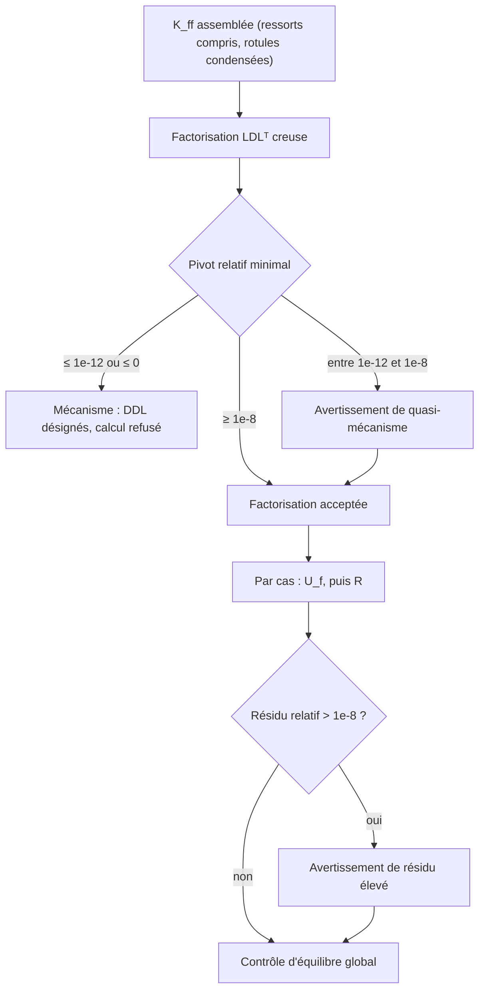

# Niveau 3 — Solveur : assemblage, conditions aux limites, résolution, stabilité

> Niveau **pédagogique** 3 sur 6 : il mesure ce que vous avez appris, pas la maturité du moteur (niveaux 1 à 5,
> définis dans [../../validation/QUALIFICATION.md](../../validation/QUALIFICATION.md)).

[Parcours](../index.md) · Niveau précédent : [2 — Poutre 3D](../level-02/index.md) · Niveau suivant :
[4 — Résultats](../level-04/index.md)

## Objectif

Comprendre comment Fem3D passe des matrices élémentaires au système global, comment il traite appuis, déplacements
imposés, ressorts et rotules, comment il résout, et comment il reconnaît une structure instable (mécanisme).

## Prérequis

[Niveau 2](../level-02/index.md). Résolution d'un système linéaire, notion de matrice singulière et de
factorisation (Cholesky ou LDLᵀ).

## Notions à connaître

Assemblage, partition DDL libres / imposés, forces nodales équivalentes, condensation statique, ressort nodal,
factorisation LDLᵀ creuse, pivot, mécanisme, quasi-mécanisme, résidu.

## Contenu explicatif

### Assemblage et partition

La classe `DofMap` classe chaque DDL global en **libre** (f) ou **imposé** (r, bloqué ou à valeur imposée).
`GlobalAssembler` ajoute la matrice globale 12 × 12 de chaque élément aux bons emplacements et produit directement
quatre blocs creux : K_ff, K_fr, K_rf, K_rr. Les contributions d'éléments voisins sur un même DDL s'additionnent.

### Forces

- Les **charges nodales** s'ajoutent directement au vecteur F.
- Les **charges réparties** donnent des **forces nodales équivalentes** exactes, f_eq,k = ∫₀ᴸ N_k(x) q(x) dx, avec
  les fonctions de forme de la formulation de l'élément et une quadrature de Gauss à 4 points (exacte ici). Elles
  sont ensuite tournées en global par f_global = Tᵀ f_local. Ce sont exactement les opposées des réactions
  d'encastrement parfait ([../../theory/THEORY.md](../../theory/THEORY.md) §4).

### Conditions aux limites, ressorts, rotules

- **Appuis** et **déplacements imposés** : pas de « grand nombre » sur la diagonale. Le système est partitionné :

$$
K_{ff}\,U_f = F_f - K_{fr}\,U_r, \qquad R = K_{rf}\,U_f + K_{rr}\,U_r - F_r .
$$

- **Ressort nodal** de raideur k sur un DDL libre : il ajoute simplement k au terme diagonal de ce DDL. La force qu'il
  exerce sur la structure vaut −k·u. Un ressort sur un DDL bloqué est refusé (la réaction serait ambiguë) ; une
  raideur négative ou non finie aussi ; une raideur nulle ne retient rien.
- **Rotules My, Mz** : elles sont éliminées au niveau de l'élément par **condensation statique**, commune aux deux
  formulations : K_c = K_aa − K_ab K_bb⁻¹ K_ba et f_c = f_eq,a − K_ab K_bb⁻¹ f_eq,b (a : DDL conservés, b : DDL
  relâchés). Le système global ne voit donc que la rigidité condensée.

### Résolution

K_ff est factorisée **une seule fois** par LDLᵀ creuse (Eigen `SimplicialLDLT`, sans inverse explicite), puis la
factorisation est réutilisée pour chaque cas de charge. Après la résolution, le moteur calcule le résidu relatif
‖K_ff U_f − second membre‖ / ‖second membre‖ et contrôle l'équilibre global (niveau 4).

### Stabilité : mécanismes et quasi-mécanismes

Une structure mal appuyée (ou rendue mobile par des rotules) a une matrice K_ff singulière. Fem3D compare chaque
pivot d_k de la factorisation au terme diagonal de **son propre DDL** :

| Pivot relatif d_k / K_kk | Décision |
|---|---|
| ≤ 10⁻¹² (ou pivot non positif) | **Mécanisme** : calcul refusé, `Fem3DError` de code `Mechanism` |
| entre 10⁻¹² et 10⁻⁸ | **Quasi-mécanisme** : avertissement, le calcul continue |
| ≥ 10⁻⁸ | normal |

Ce critère relatif ne dépend pas des unités (une comparaison au plus grand terme de la matrice mélangerait des
raideurs en F/L et en F·L : c'était un défaut d'une première version, corrigé). En cas de mécanisme, les DDL en
cause sont désignés dans le message à partir des modes propres de valeur nulle de la matrice équilibrée
S K_ff S, avec S = diag(K_ff)^(−1/2), tant que le nombre de DDL libres ne dépasse pas 2000. Un mécanisme n'est jamais
confié à un autre moteur dans TSA : c'est une propriété du modèle.



Le diagramme complet du diagnostic est dans [../../diagrams/stabilite.md](../../diagrams/stabilite.md).

## Dans le code source

| Notion | Lien |
|---|---|
| Numérotation libres / imposés | [`DofMap::DofMap`](https://github.com/ChristinotLeonnel/TSA-3D-FEM-Engine/blob/75700d2bfd33c29b2fadc795fd3051f25399ad19/src/Assembly/Assembly.cpp#L9-L30) |
| Blocs de rigidité | [`struct PartitionedStiffness`](https://github.com/ChristinotLeonnel/TSA-3D-FEM-Engine/blob/75700d2bfd33c29b2fadc795fd3051f25399ad19/include/Fem3D/Assembly/GlobalAssembler.h#L21-L28) |
| Assemblage de K (ressorts compris) | [`GlobalAssembler::assembleStiffness`](https://github.com/ChristinotLeonnel/TSA-3D-FEM-Engine/blob/75700d2bfd33c29b2fadc795fd3051f25399ad19/src/Assembly/Assembly.cpp#L55-L101) |
| Assemblage de F | [`GlobalAssembler::assembleLoads`](https://github.com/ChristinotLeonnel/TSA-3D-FEM-Engine/blob/75700d2bfd33c29b2fadc795fd3051f25399ad19/src/Assembly/Assembly.cpp#L103-L126) |
| Forces nodales équivalentes | [`equivalentNodalLoads`](https://github.com/ChristinotLeonnel/TSA-3D-FEM-Engine/blob/75700d2bfd33c29b2fadc795fd3051f25399ad19/src/Results/BeamResponse.cpp#L31-L51) |
| Condensation des rotules | [`condensedStiffness`](https://github.com/ChristinotLeonnel/TSA-3D-FEM-Engine/blob/75700d2bfd33c29b2fadc795fd3051f25399ad19/src/Elements/StaticCondensation.cpp#L34-L45), [`condensedLoads`](https://github.com/ChristinotLeonnel/TSA-3D-FEM-Engine/blob/75700d2bfd33c29b2fadc795fd3051f25399ad19/src/Elements/StaticCondensation.cpp#L47-L58) |
| Rotules (données) | [`struct EndReleases`](https://github.com/ChristinotLeonnel/TSA-3D-FEM-Engine/blob/75700d2bfd33c29b2fadc795fd3051f25399ad19/include/Fem3D/Elements/EndReleases.h#L16-L38) |
| Factorisation et critère de mécanisme | [`LinearSystemSolver::factorize`](https://github.com/ChristinotLeonnel/TSA-3D-FEM-Engine/blob/75700d2bfd33c29b2fadc795fd3051f25399ad19/src/Solver/LinearSystemSolver.cpp#L59-L98) |
| DDL du mécanisme | [`mechanismDofs`](https://github.com/ChristinotLeonnel/TSA-3D-FEM-Engine/blob/75700d2bfd33c29b2fadc795fd3051f25399ad19/src/Solver/LinearSystemSolver.cpp#L33-L56) |
| Seuils numériques | [`struct Tolerance`](https://github.com/ChristinotLeonnel/TSA-3D-FEM-Engine/blob/75700d2bfd33c29b2fadc795fd3051f25399ad19/include/Fem3D/Core/Types.h#L43-L55) |
| Partition, résolution, réactions, ressorts | [`LinearStaticAnalysis::run`](https://github.com/ChristinotLeonnel/TSA-3D-FEM-Engine/blob/75700d2bfd33c29b2fadc795fd3051f25399ad19/src/Analysis/LinearStaticAnalysis.cpp#L40-L115) |
| Avertissement de quasi-mécanisme | [`LinearStaticAnalysis::LinearStaticAnalysis`](https://github.com/ChristinotLeonnel/TSA-3D-FEM-Engine/blob/75700d2bfd33c29b2fadc795fd3051f25399ad19/src/Analysis/LinearStaticAnalysis.cpp#L14-L33) |

## Vérifier par les tests

```bat
build\fem3d_tests.exe | findstr "Springs_ Releases_ Solver_ Mechanism Settlement"
```

- [`Springs_TipSpringInParallelWithCantilever`](https://github.com/ChristinotLeonnel/TSA-3D-FEM-Engine/blob/75700d2bfd33c29b2fadc795fd3051f25399ad19/tests/analytical/test_springs.cpp#L37-L54), [`Springs_RotationalSpringAtBase`](https://github.com/ChristinotLeonnel/TSA-3D-FEM-Engine/blob/75700d2bfd33c29b2fadc795fd3051f25399ad19/tests/analytical/test_springs.cpp#L56-L74), [`Springs_StructureSupportedOnlyBySprings`](https://github.com/ChristinotLeonnel/TSA-3D-FEM-Engine/blob/75700d2bfd33c29b2fadc795fd3051f25399ad19/tests/analytical/test_springs.cpp#L76-L97) : ressorts de translation et de rotation, structure portée par les seuls ressorts ;
- [`Springs_ZeroStiffnessDoesNotHideMechanism`](https://github.com/ChristinotLeonnel/TSA-3D-FEM-Engine/blob/75700d2bfd33c29b2fadc795fd3051f25399ad19/tests/analytical/test_springs.cpp#L99-L110), [`Springs_InvalidInputRejected`](https://github.com/ChristinotLeonnel/TSA-3D-FEM-Engine/blob/75700d2bfd33c29b2fadc795fd3051f25399ad19/tests/analytical/test_springs.cpp#L112-L126) : raideur nulle, données incohérentes ;
- [`Releases_CondensedStiffnessIsProppedCantilever`](https://github.com/ChristinotLeonnel/TSA-3D-FEM-Engine/blob/75700d2bfd33c29b2fadc795fd3051f25399ad19/tests/analytical/test_releases.cpp#L43-L57), [`Releases_GerberHingeBetweenTwoCantilevers`](https://github.com/ChristinotLeonnel/TSA-3D-FEM-Engine/blob/75700d2bfd33c29b2fadc795fd3051f25399ad19/tests/analytical/test_releases.cpp#L98-L123), [`Releases_HingeAtSupportCreatesMechanism`](https://github.com/ChristinotLeonnel/TSA-3D-FEM-Engine/blob/75700d2bfd33c29b2fadc795fd3051f25399ad19/tests/analytical/test_releases.cpp#L125-L144) : condensation (3EI/L³, 3EI/L², 3EI/L), rotule de Gerber, mécanisme par rotule ;
- [`Analytical_SupportSettlement`](https://github.com/ChristinotLeonnel/TSA-3D-FEM-Engine/blob/75700d2bfd33c29b2fadc795fd3051f25399ad19/tests/analytical/test_analytical.cpp#L190-L209) : déplacement imposé non nul (6EIδ/L², 12EIδ/L³) ;
- [`Integration_MechanismDetected`](https://github.com/ChristinotLeonnel/TSA-3D-FEM-Engine/blob/75700d2bfd33c29b2fadc795fd3051f25399ad19/tests/integration/test_frames.cpp#L137-L167) : mécanisme de torsion désigné (Rx), structure sans appui ;
- [`Solver_MechanismCriterionIndependentOfUnits`](https://github.com/ChristinotLeonnel/TSA-3D-FEM-Engine/blob/75700d2bfd33c29b2fadc795fd3051f25399ad19/tests/analytical/test_audit_gaps.cpp#L97-L128) : même verdict en kN-m et en N-mm ;
- [`Solver_QuasiMechanismWarnsButSolves`](https://github.com/ChristinotLeonnel/TSA-3D-FEM-Engine/blob/75700d2bfd33c29b2fadc795fd3051f25399ad19/tests/analytical/test_audit_gaps.cpp#L154-L181) : ressort 10¹⁰ fois plus souple que la barre, deux avertissements, calcul mené à terme.

## Exemple

Console selon X, L = 4 m, encastrée au nœud 1, avec un ressort vertical k = 5 000 kN/m au nœud 2 et une force
Fz = −20 kN en bout (Euler–Bernoulli, modèle du test `Springs_TipSpringInParallelWithCantilever`). On se limite au
plan x-z, DDL (w₁, θy₁, w₂, θy₂).

1. Matrice de l'élément (niveau 2) avec E Iy = 656 250 kN·m² et L = 4 ; le ressort ajoute 5 000 au terme (w₂, w₂).
2. DDL imposés : w₁ et θy₁. DDL libres : w₂ et θy₂, avec
   K_ff = [[123 046,9 + 5 000, 246 093,75], [246 093,75, 656 250]] et F_f = (−20 ; 0).
3. Résolution : U_f = (w₂ ; θy₂) = (**−5,5926·10⁻⁴ m** ; **+2,0972·10⁻⁴ rad**). C'est bien F/(k_console + k), avec
   k_console = 3 E Iy/L³ = 30 761,7 kN/m : les deux raideurs sont en parallèle.
4. Réactions R = K_rf U_f − F_r : Fz = **+17,204 kN**, My = **−68,815 kN·m**.
5. Force du ressort sur la structure : −k w₂ = **+2,796 kN**. Équilibre vertical : −20 + 17,204 + 2,796 = 0.

**Mécanisme.** Supprimons l'encastrement : toute la matrice 4 × 4 devient K_ff. La factorisation sans permutation
donne les pivots 123 046,9, 164 062,5 puis **0** : le pivot relatif du troisième DDL est nul, inférieur à 10⁻¹² : le
calcul est refusé (la barre peut se translater et tourner librement). Avec l'encastrement et le ressort, les pivots
relatifs valent 1 et 0,279 : aucun avertissement.

## Exercice

1. Une poutre selon X repose sur une articulation (trois translations bloquées) au nœud 10 et sur un appui qui ne
   bloque que Uy et Uz au nœud 20. Pourquoi le calcul est-il refusé ? Quels DDL le message désigne-t-il ? Que faut-il
   bloquer ?
2. Console de L = 3 m dont le pied est articulé autour de y et retenu par un ressort de rotation kθ = 2·10⁴ kN·m/rad
   (Euler–Bernoulli, section des tests), force Fz = −20 kN en bout. Calculez la flèche en bout, la rotation du pied
   et le moment du ressort.
3. Pourquoi un ressort de raideur nulle ne « sauve » pas un mécanisme ?

### Corrigé

1. Rien n'empêche la barre de tourner autour de son axe (Rx libre aux deux nœuds) : mode de corps rigide, pivot nul.
   Le message désigne `Rx` (test `Integration_MechanismDetected`). Il suffit de bloquer Rx en un nœud.
2. Souplesses en série : δ = F (L³/(3 E Iy) + L²/kθ) = −20 × (1,3714·10⁻⁵ + 4,5·10⁻⁴) = **−9,2743·10⁻³ m** ;
   rotation du pied θy = −F L/kθ = **+3,0·10⁻³ rad** ; moment du ressort = F L = **−60 kN·m** (test
   `Springs_RotationalSpringAtBase`). La souplesse du ressort domine largement celle de la barre.
3. Il ajoute 0 à la diagonale : la matrice reste singulière, le pivot reste nul et le DDL reste désigné comme
   mécanisme (test `Springs_ZeroStiffnessDoesNotHideMechanism`).

## Critères de réussite

- Vous savez écrire et résoudre le système partitionné, puis calculer les réactions.
- Vous savez où entrent ressorts, rotules et charges réparties dans le système.
- Vous savez expliquer le critère de mécanisme et pourquoi il ne dépend pas des unités.

## À retenir

- K_ff U_f = F_f − K_fr U_r ; R = K_rf U_f + K_rr U_r − F_r ; une seule factorisation pour tous les cas.
- Ressort : +k sur la diagonale, force −k·u ; rotule : condensation statique dans l'élément.
- Pivot relatif ≤ 10⁻¹² : mécanisme refusé et désigné ; entre 10⁻¹² et 10⁻⁸ : avertissement.

## Pour aller plus loin

- Livre : [11 — Ressorts](../../book/chapters/11-ressorts.md),
  [12 — Assemblage](../../book/chapters/12-assemblage.md),
  [13 — Conditions aux limites et stabilité](../../book/chapters/13-conditions-limites-stabilite.md),
  [14 — Solveur et diagnostics](../../book/chapters/14-solveur-diagnostics.md).
- Documentation : [../../theory/THEORY.md](../../theory/THEORY.md) §6 à §8, [../../AUDIT.md](../../AUDIT.md),
  [../../diagrams/calcul.md](../../diagrams/calcul.md).

---

[Parcours](../index.md) · Niveau précédent : [2 — Poutre 3D](../level-02/index.md) · Niveau suivant :
[4 — Résultats](../level-04/index.md)
