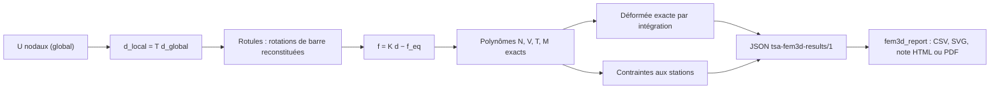

# Niveau 4 — Résultats : réactions, déplacements, efforts, contraintes, diagrammes

> Niveau **pédagogique** 4 sur 6 : il mesure ce que vous avez appris, pas la maturité du moteur (niveaux 1 à 5,
> définis dans [../../validation/QUALIFICATION.md](../../validation/QUALIFICATION.md)).

[Parcours](../index.md) · Niveau précédent : [3 — Solveur](../level-03/index.md) · Niveau suivant :
[5 — Validation scientifique](../level-05/index.md)

## Objectif

Savoir lire, interpréter et contrôler tous les résultats rendus par Fem3D, et savoir ce que le post-traitement
(`postprocessor/`) en fait.

## Prérequis

[Niveau 3](../level-03/index.md). Diagrammes d'efforts de la RDM (N, V, M), contraintes normales et tangentielles.

## Notions à connaître

Réaction, force de ressort, efforts d'extrémité, efforts internes, face positive, station, déformée exacte, pente et
rotation de section, contrainte de calcul, contrôle d'équilibre global.

## Contenu explicatif

### Ce que rend le moteur, par cas de charge

| Résultat | Repère | Signification |
|---|---|---|
| Déplacements nodaux | global | Ux, Uy, Uz, Rx, Ry, Rz de chaque nœud |
| Réactions | global | forces exercées **par l'appui sur la structure** ; 0 sur les DDL libres d'un nœud d'appui |
| Forces des ressorts | global | −k·u, exercées **par le ressort sur la structure** |
| Efforts d'extrémité | local | `f = K_local d_local − f_eq` : forces exercées **sur l'élément** par les nœuds (convention `localForce` d'OpenSees) ; nuls aux rotules |
| Stations | local (et global pour le déplacement) | efforts internes, déplacements, rotations, pentes, contraintes en points équidistants (11 par défaut, extrémités comprises) |
| Flèche locale maximale | local | écart transversal √(v² + w²) à la corde des extrémités déplacées, cherché sur L/200 |
| Contrôle d'équilibre | global | ΣF_appliquées + ΣR + ΣF_ressorts = 0 et même chose pour les moments, plus le résidu de résolution |
| Avertissements | — | quasi-mécanisme, résidu élevé (non bloquants) |

### Efforts internes exacts

Les efforts internes sont obtenus par l'équilibre du tronçon [0, x], avec q(s) = a + b s par composante :

$$
N = -f_{ix} - \int_0^x q_x, \qquad V_z = -f_{iz} - \int_0^x q_z, \qquad
M_y = -m_{iy} - x\,f_{iz} - \int_0^x (x-s)\,q_z\,ds ,
$$

et de même pour Vy, Mz (avec + x f_iy), T = −m_ix. Ce sont des **polynômes** (N et V de degré ≤ 2, M de degré ≤ 3) :
ils sont exacts en toute abscisse, les stations ne sont qu'un choix d'affichage. Relations de contrôle :
dN/dx = −q_x, dVz/dx = −q_z, **dMz/dx = −Vy** et **dMy/dx = +Vz**.

### Déformée, rotations et pentes

La déformée est obtenue par intégration exacte de ces polynômes : θz = θz_i + ∫ Mz/(E Iz), v = v_i + ∫ (θz +
Vy/(G Asy)), etc. En Timoshenko, la **pente** dv/dx diffère de la **rotation de section** θz du glissement
Vy/(G Asy) ; en Euler–Bernoulli, elles coïncident (au signe près pour le plan x-z). Aux rotules, les DDL d'élément
portent la rotation **de la barre**, distincte de celle du nœud.

### Contraintes (formules de RDM)

σ = N/A ; σ_flexion = |My| z_ext/Iy et |Mz| y_ext/Iz ; contrainte normale extrême |N/A| + flexions (exacte pour un
rectangle, majorante sinon) ; τ_V = |V|/As (contrainte **de calcul** : la moyenne vraie vaut |V|/A) ; τ_T = |T|/Wt ;
von Mises **indicatif**. Une valeur est absente (`null` dans le JSON) si la donnée de section manque : jamais 0.
Aucune vérification réglementaire (Eurocodes) n'est faite.

### Le post-traitement

Le sous-projet `postprocessor/` (bibliothèque `fem3dpost`, outil `fem3d_report`) lit seulement le fichier JSON. Il
produit `deplacements.csv`, `reactions.csv`, `sollicitations.csv`, `deformations_contraintes.csv`, un CSV et neuf
SVG par élément et par cas (N, Vy, Vz, T, My, Mz, déformée, flèches, rotations) et une note de calcul HTML (PDF en
option). **Limite** : entre deux stations, ses diagrammes interpolent linéairement (c'est écrit dans chaque
légende) ; pour un tracé plus fin, demander plus de stations au moteur (`AnalysisOptions::stationsPerElement`).



## Dans le code source

| Notion | Lien |
|---|---|
| Efforts d'extrémité, polynômes, déformée | [`BeamResponse::BeamResponse`](https://github.com/ChristinotLeonnel/TSA-3D-FEM-Engine/blob/75700d2bfd33c29b2fadc795fd3051f25399ad19/src/Results/BeamResponse.cpp#L53-L98) |
| Rotations de barre aux rotules | [`completeReleasedDisplacements`](https://github.com/ChristinotLeonnel/TSA-3D-FEM-Engine/blob/75700d2bfd33c29b2fadc795fd3051f25399ad19/src/Elements/StaticCondensation.cpp#L60-L72) |
| Contraintes | [`BeamResponse::stressesAt`](https://github.com/ChristinotLeonnel/TSA-3D-FEM-Engine/blob/75700d2bfd33c29b2fadc795fd3051f25399ad19/src/Results/BeamResponse.cpp#L108-L122) |
| Stations et flèche locale | [`BeamResponse::result`](https://github.com/ChristinotLeonnel/TSA-3D-FEM-Engine/blob/75700d2bfd33c29b2fadc795fd3051f25399ad19/src/Results/BeamResponse.cpp#L124-L165) |
| Polynômes exacts | [`class Polynomial`](https://github.com/ChristinotLeonnel/TSA-3D-FEM-Engine/blob/75700d2bfd33c29b2fadc795fd3051f25399ad19/include/Fem3D/Core/Polynomial.h#L14-L74) |
| Structures de résultats | [`SectionForces`](https://github.com/ChristinotLeonnel/TSA-3D-FEM-Engine/blob/75700d2bfd33c29b2fadc795fd3051f25399ad19/include/Fem3D/Results/AnalysisResults.h#L39-L47), [`SectionStresses`](https://github.com/ChristinotLeonnel/TSA-3D-FEM-Engine/blob/75700d2bfd33c29b2fadc795fd3051f25399ad19/include/Fem3D/Results/AnalysisResults.h#L49-L59), [`ReactionResult`](https://github.com/ChristinotLeonnel/TSA-3D-FEM-Engine/blob/75700d2bfd33c29b2fadc795fd3051f25399ad19/include/Fem3D/Results/AnalysisResults.h#L25-L29), [`SpringResult`](https://github.com/ChristinotLeonnel/TSA-3D-FEM-Engine/blob/75700d2bfd33c29b2fadc795fd3051f25399ad19/include/Fem3D/Results/AnalysisResults.h#L31-L35), [`EquilibriumCheck`](https://github.com/ChristinotLeonnel/TSA-3D-FEM-Engine/blob/75700d2bfd33c29b2fadc795fd3051f25399ad19/include/Fem3D/Results/AnalysisResults.h#L85-L94) |
| Contrôle d'équilibre global | [`LinearStaticAnalysis::checkEquilibrium`](https://github.com/ChristinotLeonnel/TSA-3D-FEM-Engine/blob/75700d2bfd33c29b2fadc795fd3051f25399ad19/src/Analysis/LinearStaticAnalysis.cpp#L124-L170) |
| Export JSON | [`resultsToJson`](https://github.com/ChristinotLeonnel/TSA-3D-FEM-Engine/blob/75700d2bfd33c29b2fadc795fd3051f25399ad19/src/Results/ResultsJsonWriter.cpp#L78-L78) |
| Post-traitement : flèche à la corde | [`chordDeflection`](https://github.com/ChristinotLeonnel/TSA-3D-FEM-Engine/blob/75700d2bfd33c29b2fadc795fd3051f25399ad19/postprocessor/include/fem3dpost/Calculations.h#L20-L21) |
| Post-traitement : diagrammes | [`elementDiagrams`](https://github.com/ChristinotLeonnel/TSA-3D-FEM-Engine/blob/75700d2bfd33c29b2fadc795fd3051f25399ad19/postprocessor/include/fem3dpost/Diagrams.h#L34-L34) |
| Post-traitement : note de calcul | [`buildReport`](https://github.com/ChristinotLeonnel/TSA-3D-FEM-Engine/blob/75700d2bfd33c29b2fadc795fd3051f25399ad19/postprocessor/include/fem3dpost/Report.h#L43-L43), outil [`fem3d_report.cpp`](https://github.com/ChristinotLeonnel/TSA-3D-FEM-Engine/blob/75700d2bfd33c29b2fadc795fd3051f25399ad19/postprocessor/tools/fem3d_report.cpp) |

## Vérifier par les tests

Moteur :

```bat
build\fem3d_tests.exe | findstr "Analytical_ Integration_Response Integration_ResultsJson"
```

- [`Analytical_SimplySupportedUniform_OneElement`](https://github.com/ChristinotLeonnel/TSA-3D-FEM-Engine/blob/75700d2bfd33c29b2fadc795fd3051f25399ad19/tests/analytical/test_analytical.cpp#L125-L140) : flèche à mi-portée, My(L/2), position de la flèche maximale, σ = M z/Iy ;
- [`Analytical_CantileverUniformLoad_ExactAlongMember`](https://github.com/ChristinotLeonnel/TSA-3D-FEM-Engine/blob/75700d2bfd33c29b2fadc795fd3051f25399ad19/tests/analytical/test_analytical.cpp#L102-L123) : My(x), Vz(x) et w(x) exacts à toutes les stations ;
- [`Analytical_SaintVenantTorsion`](https://github.com/ChristinotLeonnel/TSA-3D-FEM-Engine/blob/75700d2bfd33c29b2fadc795fd3051f25399ad19/tests/analytical/test_analytical.cpp#L65-L73), [`Analytical_AxialTension`](https://github.com/ChristinotLeonnel/TSA-3D-FEM-Engine/blob/75700d2bfd33c29b2fadc795fd3051f25399ad19/tests/analytical/test_analytical.cpp#L52-L63) : θx = TL/GJ, τ = T/Wt ; u = PL/EA, N = +P, réaction −P ;
- [`Integration_ResponseConsistentWithNodalDisplacements`](https://github.com/ChristinotLeonnel/TSA-3D-FEM-Engine/blob/75700d2bfd33c29b2fadc795fd3051f25399ad19/tests/integration/test_frames.cpp#L111-L135) : la déformée intégrée retrouve le nœud j ; efforts internes en L = efforts d'extrémité ;
- [`Releases_ResponseConsistentInFrame`](https://github.com/ChristinotLeonnel/TSA-3D-FEM-Engine/blob/75700d2bfd33c29b2fadc795fd3051f25399ad19/tests/analytical/test_releases.cpp#L146-L183) : même cohérence avec des rotules ;
- [`Springs_ExportedInResultsJson`](https://github.com/ChristinotLeonnel/TSA-3D-FEM-Engine/blob/75700d2bfd33c29b2fadc795fd3051f25399ad19/tests/analytical/test_springs.cpp#L128-L137) : forces des ressorts dans le JSON.

Post-traitement (15 tests, dans `postprocessor/`, voir son `README.md`) :

```bat
cd postprocessor
build.cmd test
```

Par exemple [« flèche locale par rapport à la corde »](https://github.com/ChristinotLeonnel/TSA-3D-FEM-Engine/blob/75700d2bfd33c29b2fadc795fd3051f25399ad19/postprocessor/tests/tests.cpp#L424),
[« diagrammes : 9 grandeurs, stations, extrêmes, légende d'interpolation »](https://github.com/ChristinotLeonnel/TSA-3D-FEM-Engine/blob/75700d2bfd33c29b2fadc795fd3051f25399ad19/postprocessor/tests/tests.cpp#L447)
et [« contrôles de cohérence et équilibre recalculé »](https://github.com/ChristinotLeonnel/TSA-3D-FEM-Engine/blob/75700d2bfd33c29b2fadc795fd3051f25399ad19/postprocessor/tests/tests.cpp#L509).

## Exemple

Poutre sur deux appuis simples selon X, L = 6 m, charge uniforme **q = −10 kN/m** selon Z (repère global), un seul
élément, section 0,3 × 0,5 m (modèle du test `Analytical_SimplySupportedUniform_OneElement`).

- **Réactions** : Fz = +30 kN à chaque appui.
- **Efforts d'extrémité** au nœud i : f_iz = +30 kN (l'appui pousse l'élément vers le haut).
- **Efforts internes** : Vz(x) = −30 + 10 x et My(x) = −30 x + 5 x².

| x (m) | 0 | 1,5 | 3 | 4,5 | 6 |
|---|---|---|---|---|---|
| Vz (kN) | −30 | −15 | 0 | +15 | +30 |
| My (kN·m) | 0 | −33,75 | **−45** | −33,75 | 0 |

On vérifie dMy/dx = −30 + 10 x = Vz. Le moment à mi-portée vaut q L²/8 = −45 kN·m : **négatif** pour une charge
descendante, parce que θy = −dw/dx dans cette convention (un logiciel qui compte le moment « positif en travée »
afficherait +45).

- **Flèche à mi-portée** : 5 q L⁴/(384 E Iy) = **−2,5714·10⁻⁴ m** en Euler–Bernoulli ; Timoshenko ajoute
  q L²/(8 G As) = −4,444·10⁻⁶ m, soit **−2,6159·10⁻⁴ m**. La flèche maximale est à x = 3 m.
- **Contraintes** à mi-portée : σ = |My| z_ext/Iy = 45 × 0,25/3,125·10⁻³ = **3 600 kN/m²** (3,6 MPa). Aux appuis :
  τ_V = |Vz|/As = 30/0,125 = **240 kN/m²** (contrainte de calcul ; la moyenne |V|/A vaudrait 200 kN/m²).

## Exercice

1. Console L = 4 m, couple de torsion Mx = 12 kN·m en bout (section 0,3 × 0,5 m, G = 81·10⁶ kN/m²). La section
   rectangulaire donne J = 2,81737·10⁻³ m⁴ et Wt = 1,06121·10⁻² m³. Calculez θx en bout et τ_T.
2. Pour la poutre de l'exemple, que vaut la rotation de la barre à x = 3 m ? Pourquoi ?
3. Le post-traitement trace My avec 11 stations sur la poutre de l'exemple. Le maximum affiché est-il exact ?
   Et la courbe entre les stations ?
4. Un contrôle d'équilibre global parfait (résidus 10⁻¹⁴) prouve-t-il que la rigidité est correcte ?

### Corrigé

1. θx = T L/(G J) = 48/(81·10⁶ × 2,81737·10⁻³) = **2,1034·10⁻⁴ rad** ; τ_T = T/Wt = 12/1,06121·10⁻² =
   **1 130,8 kN/m²** (test `Analytical_SaintVenantTorsion`).
2. **Nulle**, par symétrie : la déformée est symétrique par rapport au milieu, la pente y est nulle.
3. Oui : x = 3 m est une station (pas de 0,6 m) et les valeurs aux stations sont exactes. Entre deux stations, la
   courbe est une interpolation linéaire de la parabole exacte, ce que la légende signale.
4. Non : il vérifie l'équivalence statique des charges et la précision de la résolution. Une matrice fausse mais
   symétrique le satisferait aussi. La rigidité est validée par les solutions analytiques et OpenSees (niveau 5).

## Critères de réussite

- Vous distinguez réactions, forces de ressort, efforts d'extrémité et efforts internes, avec leurs repères et leurs
  signes.
- Vous savez tracer N, V, M à partir des efforts d'extrémité et vérifier dMy/dx = +Vz, dMz/dx = −Vy.
- Vous connaissez les limites des contraintes et des diagrammes du post-traitement.

## À retenir

- f = K d − f_eq sur l'élément ; efforts internes sur la face positive ; réactions exercées par l'appui.
- Efforts et déformée sont des polynômes exacts ; les stations ne sont qu'un échantillonnage.
- Contraintes de RDM, indicatives, sans vérification réglementaire ; une valeur absente reste `null`.

## Pour aller plus loin

- Livre : [15 — Efforts internes](../../book/chapters/15-efforts-internes.md),
  [16 — Déplacements et contraintes](../../book/chapters/16-deplacements-contraintes.md).
- Documentation : [../../RESULTS_FORMAT.md](../../RESULTS_FORMAT.md),
  [../../theory/SIGN_CONVENTIONS.md](../../theory/SIGN_CONVENTIONS.md) §3 et §5,
  [`postprocessor/README.md`](https://github.com/ChristinotLeonnel/TSA-3D-FEM-Engine/blob/75700d2bfd33c29b2fadc795fd3051f25399ad19/postprocessor/README.md).

---

[Parcours](../index.md) · Niveau précédent : [3 — Solveur](../level-03/index.md) · Niveau suivant :
[5 — Validation scientifique](../level-05/index.md)
