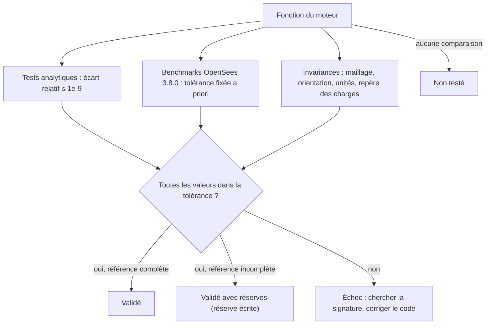

# Niveau 5 — Validation scientifique

> Niveau **pédagogique** 5 sur 6 : il mesure ce que vous avez appris, pas la maturité du moteur. Les niveaux de
> maturité 1 à 5 du moteur (implémenté, vérifié, validé…) sont définis et attribués uniquement dans
> [../../validation/QUALIFICATION.md](../../validation/QUALIFICATION.md) ; cette page n'en déclare aucun.

[Parcours](../index.md) · Niveau précédent : [4 — Résultats](../level-04/index.md) · Niveau suivant :
[6 — Développement et recherche](../level-06/index.md)

## Objectif

Comprendre comment on établit qu'un moteur de calcul donne des résultats justes, savoir relire les preuves fournies
pour Fem3D et savoir interpréter un écart entre deux codes.

## Prérequis

[Niveau 4](../level-04/index.md). Erreur absolue et relative, précision machine (environ 10⁻¹⁶ en double précision).

## Notions à connaître

Vérification et validation, solution analytique, référence indépendante, tolérance fixée a priori, plancher absolu,
invariance, convergence, cas non comparable, verdict.

## Contenu explicatif

### Vérifier, valider

- **Vérifier** : le code résout-il correctement les équations choisies ? On compare à des **solutions analytiques**
  exactes (console, poutre sur appuis, torsion, tassement, ressorts, rotules). Comme les éléments sont exacts pour
  des barres prismatiques, seul l'arrondi doit subsister : tolérance relative **10⁻⁹**.
- **Valider** (au sens de ce dépôt) : les résultats sont-ils égaux à ceux d'un **code indépendant** ? La référence est
  **OpenSees 3.8.0** (`elasticBeamColumn` pour Euler–Bernoulli, `ElasticTimoshenkoBeam` pour Timoshenko, même repère
  `geomTransf`, même convention `localForce`).
- **Auditer** les formulations indépendamment : les forces d'encastrement de Timoshenko ont été redérivées par calcul
  symbolique ([../../verification/INDEPENDENT_FORMULATION_AUDIT.md](../../verification/INDEPENDENT_FORMULATION_AUDIT.md)).

### Tolérances fixées avant les essais

Pour la comparaison à OpenSees :

$$
|\text{Fem3D} - \text{OpenSees}| \le \max\left(10^{-6}\,|\text{réf}|,\; 10^{-9}\,\text{échelle}\right)
$$

où l'échelle est la plus grande valeur absolue de même nature dans le cas (translations, rotations, forces ou
moments), avec des planchers dimensionnellement cohérents. La partie relative (10⁻⁶) est large devant l'arrondi,
mais **10⁴ à 10⁶ fois plus petite** que l'effet d'une erreur de formulation (un signe, un Φ ou un axe faux donne
1 à 100 %). La partie absolue évite de juger en relatif une composante théoriquement nulle. Une tolérance ne se
modifie jamais pour masquer un écart ([../../validation/VALIDATION_PLAN.md](../../validation/VALIDATION_PLAN.md) §2).

### Ce qui a été mesuré

20 cas × 2 formulations : traction, torsion, flexion dans les deux plans, poutre courte, barres inclinées, portiques
spatiaux, charges réparties locales et globales, rotules (12 à 17), ressorts (18 à 20). **2 657 valeurs comparées,
0 hors tolérance**. Les deux mécanismes (cas 11 et 17) sont refusés par les deux codes. Un cas est **non comparable**
(16 en Timoshenko : la référence par `equalDOF` n'est exacte que si l'axe relâché est un axe global). Écarts relatifs
maximaux : 10⁻¹⁶ à 10⁻¹², c'est-à-dire la précision machine. Détail :
[../../validation/VALIDATION_OPENSEES.md](../../validation/VALIDATION_OPENSEES.md).

### Invariances et « convergence »

Pour un élément approché, on étudie la convergence en raffinant le maillage. Ici, les éléments sont exacts : la
propriété attendue est plus forte, l'**invariance**. Subdiviser une barre ne doit **rien** changer aux nœuds communs
(`Integration_SpatialFrame_EquilibriumAndMeshInvariance`). De même : tourner une console dans l'espace ne change pas
sa flèche dans son repère local ; changer d'unités (kN-m ou N-mm) ne change ni les résultats convertis ni le verdict
de mécanisme ; une charge donnée en global ou sa projection en local donnent le même résultat.

### Interpréter un écart

Un écart n'est pas un échec à corriger en élargissant la tolérance. On cherche d'abord sa **signature** :

| Signature de l'écart | Cause probable |
|---|---|
| Rapport constant, par exemple 2,78 sur une flèche | inertie Iy et Iz inversées (rapport Iy/Iz de la section) |
| Rapport 1 + Φ/4 sur une console | formulations différentes (Euler–Bernoulli contre Timoshenko) ou aires de cisaillement différentes |
| Signe opposé sur un moment ou une rotation | convention de signe (θy = −dw/dx, réaction / effort interne) |
| Écart sur les seules réactions d'un nœud dédoublé | extraction de la référence (cas 12-13 : somme maître + esclave nécessaire avec `equalDOF`) |
| Écart sur une charge trapézoïdale | référence défaillante : OpenSees 3.8.0 ignore la variation de `-beamUniform` en 3D, sans message |
| Écart de l'ordre de 10⁻¹² en relatif | arrondi : aucun problème |

Les deux derniers cas montrent que la **référence** aussi peut se tromper : il faut documenter la réserve (verdict
« validé avec réserves » ou « non comparable »), jamais retoucher une valeur de référence à la main.



Le circuit de comparaison complet est décrit dans [../../diagrams/validation-opensees.md](../../diagrams/validation-opensees.md).

## Dans le code source

| Notion | Lien |
|---|---|
| Liste des 20 cas OpenSees | [`cases()`](https://github.com/ChristinotLeonnel/TSA-3D-FEM-Engine/blob/75700d2bfd33c29b2fadc795fd3051f25399ad19/benchmarks/OpenSees/opensees_benchmarks.cpp#L114-L296) |
| Tolérances relative et absolue | [`kRelativeTolerance`](https://github.com/ChristinotLeonnel/TSA-3D-FEM-Engine/blob/75700d2bfd33c29b2fadc795fd3051f25399ad19/benchmarks/OpenSees/opensees_benchmarks.cpp#L48-L48) |
| Comparaison valeur par valeur | [`compareGroup`](https://github.com/ChristinotLeonnel/TSA-3D-FEM-Engine/blob/75700d2bfd33c29b2fadc795fd3051f25399ad19/benchmarks/OpenSees/opensees_benchmarks.cpp#L489-L514) |
| Synthèse versionnée des résultats | [`benchmarks/OpenSees/results/synthese.csv`](https://github.com/ChristinotLeonnel/TSA-3D-FEM-Engine/blob/75700d2bfd33c29b2fadc795fd3051f25399ad19/benchmarks/OpenSees/results/synthese.csv) |
| Mode d'emploi des benchmarks | [`benchmarks/OpenSees/README.md`](https://github.com/ChristinotLeonnel/TSA-3D-FEM-Engine/blob/75700d2bfd33c29b2fadc795fd3051f25399ad19/benchmarks/OpenSees/README.md) |
| Critère d'écart des tests (`near`) | [`tests/TestFramework.h`](https://github.com/ChristinotLeonnel/TSA-3D-FEM-Engine/blob/75700d2bfd33c29b2fadc795fd3051f25399ad19/tests/TestFramework.h#L40-L43) |
| Comparaison dans TSA | [`Fem3DEngine::kCompareRelative`](https://github.com/ChristinotLeonnel/Tsaraloha-Structural-Analysis/blob/2f5d7d4342e903fe536fbab91a7dcf80e8b89f7d/src/Analysis/Engines/Fem3D/Fem3DEngine.h#L23-L57) (dépôt TSA) |

## Vérifier par les tests

```bat
build\fem3d_tests.exe
build\fem3d_opensees_benchmarks.exe [chemin\OpenSees.exe] [dossier de sortie]
```

La première commande a donné 41/41 le 19/10/2026. La seconde exige OpenSees 3.8.0 (par défaut
`../TSA/thirdparty/OpenSees/bin/OpenSees.exe`) ; elle régénère les scripts Tcl, exécute OpenSees et écrit les CSV de
comparaison et la synthèse. Tests d'invariance et de cohérence à relire :

- [`Integration_SpatialFrame_EquilibriumAndMeshInvariance`](https://github.com/ChristinotLeonnel/TSA-3D-FEM-Engine/blob/75700d2bfd33c29b2fadc795fd3051f25399ad19/tests/integration/test_frames.cpp#L77-L92) : 1 ou 4 éléments par barre, mêmes déplacements nodaux ;
- [`Integration_InclinedCantilever_OrientationInvariance`](https://github.com/ChristinotLeonnel/TSA-3D-FEM-Engine/blob/75700d2bfd33c29b2fadc795fd3051f25399ad19/tests/integration/test_frames.cpp#L54-L75) : invariance par rotation ;
- [`Integration_GlobalAndLocalDistributedLoadsEquivalent`](https://github.com/ChristinotLeonnel/TSA-3D-FEM-Engine/blob/75700d2bfd33c29b2fadc795fd3051f25399ad19/tests/integration/test_frames.cpp#L94-L109) : charge globale et sa projection locale ;
- [`Solver_MechanismCriterionIndependentOfUnits`](https://github.com/ChristinotLeonnel/TSA-3D-FEM-Engine/blob/75700d2bfd33c29b2fadc795fd3051f25399ad19/tests/analytical/test_audit_gaps.cpp#L97-L128) : invariance par changement d'unités ;
- [`Analytical_FixedFixedTriangularLoad_EulerBernoulli`](https://github.com/ChristinotLeonnel/TSA-3D-FEM-Engine/blob/75700d2bfd33c29b2fadc795fd3051f25399ad19/tests/analytical/test_analytical.cpp#L142-L162) et [`Analytical_FixedFixedTriangularLoad_Timoshenko`](https://github.com/ChristinotLeonnel/TSA-3D-FEM-Engine/blob/75700d2bfd33c29b2fadc795fd3051f25399ad19/tests/analytical/test_audit_gaps.cpp#L40-L57) : charges trapézoïdales, validées analytiquement faute de référence OpenSees ;
- [`Section_RectangleTorsionMatchesExactSeries`](https://github.com/ChristinotLeonnel/TSA-3D-FEM-Engine/blob/75700d2bfd33c29b2fadc795fd3051f25399ad19/tests/analytical/test_audit_gaps.cpp#L130-L152) : J et Wt du rectangle contre les séries exactes de Saint-Venant (tolérance 6·10⁻³, justifiée par la précision des formules approchées).

## Exemple

Cas OpenSees 03 en Euler–Bernoulli (console L = 3 m, Fz = −20 kN), flèche en bout Uz :

| Source | Valeur (m) |
|---|---|
| Solution analytique F L³/(3 E Iy) | −2,742857142857143·10⁻⁴ |
| Fem3D | −2,7428571428571443·10⁻⁴ |
| OpenSees 3.8.0 | −2,7428571428571427·10⁻⁴ |

- Écart Fem3D / OpenSees : 1,6·10⁻¹⁹ m, soit **5,9·10⁻¹⁶** en relatif.
- Tolérance : l'échelle des translations du cas vaut 2,74·10⁻⁴ m, donc
  max(10⁻⁶ × 2,74·10⁻⁴ ; 10⁻⁹ × 2,74·10⁻⁴) = **2,74·10⁻¹⁰ m** : l'écart est un million de fois plus petit.
- Écart Fem3D / analytique : 4,0·10⁻¹⁶ en relatif, très en dessous de 10⁻⁹.

Comparons à l'effet d'une erreur : en inversant Iy et Iz, on obtiendrait une flèche 2,78 fois plus grande (écart de
178 %), soit 10¹² fois la tolérance relative.

## Exercice

1. Cas 06 : console courte de L = 1 m (section 0,3 × 0,5 m), charge (0 ; 30 ; −50) kN en bout. Prévoyez de combien
   la flèche de Timoshenko dépasse celle d'Euler–Bernoulli selon Uy et selon Uz.
2. Un étudiant modifie le moteur et observe un écart relatif de 3·10⁻³ sur tous les moments d'un portique, alors que
   les déplacements sont exacts. Faut-il porter la tolérance à 10⁻² ? Que regarder ?
3. Pourquoi l'étude de convergence classique (raffiner le maillage) n'est-elle pas le bon outil ici ?

### Corrigé

1. Rapport 1 + Φ/4 dans chaque plan. Plan x-y (Uy, Iz = 1,125·10⁻³ m⁴) : Φy = 12 × 210·10⁶ × 1,125·10⁻³/(81·10⁶ ×
   0,125 × 1) = 0,28, rapport **1,07** (+7 %). Plan x-z (Uz, Iy = 3,125·10⁻³ m⁴) : Φz = 0,778, rapport **1,194**
   (+19 %). C'est ce que rapporte [../../validation/VALIDATION_OPENSEES.md](../../validation/VALIDATION_OPENSEES.md)
   (« 7 % en Uy et 19 % en Uz »).
2. Non : la tolérance est fixée a priori et 3·10⁻³ est la signature d'une erreur, pas de l'arrondi. Des déplacements
   exacts et des moments faux pointent vers la reconstruction des efforts (f = K d − f_eq, polynômes de
   `BeamResponse`) ou vers les forces nodales équivalentes ; vérifier `Integration_ResponseConsistentWithNodalDisplacements`
   et les tests analytiques de charges réparties.
3. Parce que les éléments sont exacts : la réponse nodale ne dépend pas du maillage. Le test pertinent est
   l'invariance (même résultat avec 1 ou 4 éléments par barre), plus forte qu'une convergence.

## Critères de réussite

- Vous savez distinguer vérification analytique, validation croisée et audit.
- Vous savez appliquer la formule de tolérance à une valeur d'un CSV de comparaison.
- Face à un écart, vous cherchez sa signature avant de conclure, et vous savez qu'une référence peut être fautive.

## À retenir

- Analytique ≤ 10⁻⁹ ; OpenSees ≤ max(10⁻⁶ |réf|, 10⁻⁹ échelle), tolérances fixées avant les essais.
- 2 657 valeurs, 0 hors tolérance ; un cas non comparable, des réserves écrites (charges trapézoïdales, rotules de
  Timoshenko hors axes globaux, contraintes).
- Éléments exacts : on teste l'invariance au maillage, pas la convergence.

## Pour aller plus loin

- Livre : [19 — Validation et reproductibilité](../../book/chapters/19-validation-reproductibilite.md),
  [20 — Tests et limites](../../book/chapters/20-tests-limites.md).
- Documentation : [../../validation/VALIDATION_PLAN.md](../../validation/VALIDATION_PLAN.md),
  [../../validation/VALIDATION_OPENSEES.md](../../validation/VALIDATION_OPENSEES.md),
  [../../validation/QUALIFICATION.md](../../validation/QUALIFICATION.md),
  [../../references/REFERENCES.md](../../references/REFERENCES.md).

---

[Parcours](../index.md) · Niveau précédent : [4 — Résultats](../level-04/index.md) · Niveau suivant :
[6 — Développement et recherche](../level-06/index.md)
