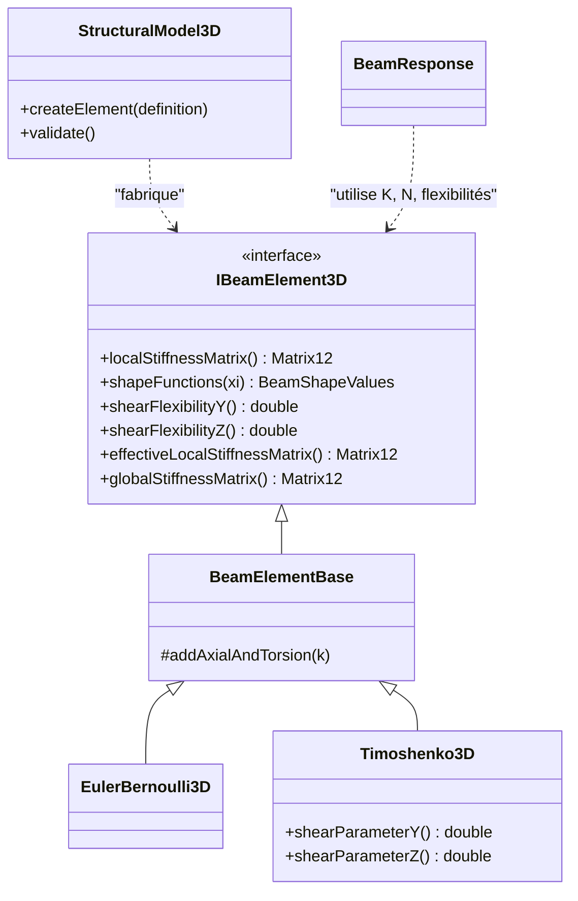

# Niveau 6 — Développement et recherche

> Niveau **pédagogique** 6 sur 6 : il mesure ce que vous avez appris, pas la maturité du moteur (niveaux 1 à 5,
> définis dans [../../validation/QUALIFICATION.md](../../validation/QUALIFICATION.md)). Une extension que vous
> écrivez n'a aucun niveau de maturité tant que ses preuves n'ont pas été apportées et relues.

[Parcours](../index.md) · Niveau précédent : [5 — Validation scientifique](../level-05/index.md) · Suite :
[guide pour les étudiants, les enseignants et les chercheurs](../../education/RESEARCH_AND_STUDENT_GUIDE.md)

## Objectif

Savoir où et comment modifier Fem3D sans casser ce qui est validé : architecture, interfaces, ajout d'un élément ou
d'un type de charge, stratégie de test, reproductibilité, et connaître les limites qui ouvrent des sujets de
recherche.

## Prérequis

[Niveau 5](../level-05/index.md). C++20 (classes abstraites, `std::unique_ptr`, `std::optional`), CMake, notions
d'Eigen.

## Notions à connaître

Interface abstraite, fabrique, dépendances acycliques, test unitaire / analytique / d'intégration, benchmark,
non-régression, révision (hash de commit), reproductibilité.

## Contenu explicatif

### Architecture

Le moteur est une bibliothèque `fem3d` (C++20, Eigen 3.4, sans Qt). Les modules dépendent les uns des autres dans un
seul sens : `Core ← Geometry ← Elements ← Model ← Assembly ← Solver ← Analysis`, `Results` dépendant des éléments et
des charges. Le post-traitement (`postprocessor/`, Qt) ne communique avec le moteur que par le fichier JSON ; TSA
l'utilise par un adaptateur qui lui est propre. Le moteur ne connaît ni TSA ni le post-traitement. Voir
[../../ARCHITECTURE.md](../../ARCHITECTURE.md), [../../diagrams/architecture.md](../../diagrams/architecture.md) et
[../../diagrams/dependances-code.md](../../diagrams/dependances-code.md) ; l'API publique est résumée dans
[../../reference/API.md](../../reference/API.md).



### L'interface d'un élément

Une formulation ne fournit que **trois choses** : sa matrice de rigidité locale, ses fonctions de forme (pour les
forces nodales équivalentes) et ses flexibilités de cisaillement (nulles en Euler–Bernoulli). Repère, transformation,
condensation des rotules, assemblage, résolution et reconstruction des efforts sont communs. C'est ce qui permet de
choisir la formulation **barre par barre** (`ElementDefinition::formulation`).

### Ajouter une formulation d'élément

1. Écrire la théorie d'abord (hypothèses, équations, limites) dans [../../theory/THEORY.md](../../theory/THEORY.md),
   avec des sources de [../../references/REFERENCES.md](../../references/REFERENCES.md) et leur statut.
2. Créer une classe dérivée de `BeamElementBase` (comme `Timoshenko3D`), qui n'ajoute que ses équations.
3. Ajouter la valeur à `BeamFormulation`, son nom dans `formulationName`, et la branche dans
   `StructuralModel3D::createElement`.
4. Vérifier que `BeamResponse` reste juste : il reconstruit efforts et déformée par la théorie des poutres
   prismatiques (M/EI, V/GAs). Une cinématique différente (section variable, gauchissement) exige de le modifier.
5. Tests : symétrie et six modes de corps rigide, limite connue (comme Φ → 0), solutions analytiques à 10⁻⁹,
   invariances, puis benchmark contre une référence indépendante avec tolérances fixées avant les essais.
6. Mettre à jour [../../validation/VALIDATION_PLAN.md](../../validation/VALIDATION_PLAN.md),
   [../../limitations/KNOWN_LIMITATIONS.md](../../limitations/KNOWN_LIMITATIONS.md) et
   [../../ROADMAP.md](../../ROADMAP.md).

Esquisse (illustration, **pas du code existant**) :

```cpp
class MyBeam3D final : public BeamElementBase
{
public:
    using BeamElementBase::BeamElementBase;
    BeamFormulation formulation() const override;          // nouvelle valeur de l'énumération
    Matrix12 localStiffnessMatrix() const override;        // addAxialAndTorsion(k) puis la flexion
    BeamShapeValues shapeFunctions(double xi) const override;
    double shearFlexibilityY() const override;
    double shearFlexibilityZ() const override;
};
```

La **barre de treillis** (effort normal seul) figure dans la feuille de route ; la façon de l'intégrer (ses DDL de
rotation n'ont pas de rigidité propre) n'est pas encore décidée : à vérifier avant d'écrire le code.

### Ajouter un type de charge

Exemple : la charge ponctuelle sur barre, prochaine étape de la feuille de route (**non implémentée**). Il faut
toucher : la structure de charge (`Loads3D.h`) et le contrôle du modèle ; les forces nodales équivalentes
(`equivalentNodalLoads`, et leur condensation aux rotules) ; la reconstruction des efforts et de la déformée, qui
devient **polynomiale par morceaux** (`BeamResponse`) ; le contrôle d'équilibre (`checkEquilibrium`) ; l'export
JSON ; puis, dans TSA, le diagnostic de périmètre de l'adaptateur. Référence prévue : `eleLoad -beamPoint`
d'OpenSees ([../../validation/VALIDATION_PLAN.md](../../validation/VALIDATION_PLAN.md) §5).

### Stratégie de test

| Couche | Fichiers | Rôle |
|---|---|---|
| Unitaire | `tests/unit/` | repères, matrices, polynômes, refus des données invalides |
| Analytique | `tests/analytical/` | solutions exactes à 10⁻⁹ (formulations, rotules, ressorts, audit) |
| Intégration | `tests/integration/` | portiques, invariances, mécanismes, format JSON |
| Benchmarks | `benchmarks/OpenSees/` | comparaison à OpenSees 3.8.0 |
| TSA | dépôt TSA, tests 476 à 480 | intégration, secours, comparaison |

Règles du dépôt (`AGENTS.md`) : on ne supprime, ne désactive ni n'affaiblit un test pour obtenir une suite verte ; une
tolérance ne change qu'avec une justification scientifique écrite ; les valeurs OpenSees sont régénérées, jamais
retouchées ; une modification du moteur s'accompagne de tests, de la reproduction des benchmarks et d'une revue.
Ajouter un test, c'est écrire `FEM3D_TEST(Nom) { … }` dans un des fichiers listés par la cible `fem3d_tests` de
`CMakeLists.txt` : il est enregistré automatiquement.

### Reproductibilité

Un résultat est reproductible si l'on connaît : la **révision** du dépôt (hash complet de 40 caractères ; tout le
code actuel a été introduit par le commit
[75700d2](https://github.com/ChristinotLeonnel/TSA-3D-FEM-Engine/commit/75700d2bfd33c29b2fadc795fd3051f25399ad19)),
la version du moteur écrite dans chaque fichier JSON (`"engine":"TSA Fem3D 0.2.0"`), la version d'Eigen, le
compilateur, et pour la validation la version d'OpenSees (3.8.0). Les tests et les benchmarks s'exécutent par des
commandes uniques, les scripts Tcl sont régénérés et les CSV de comparaison sont versionnés.

### Limites

Statique linéaire seulement, sections constantes, torsion de Saint-Venant sans gauchissement, pas de treillis ni de
câble, rotules My et Mz seulement, ressorts découplés en axes globaux, charges réparties sur toute la longueur
seulement, critère de quasi-mécanisme à seuils fixes, désignation des modes de mécanisme limitée à 2000 DDL libres.
Liste de référence : [../../limitations/KNOWN_LIMITATIONS.md](../../limitations/KNOWN_LIMITATIONS.md) ; sujets de
recherche qui en découlent : [guide](../../education/RESEARCH_AND_STUDENT_GUIDE.md#sujets-de-recherche-ouverts).

## Dans le code source

| Notion | Lien |
|---|---|
| Interface d'élément | [`class IBeamElement3D`](https://github.com/ChristinotLeonnel/TSA-3D-FEM-Engine/blob/75700d2bfd33c29b2fadc795fd3051f25399ad19/include/Fem3D/Elements/IBeamElement3D.h#L35-L64) |
| Base commune | [`class BeamElementBase`](https://github.com/ChristinotLeonnel/TSA-3D-FEM-Engine/blob/75700d2bfd33c29b2fadc795fd3051f25399ad19/include/Fem3D/Elements/BeamElementBase.h#L11-L47) |
| Fabrique d'éléments | [`StructuralModel3D::createElement`](https://github.com/ChristinotLeonnel/TSA-3D-FEM-Engine/blob/75700d2bfd33c29b2fadc795fd3051f25399ad19/src/Model/StructuralModel3D.cpp#L96-L111) |
| Choix par barre | [`struct ElementDefinition`](https://github.com/ChristinotLeonnel/TSA-3D-FEM-Engine/blob/75700d2bfd33c29b2fadc795fd3051f25399ad19/include/Fem3D/Model/StructuralModel3D.h#L22-L32) |
| Charges (structures) | [`struct DistributedLoad3D`](https://github.com/ChristinotLeonnel/TSA-3D-FEM-Engine/blob/75700d2bfd33c29b2fadc795fd3051f25399ad19/include/Fem3D/Loads/Loads3D.h#L31-L37) |
| Forces nodales équivalentes | [`equivalentNodalLoads`](https://github.com/ChristinotLeonnel/TSA-3D-FEM-Engine/blob/75700d2bfd33c29b2fadc795fd3051f25399ad19/src/Results/BeamResponse.cpp#L31-L51) |
| Reconstruction des efforts | [`BeamResponse::BeamResponse`](https://github.com/ChristinotLeonnel/TSA-3D-FEM-Engine/blob/75700d2bfd33c29b2fadc795fd3051f25399ad19/src/Results/BeamResponse.cpp#L53-L98) |
| Équilibre global | [`LinearStaticAnalysis::checkEquilibrium`](https://github.com/ChristinotLeonnel/TSA-3D-FEM-Engine/blob/75700d2bfd33c29b2fadc795fd3051f25399ad19/src/Analysis/LinearStaticAnalysis.cpp#L124-L170) |
| Codes d'erreur stables | [`enum class ErrorCode`](https://github.com/ChristinotLeonnel/TSA-3D-FEM-Engine/blob/75700d2bfd33c29b2fadc795fd3051f25399ad19/include/Fem3D/Core/Fem3DError.h#L11-L20) |
| Macro de test | [`FEM3D_TEST`](https://github.com/ChristinotLeonnel/TSA-3D-FEM-Engine/blob/75700d2bfd33c29b2fadc795fd3051f25399ad19/tests/TestFramework.h#L49-L52) |
| Cible de test CMake | [`add_executable(fem3d_tests …)`](https://github.com/ChristinotLeonnel/TSA-3D-FEM-Engine/blob/75700d2bfd33c29b2fadc795fd3051f25399ad19/CMakeLists.txt#L47-L58) |
| Adaptateur TSA (conversion) | [`struct Conversion`](https://github.com/ChristinotLeonnel/Tsaraloha-Structural-Analysis/blob/2f5d7d4342e903fe536fbab91a7dcf80e8b89f7d/src/Analysis/Engines/Fem3D/Fem3DAdapter.h#L30-L44) (dépôt TSA) |
| Tests 476 à 480 de TSA | [`tests/test_analysis_engines.cpp`](https://github.com/ChristinotLeonnel/Tsaraloha-Structural-Analysis/blob/2f5d7d4342e903fe536fbab91a7dcf80e8b89f7d/tests/test_analysis_engines.cpp#L799) (dépôt TSA) |

## Vérifier par les tests

Avant et après toute modification :

```bat
cmake --build build
build\fem3d_tests.exe
build\fem3d_opensees_benchmarks.exe [chemin\OpenSees.exe] [dossier de sortie]
```

Les 41 tests doivent rester verts (41/41 le 19/10/2026) et la synthèse des benchmarks ne doit montrer aucun cas hors
tolérance. Pour un nouvel élément, les modèles à suivre sont
[`Element_SymmetryAndRigidBodyModes`](https://github.com/ChristinotLeonnel/TSA-3D-FEM-Engine/blob/75700d2bfd33c29b2fadc795fd3051f25399ad19/tests/unit/test_geometry_and_elements.cpp#L65-L82),
[`Element_TimoshenkoTendsToEulerBernoulli`](https://github.com/ChristinotLeonnel/TSA-3D-FEM-Engine/blob/75700d2bfd33c29b2fadc795fd3051f25399ad19/tests/unit/test_geometry_and_elements.cpp#L84-L93)
et [`Integration_SpatialFrame_EquilibriumAndMeshInvariance`](https://github.com/ChristinotLeonnel/TSA-3D-FEM-Engine/blob/75700d2bfd33c29b2fadc795fd3051f25399ad19/tests/integration/test_frames.cpp#L77-L92).
Pour une charge, [`Analytical_CantileverUniformLoad_ExactAlongMember`](https://github.com/ChristinotLeonnel/TSA-3D-FEM-Engine/blob/75700d2bfd33c29b2fadc795fd3051f25399ad19/tests/analytical/test_analytical.cpp#L102-L123)
et [`Integration_ResponseConsistentWithNodalDisplacements`](https://github.com/ChristinotLeonnel/TSA-3D-FEM-Engine/blob/75700d2bfd33c29b2fadc795fd3051f25399ad19/tests/integration/test_frames.cpp#L111-L135).

## Exemple

Pourquoi le test des modes de corps rigide est-il si efficace ? On reconstruit en Python (NumPy) la matrice locale
12 × 12 d'Euler–Bernoulli de la barre des tests (L = 4 m, section 0,3 × 0,5 m), exactement comme
`EulerBernoulli3D::localStiffnessMatrix`, puis on calcule ses valeurs propres :

- matrice correcte : symétrique, **6 valeurs propres nulles** (de l'ordre de 10⁻¹¹, arrondi) et 6 positives :
  1,141·10⁵ ; 1,181·10⁵ ; 3,281·10⁵ ; 4,430·10⁵ ; 1,230·10⁶ ; 1,575·10⁷ (la dernière vaut 2 E A/L) ;
- on inverse volontairement le signe du terme couplé w-θy (rang 2, 4 et symétrique) : la matrice reste symétrique,
  mais il ne reste que **4 valeurs propres nulles** et une devient **négative** (−1,861·10⁵).

Une erreur de signe de ce genre passerait le contrôle d'équilibre global (niveau 4), mais pas le test
`Element_SymmetryAndRigidBodyModes`, qui exige exactement six valeurs propres nulles et aucune négative.

## Exercice

1. Rédigez le plan de test de la charge ponctuelle sur barre avant d'écrire une ligne de code.
2. Vous ajoutez une formulation. Quels fichiers, en dehors de la nouvelle classe, faut-il modifier au minimum ?
3. Un collègue vous envoie un résultat de Fem3D « calculé la semaine dernière ». Quelles informations demandez-vous
   pour le reproduire ?

### Corrigé

1. (a) Solutions analytiques à 10⁻⁹ : console et poutre bi-encastrée chargées en un point quelconque, dans les deux
   plans, en Euler–Bernoulli et en Timoshenko, avec et sans rotule ; (b) efforts internes et déformée exacts de part
   et d'autre du point (polynômes par morceaux), cohérence avec le nœud j ; (c) équilibre global ; (d) refus des
   données invalides (position hors de [0, L]) ; (e) benchmark OpenSees `-beamPoint`, tolérances fixées avant les
   essais ; (f) mise à jour du plan de validation, des limites et, dans TSA, du périmètre (le refus actuel est vérifié
   par le test 478).
2. L'énumération `BeamFormulation` et `formulationName` (`IBeamElement3D.h`, `BeamElements.cpp`), la fabrique
   `StructuralModel3D::createElement`, les tests, et la documentation (théorie, plan de validation, limites). Selon
   la cinématique, `BeamResponse`. Le générateur de scripts OpenSees doit aussi savoir traduire l'élément pour le
   benchmark.
3. Le hash de commit complet (ou la version du moteur lue dans le JSON, moins précise), le modèle d'entrée, le système
   d'unités, la formulation de chaque barre, le nombre de stations, le compilateur ; pour une comparaison, la version
   d'OpenSees.

## Critères de réussite

- Vous savez dire quel module modifier pour une extension donnée, sans créer de dépendance inverse.
- Vous savez écrire un test `FEM3D_TEST` et justifier sa tolérance.
- Vous savez rendre un calcul reproductible (révision, versions, commandes).

## À retenir

- Une formulation = K locale + fonctions de forme + flexibilités de cisaillement ; tout le reste est commun.
- Théorie écrite, tests analytiques, invariances, benchmark indépendant, documentation : dans cet ordre.
- Jamais de test affaibli, de tolérance ajustée après coup ni de référence retouchée.

## Pour aller plus loin

- Livre : [17 — Architecture C++](../../book/chapters/17-architecture-cpp.md),
  [18 — Intégration TSA et OpenSees](../../book/chapters/18-integration-tsa-opensees.md),
  [20 — Tests et limites](../../book/chapters/20-tests-limites.md),
  [21 — Extensions](../../book/chapters/21-extensions.md),
  [22 — Exercices et projets](../../book/chapters/22-exercices-projets.md).
- Documentation : [../../ROADMAP.md](../../ROADMAP.md), [../../AUDIT.md](../../AUDIT.md),
  [../../INTEGRATION_TSA.md](../../INTEGRATION_TSA.md), [../../LICENSING.md](../../LICENSING.md).

---

[Parcours](../index.md) · Niveau précédent : [5 — Validation scientifique](../level-05/index.md) · Suite :
[guide pour les étudiants, les enseignants et les chercheurs](../../education/RESEARCH_AND_STUDENT_GUIDE.md)
